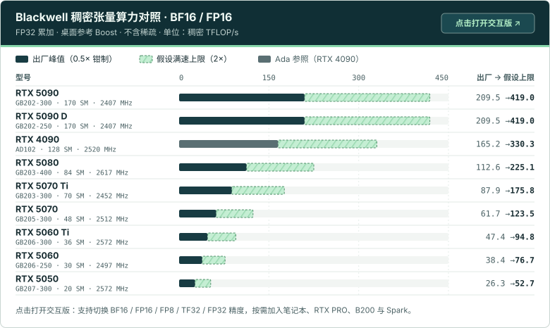

[English](README.md) | [中文](README.cn.md)

# blackwell-unlock-research

**为解锁 NVIDIA Blackwell（RTX 50 系列 / GB20x）FP32 累加 0.5× 算力钳制提供漏洞发掘方向、攻击面地图与低门槛原生 Linux 实机测试工具包。**

**你的英伟达显卡，有一半的张量算力在出厂时就被锁死了。** 同一张 RTX 5090，FP16 输入在 FP16 累加下的稠密峰值约为 419 TFLOP/s，改用 FP32 累加便只剩约 209.5 TFLOP/s。NVIDIA 在架构白皮书中列出了这组数字，但购买页面突出展示的是 AI TOPS，消费者很难从中判断自己常用的训练或推理路径会损失多少吞吐。在审阅的资料中，NVIDIA 没有充分说明这项限制的技术必要性。我的判断是，它主要服务于消费级与专业级产品的人为分档。让消费者承担这样的性能折损，却不在选购时清楚披露，在我看来是极不正当、也可耻的商业做法。[RTX 5090 产品规格](https://www.nvidia.com/en-us/geforce/graphics-cards/50-series/rtx-5090/) · [架构白皮书，附录 A](https://images.nvidia.com/aem-dam/Solutions/geforce/blackwell/nvidia-rtx-blackwell-gpu-architecture.pdf)

[](https://vanillartwork.github.io/blackwell-unlock-research/#zh)

*Blackwell 稠密张量算力预览（BF16 / FP16 输入、FP32 累加、桌面卡）——**[打开可交互算力图](https://vanillartwork.github.io/blackwell-unlock-research/#zh)**，可在浏览器中切换 BF16 / FP16 / FP8 / TF32 / FP32 精度、对数刻度，并加入笔记本、RTX PRO、B200 与 DGX Spark 参照。*

| 型号 | SM 数 | 参考 Boost | 出厂峰值 | 假设满速上限 |
|---|---:|---:|---:|---:|
| RTX 5090 | 170 | 2407 MHz | 209.5 | 419.0 |
| RTX 5080 | 84 | 2617 MHz | 112.6 | 225.1 |
| RTX 5070 | 48 | 2512 MHz | 61.7 | 123.5 |

单位为稠密 TFLOP/s，FP16 或 BF16 输入、FP32 累加。出厂列与 NVIDIA 白皮书口径一致；最后一列假设在相同频率下每 SM 吞吐翻倍。两列都不计结构化稀疏。按此模型，满速 5080 会超过出厂 5090，满速 5070 会超过出厂 5080。5090 的 FP8 满速假设值为 838.0 TFLOP/s。路线 1 尚未实现这些上限。

### 为什么值得在 50 系上测

- **训练和微调。** LoRA、QLoRA 和全量训练中，若主要耗时来自采用 FP32 累加的矩阵乘，更高吞吐可以在保留累加精度的同时缩短每步时间。即使这些算子快一倍，它们也须占原耗时的三分之二，端到端才有 1.5 倍加速。
- **长提示词与扩散模型。** 长上下文 prefill、大批量推理，以及 Flux、Wan 等模型中的稠密矩阵乘值得优先测。单请求逐 token 解码往往受显存带宽限制，即使张量核峰值翻倍，输出速度也可能变化很小。
- **科学计算和渲染。** 对 PINN、NeRF 或 3DGS，先用 profiler 确认时间是否花在启用 TF32 的矩阵乘或卷积上。光栅化、访存和归约各有自己的瓶颈。
- **速度与误差。** GB205 在 `N = K = 8192` 时，全程 FP16 累加的样本相对 L2 误差是 FP32 累加的 16.6 倍。路线 2 的分块规约已能在现有驱动上压低误差；路线 1 的目标则是检验能否从固件层解开限制，在保留 FP32 累加的前提下拿回完整吞吐。[实测对照](reports/gb205-2f18/README.cn.md)

笔记本功耗上限、持续时钟、显存带宽和 cuBLAS 的内核选择都会影响实际收益。下列实测是这项工作的起点。

在 RTX 5070 Ti Laptop（GB205）上，以 FP16、BF16、TF32 或 FP8 为输入、用 FP32 累加时，稳态吞吐按 SM 时钟归一化后约为各自参考满速的 **0.5 倍**。GB202、GB203M、GB205 和 GB206 的消费卡样本还读到了相同的 `FEAT_OVR_PLM = 0xfffffb8f`，其中写权限仅开放给 PL3。前者是算子实测，后者是寄存器读回；跨卡判断需要同条件的吞吐测量。[GB205 实测报告](reports/gb205-2f18/README.cn.md) · [跨卡基线](docs/test-matrix.cn.md)

### 为什么 20–40 系的解锁方法在 50 系上失效了？

- **20–40 系的旧路径已堵死。** 在 Turing、Ampere 和 Ada 架构上，社区工具（如 `nv-uefi-unlocker`）之所以生效，是因为主机侧（PL0）在 UEFI 阶段或驱动早期仍能直接通过 BAR0 改写速率与特性覆盖寄存器。
- **PL3 硬件权限墙。** 在已采样的 Blackwell（GB202、GB203M、GB205、GB206）消费卡上，`FEAT_OVR_PLM` 均读回 `0xfffffb8f`——**写权限仅开放给最高特权级 PL3（片内安全固件）**，前代常用的 SEC2 Booter 载体也已取消（`SEC2_PLM = 0x00000b0f`）。主机 CPU、UEFI 和操作系统驱动都运行在 PL0，直接向 BAR0 写寄存器会被硬件拦截。
- **没有“抢跑”窗口。** Blackwell 的片上不可变 ROM 与 FSP → FMC 安全启动链会在主机驱动接管 GPU 之前完成初始化并锁死权限，不存在“赶在上锁前改写寄存器”的时间窗口。

因此，沿用 20–40 系的 UEFI/BAR0 改写思路在 50 系上行不通。想在软件层突破这道墙，必须找到主机侧能直接触达 **PL3 执行环境**的交互面——这就是本仓库将**路线 1** 锁定在 **Host → FMC 引导 ABI** 的根本原因。[启动链与权限详情](docs/architecture-map.cn.md)

## 一、两条主线

**现状与分工。** 目前尚无已知的 50 系解锁漏洞，我个人也缺少带独立恢复路径的原生 Linux 裸机，因此先把前期排雷、公开源码审计、攻击面梳理、裸机预检与故障恢复脚本，以及第一步的只读基线补丁全部搭好，尽量把实机试错的门槛降下来。如果你手里有合适的 RTX 50 系裸机，可以直接拿这套工具上手抓基线、撞固件边界（路线 1）；如果你更关心当下如何在现有驱动上缓解限速，可以直接在 Windows 或 Linux 上试软件折中方案（路线 2）。

### 路线 1 · Host → FMC（PL3）引导接口边界探测

由于 `FEAT_OVR_PLM` 仅向 PL3 开放写权限，运行在 PL2 的 GSP-RM 与常规主机驱动路径都无法直接改写限速状态。**Host → FMC（First Mutable Code，运行于 PL3）引导接口**是目前主机侧能直接触达的最底层动态攻击面：想在软件层突破锁死，必须先搞清 PL3 固件如何解析并校验主机在 GSP 启动前提交的 `GSP_FMC_BOOT_PARAMS`、冷启动 `GspFwWprMeta` 以及恢复路径 `GspFwSRMeta`。

这条路线按两步推进，本仓库先把第一步的工程基础铺平：

1. **第一步：实机参数基线采集（本仓库已提供）。** 通过针对官方 `open-gpu-kernel-modules 620.73.04` 的只读日志补丁，先在真机上抓出冷启动、驱动重载与挂起恢复时的完整参数基线，确认驱动实际传了什么、固件回填了什么以及如何响应。该只读日志补丁已通过驱动目标文件编译，完整模块链接、加载与真机引导仍待实测验证；配套的裸机预检、日志脱敏、解码脚本与故障恢复指南均已就绪。[RFC 补丁](patches/620.73.04-01-boot-abi-trace.patch) · [验证记录](patches/README.cn.md) · [裸机操作步骤](#四路线-1-原生-linux-实机操作)
2. **第二步：参数可控变异与边界探测（后续发掘方向）。** 拿到实机基线后，结合字段映射与 [不变量清单](docs/abi-invariants.cn.md)（状态标志、内存边界与对齐、跨结构一致性等），对主机可控的引导参数做可控变异与差分测试（Fuzzing / 边界探测），检验 FMC 的解析与校验逻辑是否存在可利用的边界缺陷。主机写入与固件回填字段划分见 [ABI 字段表](docs/abi-fields.cn.md)。

> 鉴于 Blackwell 安全启动的加固程度，通过路线 1 找到可利用缺陷的概率并不高，本仓库不承诺能够解锁。先把排雷与工具铺好，是为了让有条件的开发者以最低成本检验这道边界——**哪怕最终确认防线无懈可击，确切的实测证据也比无休止的猜测更有价值。**

### 路线 2 · 当下可用的软件提速方案

在硬件或固件层面解开 `HMMA` 限制之前，现有驱动上可按计算精度选用两条软件路径：

- **FP8→FP32（`QMMA.SF` / CUDA 13.2+，无损满速）。** 传统 `QMMA` 仍被锁在 `0.50×`，但 Blackwell 新增的块缩放指令 `QMMA.SF.16832.F32.E4M3.E4M3.E8`（`kind::mxf8f6f4` 配常量单位 UE8M0 缩放 `0x7F7F7F7F`）未被限速且与普通指令逐位一致。在本机原装 GB205（驱动 `621.01`，CUDA 13.5）实测中，`QMMA.SF` 达到 **1956.3 FLOP/SM/clk**（`0.955×`，普通 `QMMA` 为 `1020.0`）且 `256² + 0.125² = 65536.015625` 精确无损；同卡同驱动 `N = 8192` FP8→FP32 GEMM（`FAST_ACCUM=0`）从 CUDA 12.8 的 **111.80 TFLOP/s** 直接跃升至 CUDA 13.5 `cuBLASLt` 的 **241.70 TFLOP/s**。这证实消费卡并未物理阉割 FP32 累加器，半速锁仅挂在传统 `HMMA` 与非缩放 `QMMA` 发射路径上。跑 FP8 负载直接升级 CUDA 13.2+ 或在 CUTLASS / CuTe / FlashInfer 内核中改发单位缩放 `QMMA.SF` 即可。[QMMA.SF 实测详情](software/README.cn.md#4-fp8fp32-满速软件路径qmmasf-与-cuda-132) · [核查记录](docs/references.cn.md#5-补充核查记录2026-11-25)
- **FP16 / BF16 / TF32 → FP32（K 维分块规约折中方案）。** `HMMA` 没有对应的微缩放指令，依然被锁在 `0.5×`。在安装 CUDA 版 PyTorch 的 Windows 或 Linux 上，可沿内积维度 `K` 分块，块内走较快的 FP16 累加路径，块间以 FP32 归约来压低误差。在上述 GB205 上，`N = K = 8192` 时，块大小 2048 的吞吐为 **48.90 TFLOP/s**（比全程 FP32 累加高 **10%**），样本相对 L2 误差为 **0.001644**（比全程 FP16 累加低 **49%**）；块大小降到 1024 时吞吐低于 FP32 基线。建议用自己的矩阵形状同时测吞吐和误差。[软件用法与完整结果](software/README.cn.md)

## 二、前期排雷与已归档工作

- **VBIOS 静态分析。** 已比较五种芯片的十二份 ROM，含 RTX PRO 6000 和 RTX 5090 D。72 个 V6 描述符均为 80 字节，每个对象的长度都等于头部、行区和声明的存储长度之和，SHA-384 对象目录提供了独立的边界校验。在已比较的明文结构中未发现专业卡专属标记，28 字节尾部与载荷在样本中一一对应。现有结果没有给出通过改头或换表解除钳制的依据。尾部用途和运行时认证顺序仍未知。[V6 研究](docs/vbios-v6-descriptor.cn.md) · [样本与来源](reports/rom-survey-20261123/README.cn.md)
- **Debug 签名 FMC 与 LS 协处理器排雷。** 直接核验上游 `615.71.10` 和 `620.73.04` 源码确认，`GspRmFmcGfwDebugSigned_GB202` 与 `ProdSigned_GB202` 的 287,304 B 加密 `UCODE_IMAGE`（熵 `7.9992 bits/byte`）和 48 B `UCODE_HASH` 逐字节完全一致，仅 `UCODE_SIG`（96 B）与 `UCODE_PKEY`（97 B）不同，不存在明文 gadget 或多签名槽位降级面。第三方离线静态/Unicorn 分析（[shuttie/bf16-unlock-blackwell-research#2](https://github.com/shuttie/bf16-unlock-blackwell-research/issues/2)）也确认 `PMU_RISCV_EB` 处于全加密 LS/PL2，无法作为 PL3 绕过路径。[核查记录](docs/references.cn.md#5-补充核查记录2026-11-25)
- **GSP-RM 运行时 RPC。** GSP-RM 在 FMC 初始化后以 PL2 运行。RPC 日志可解释运行期的时钟、功耗和挂起恢复行为。已测权限掩码仅向 PL3 开放相关寄存器的写权限。[启动链与权限](docs/architecture-map.cn.md)
- **跨卡只读基线。** 已归档多款消费卡及 RTX PRO 的寄存器读数。评估算力是否变化时，应在同卡、相同工作负载下对照吞吐、SM 时钟和累加模式，再用寄存器数据解释结果。[测试矩阵](docs/test-matrix.cn.md)

物理故障注入（EMFI、LFI）及侧信道研究需要专门的实验设备，不属于本工具包的范围。

## 三、快速上手

### 3.1 依赖

| 用途 | 所需环境 |
|---|---|
| 离线分析与单元测试 | Python ≥ 3.9，无需 GPU。依赖特定平台或可选软件的用例会自动跳过。 |
| 硬件基线 | 已安装驱动及其附带的 `nvidia-smi`。 |
| 路线 2 算子与吞吐基准 | CUDA 版 PyTorch ≥ 2.7。遥测优先使用 `nvidia-ml-py`，缺失时回退到 `nvidia-smi`。 |
| 路线 1 裸机采集与编译 | 原生 Linux、Git、GCC、make、运行内核的头文件，以及 Bash、GNU coreutils、grep、sed、awk 和 `dmesg`。PCI 信息取自 sysfs，无需 `lspci`。 |

以下为 Bash 示例。在 Windows PowerShell 中，用 `py -m venv .venv` 创建环境，用 `.\.venv\Scripts\Activate.ps1` 激活，后续 Python 命令使用 `python`。

```bash
# 仅算子和吞吐基准需要 CUDA 版 PyTorch
python3 -m venv .venv && . .venv/bin/activate
python -m pip install torch --index-url https://download.pytorch.org/whl/cu128
python -m pip install -r requirements.txt

# 仅路线 1 需要编译依赖，按发行版选一行
sudo apt install git build-essential linux-headers-$(uname -r)  # Debian / Ubuntu
sudo dnf install git gcc make kernel-devel-$(uname -r)          # Fedora
sudo pacman -S --needed git base-devel linux-headers            # Arch，头文件须匹配运行内核
```

### 3.2 测量与离线核对

```bash
# 跨平台测量硬件与吞吐基线，再扫描 K 分块的吞吐和误差
python3 scripts/verify-baseline.py --bench --json baseline.json
python3 software/chunked_fp16_matmul.py --n 8192 --json chunked-sweep.json

# 离线比较 ABI 布局、核对 V6 长度关系、比较本地 ROM
python3 scripts/abi-layout.py --struct GSP_FMC_BOOT_PARAMS --diff 610.57.04 620.73.04
python3 scripts/v6-closure.py reports/gb205-2f18/v6-descriptors-98.05.31.00.44.json
python3 scripts/rom-survey.py /path/to/roms

# 运行测试
python3 -B -m unittest discover -s tests -v
```

## 四、路线 1 原生 Linux 实机操作

1. 路线 1 仅适用于原生 Linux 裸机，内核头文件和工具链须与运行内核匹配。WSL2 和虚拟机（包括 GPU 直通）均不适用于此实机引导流程。
2. 在核显或非 NVIDIA 副卡上实际打开文本终端。两张 NVIDIA 卡若共用同一驱动，卸载后会同时失去输出。从另一台机器测试 SSH，并配置 netconsole 或串口，以便本机挂起时仍能保存日志。
3. 核对 Secure Boot 和内核 Lockdown 状态。若内核强制验证签名，测试模块需由内核信任的密钥签名，例如已登记的 MOK。
4. 在仓库根目录逐段执行下列命令。先检查预检汇总和警告，确认 `FAIL=0`，再继续编译。

> 以下流程对应路线 1 第一步（只读基线采集）。补丁只记录驱动准备的参数，不写 SPI 闪存。测试模块从构建目录临时加载；使用常规启动配置重启后，系统会重新加载已安装的驱动。出现挂起或 FMC 报错时，先保存日志，完全断电冷启动后再继续。[故障恢复指南](docs/recovery.cn.md)

**第 0–2 步：核对版本、取源码、编译**（不影响正在运行的驱动）

```bash
# 0. 预检须为 FAIL=0；已装驱动须与补丁 tag 完全一致（用户态与 GSP 固件都要匹配）
bash scripts/check-env.sh
modinfo -F version nvidia                 # 须为 620.73.04
ls /lib/firmware/nvidia/620.73.04/        # 须有 gsp_*.bin

# 1. 取固定 tag 的上游源码（放在本仓库之外）并核对 commit
git clone --depth 1 --branch 620.73.04 https://github.com/NVIDIA/open-gpu-kernel-modules.git "$HOME/ogkm-620.73.04"
git -C "$HOME/ogkm-620.73.04" rev-parse HEAD   # 须为 a4b95f6a2db0bba10ccaccef79190a3c18dcf14a

# 2. 打补丁并编译（任一步失败即停）
git -C "$HOME/ogkm-620.73.04" apply --check "$PWD/patches/620.73.04-01-boot-abi-trace.patch" &&
git -C "$HOME/ogkm-620.73.04" apply "$PWD/patches/620.73.04-01-boot-abi-trace.patch" &&
make -C "$HOME/ogkm-620.73.04" modules -j"$(nproc)"
```

**第 3 步：卸载现有驱动**（在 SSH 或核显终端里做；被占用时会直接报错，不要强制）

```bash
sudo systemctl stop nvidia-persistenced nvidia-powerd 2>/dev/null
sudo modprobe -r nvidia_drm nvidia_modeset nvidia_uvm nvidia
lsmod | grep '^nvidia'                    # 须无输出，否则不要继续
```

**第 4 步：加载自编译模块，并触发一次 GPU 初始化**

```bash
KO="$HOME/ogkm-620.73.04/kernel-open/nvidia.ko"
for dep in $(modinfo -F depends "$KO" | tr ',' ' '); do sudo modprobe "$dep"; done
sudo insmod "$KO" && sudo nvidia-smi
```

**第 5 步：采集并解码**

```bash
sudo bash scripts/collect-report.sh --out ./my-gb20x-report --tar
python3 scripts/abi-layout.py --from-log my-gb20x-report/dmesg-gsp-fmc.txt
```

**第 6 步：回滚**（或直接重启）

```bash
sudo rmmod nvidia && sudo modprobe nvidia_drm
```

- 第 3 步报 `in use`：用 `sudo fuser -v /dev/nvidia*` 找占用进程，用 `lsmod | grep nvidia` 看是否还有依赖模块（如 `nvidia_peermem`）；图形会话占用时先 `sudo systemctl isolate multi-user.target`（会关闭桌面，请确认 SSH 可用）。
- 需要冷启动样本时，可在本次引导中临时加入内核参数 `modprobe.blacklist=nvidia,nvidia_drm,nvidia_modeset,nvidia_uvm,nouveau,nova_core`，完全断电冷启动后检查 `lsmod`，确认上述 GPU 驱动均未加载，再执行第 4 步。
- 第 4 步出现 `Key was rejected` 时，检查模块签名和内核信任的密钥。出现 `API mismatch` 时，核对用户态驱动与测试模块的版本。
- 第 5 步退出码：`0` 与静态基线一致；`3` 有 `DIFF`，或日志缺头、缺行、长度与布局不符，请原样回传；`2` 表示未找到 `BWLAB` 行或输入不可读。

## 五、分享实测结果（可选）

可以只在本地使用这些工具。如果愿意分享，正常启动、编译报错、加载失败、`DIFF` 和挂起日志都有价值。请注明显卡、驱动、VBIOS、启动方式、实际命令，以及在哪一步得到该结果。

1. 检查 `collect-report.sh` 生成的四份脱敏文件：`summary.txt`、`nvidia-smi.txt`、`pci-topology.txt`、`dmesg-gsp-fmc.txt`。确认已移除个人信息和机器标识。
2. 将文件或 `--tar` 生成的压缩包附到 GitHub Issue 即可。若提 PR，请把报告和脱敏文件放进 `reports/<die>-<device-id>/`，压缩包仅作 Issue 附件。[报告模板](reports/template.cn.md) · [贡献指南](CONTRIBUTING.cn.md)

仓库仅收录补丁、脚本、文档与脱敏元数据。请将上游完整源码、NVIDIA 固件、密钥及原始 VBIOS/PROM 转储保留在本地。提交结论时分别标明真机实测、公开源码事实与待验证假设。项目采用 [GPL-2.0-only](LICENSE) 许可证。

## 六、目录结构

```text
blackwell-unlock-research/
├── README.cn.md                     # 定位说明、原生 Linux 前置条件与安全边界
├── CONTRIBUTING.cn.md               # 提交规范：不入库清单、证据分级、代码与一致性约定
├── requirements.txt                 # 可选 Python 依赖（仅基准与算子脚本需要）
├── .github/workflows/ci.yml         # 无 GPU 环境的单元测试、shellcheck 与一致性检查
├── docs/
│   ├── .nojekyll                    # 禁用 GitHub Pages 的 Jekyll 构建
│   ├── index.html                   # 交互式 GPU 算力图（GitHub Pages）
│   ├── throughput-ceiling.svg       # README 可点击算力预览图（英文）
│   ├── throughput-ceiling-zh.svg    # README 可点击算力预览图（中文）
│   ├── architecture-map.cn.md       # GB20x 启动链、权限与两条研究路线
│   ├── abi-fields.cn.md             # 主机侧引导结构体字段表、HAL 绑定与跨驱动版本漂移（公开源码静态阅读）
│   ├── abi-invariants.cn.md         # Host -> FMC (GSP_FMC_BOOT_PARAMS / GspFwWprMeta) 校验不变量清单
│   ├── recovery.cn.md               # 故障日志对照、恢复手段比较与恢复后样本的证据规则
│   ├── references.cn.md             # 外部资料（nova-core、SBR 脚本、VBIOS 编辑器）的核查记录
│   ├── test-matrix.cn.md            # GB202 / GB203 / GB205 / GB206 / GB207 + RTX PRO 跨卡基线表
│   └── vbios-v6-descriptor.cn.md    # GB205 80 B V6 描述符与 Class A 20 B 二级清单静态逆向笔记
├── patches/
│   ├── README.cn.md                 # 对应上游 open-gpu-kernel-modules 固定 tag 的观测补丁规范与版本对齐表
│   └── 620.73.04-01-boot-abi-trace.patch  # 只读日志补丁（RFC：已编译，未经真机实测）
├── scripts/
│   ├── check-env.sh                 # 原生 Linux 物理机预检（Secure Boot/Lockdown、独立控制台、SSH/netconsole、IO_STRICT_DEVMEM）
│   ├── collect-report.sh            # 一键采集 dmesg GSP/FMC 启动日志、PCI 拓扑、驱动/VBIOS 版本并脱敏打包（--sanitize 可单独过滤日志）
│   ├── verify-baseline.py           # 跨平台基线校验器（驱动/VBIOS/BAR1/PCIe + 可选算力/钳制基线，--compare 与归档比对）
│   ├── abi-layout.py                # 引导结构体布局计算、跨 tag 差分与十六进制快照解码（离线）
│   ├── parse-ssdiag.py              # 寄存器采集文本解析、两次采集差分与矩阵列生成（离线）
│   ├── v6-closure.py                # V6 描述符 / Class A 清单算术闭合检查（离线）
│   ├── rom-directory.py             # 本地 ROM 的 GB20x 对象目录只读解析，与 V6 清单比对（只输出元数据）
│   └── rom-survey.py                # 多份本地 ROM 的批量检验与跨卡对象比对（只输出元数据）
├── software/                        # 路线 2：用户态算子与基准
│   ├── README.cn.md                 # 分块算子的用法、吞吐与精度
│   ├── clamp_eval.py                # 跨平台（Linux/Windows）稳态张量钳制与误差评估脚本
│   └── chunked_fp16_matmul.py       # K 维分块 FP16 累加 + FP32 块间归约（缓解 L2 误差放大）
├── reports/
│   ├── template.cn.md               # 社区真机观测报告标准模板
│   ├── rom-survey-20261123/         # 十二份 ROM（GB202 ×3 / GB203 ×3 / GB205 ×3 / GB206 ×2 / GB207）的跨核心元数据
│   └── gb205-2f18/                  # 首个完整种子样本：GB205 (RTX 5070 Ti Laptop, 驱动 621.01)
└── tests/                           # 跨平台自动化单元测试与文档/数据一致性检查（无 GPU 环境亦可运行）
```

## 七、免责声明

1. **研究用途与无担保声明（AS IS）。** 本仓库提供的全部补丁、脚本、基准测试程序、分析记录与技术文档仅用于技术研究、安全分析与教育目的，均按“现状（AS IS）”与“可用状态（AS AVAILABLE）”提供。在适用法律及 [GPL-2.0-only](LICENSE) 许可证允许的最大范围内，本项目不附带任何明示或暗示的担保，包括但不限于适销性、特定用途适用性、准确性、稳定性、兼容性或不侵权保证。本项目不承诺任何路线或工具能够解锁算力限制、提升特定工作负载性能或发现可利用缺陷。
2. **内核、固件与硬件风险（尤其是路线 1）。** 内核模块编译与加载、驱动卸载与重载、调整内核引导参数、读取底层硬件寄存器，以及针对 Host → FMC（PL3）引导接口的实机采集与后续边界探测/变异测试，均属于高风险底层操作。此类操作可能导致显示输出中断、GPU 初始化失败、内核崩溃（kernel panic）、整机死锁或硬挂起、文件系统损坏、数据丢失，甚至在极端或未预见情形下导致设备进入异常锁定状态或**硬件永久性损坏**。此外，本仓库所含只读日志补丁尚未在物理真机上完成端到端加载与引导验证；基于本仓库文档自行开展的第二阶段参数变异或 Fuzzing 实验具有更高不确定性，所有风险均由执行者独立承担。
3. **软件算子数值与生产风险（路线 2）。** 路线 2 提供的分块 FP16 累加与 FP32 归约属于精度与吞吐之间的工程折中，其数值误差、溢出风险与训练/推理收敛表现取决于具体矩阵规模、数据分布和模型结构。在将其用于任何重要计算或生产环境之前，使用者须自行完成充分的数值精度回归与业务验证。
4. **保修、合法授权与合规义务。** 加载自行编译或修改的内核模块、修改引导配置或对硬件/固件接口进行探测，可能导致显卡厂商、OEM 或整机供应商拒绝提供官方保修、RMA 或技术支持。使用者须确保所有测试仅在**本人拥有合法所有权或已获得明确书面授权**的设备上进行，并自行遵守所在司法辖区的适用法律法规、软件许可协议与安全规范。请勿向本仓库或公开渠道上传任何受版权保护的专有固件、密钥或原始 VBIOS/PROM 转储文件。
5. **前置准备与责任限制。** 在执行任何实机命令或实验前，请务必充分评估自身设备与环境风险，提前备份全部重要数据，并确认已具备独立显示输出、SSH、串口或 netconsole 日志留存以及断电冷启动/系统恢复条件。使用、修改、参考或无法使用本仓库任何内容（包括基于本仓库思路开展的衍生实验）所产生的一切直接、间接、附带、特殊或后果性损失——包括但不限于**硬件损坏、设备不可用、官方保修失效、数据丢失、系统损坏、业务中断或经济损失**——均由使用者自行承担。**项目作者及所有贡献者在任何情况下均不承担任何法律责任或赔偿义务。**
6. **非关联与商标声明。** 本项目为独立的开源社区研究项目，与 NVIDIA Corporation 或任何显卡、芯片、板卡及整机厂商不存在任何隶属、合作、赞助或背书关系。文中提及的 NVIDIA、GeForce、RTX、Blackwell、CUDA、PyTorch、Linux 等名称均为各自权利人的商标或注册商标，仅用于客观技术说明。
