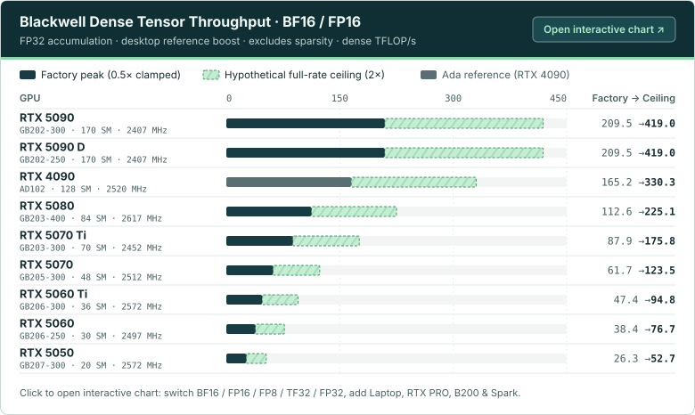

[English](README.md) | [中文](README.cn.md)

# blackwell-unlock-research

**Attack-surface map, vulnerability research roadmap, and low-friction native Linux test kit built toward unlocking the 0.5× FP32-accumulation clamp on NVIDIA Blackwell RTX 50-series GPUs (GB20x).**

**Half of your NVIDIA GPU's tensor compute is locked out of the box.** On the same RTX 5090, dense FP16 inputs peak at about 419 TFLOP/s with FP16 accumulation and 209.5 TFLOP/s with FP32 accumulation. NVIDIA lists both figures in its architecture whitepaper. The sales page emphasizes AI TOPS, leaving buyers little basis for judging the cost in their own training or inference workloads. I found no adequate technical justification for the limit in the materials reviewed. In my view, its primary purpose is to create an artificial performance gap between consumer and professional products. Imposing that cost without clearly disclosing it at the point of sale is indefensible and shameful. [RTX 5090 specifications](https://www.nvidia.com/en-us/geforce/graphics-cards/50-series/rtx-5090/) · [Architecture whitepaper, Appendix A](https://images.nvidia.com/aem-dam/Solutions/geforce/blackwell/nvidia-rtx-blackwell-gpu-architecture.pdf)

[](https://vanillartwork.github.io/blackwell-unlock-research/#en)

*Blackwell dense tensor throughput preview (BF16 / FP16, FP32 accumulation, desktop models) — **[open the interactive chart](https://vanillartwork.github.io/blackwell-unlock-research/#en)** to switch between BF16 / FP16 / FP8 / TF32 / FP32, toggle log scale, and compare desktop, laptop, RTX PRO, B200 and DGX Spark.*

| GPU | SMs | Reference boost | Factory peak | Hypothetical full rate |
|---|---:|---:|---:|---:|
| RTX 5090 | 170 | 2407 MHz | 209.5 | 419.0 |
| RTX 5080 | 84 | 2617 MHz | 112.6 | 225.1 |
| RTX 5070 | 48 | 2512 MHz | 61.7 | 123.5 |

All figures are dense TFLOP/s for FP16 or BF16 inputs with FP32 accumulation. The factory column follows NVIDIA’s whitepaper convention. The last column assumes twice the per-SM throughput at the same clock. Both exclude structured sparsity. Under this model, a full-rate 5080 would exceed a factory 5090, and a full-rate 5070 would exceed a factory 5080. The corresponding FP8 ceiling for the 5090 would be 838.0 TFLOP/s. Route 1 has not demonstrated these ceilings.

### Why test the 50 series?

- **Training and fine-tuning.** LoRA, QLoRA and full training can benefit if matrix multiplies with FP32 accumulation dominate step time. Even if those kernels become twice as fast, they must account for two-thirds of the original runtime to yield a 1.5× end-to-end speedup.
- **Long prompts and diffusion models.** Long-context prefill, large batches and the dense matrix multiplies in models such as Flux and Wan are good workloads to profile. Single-request, token-by-token decoding is often memory-bandwidth limited and may see little change.
- **Scientific computing and rendering.** For PINNs, NeRF or 3D Gaussian Splatting, profile the time spent in TF32-enabled matrix multiplies or convolutions. Rasterization, memory access and reductions have their own bottlenecks.
- **Speed and numerical error.** At `N = K = 8192` on GB205, full-length FP16 accumulation produced 16.6× the sample relative L2 error of FP32 accumulation. Route 2 already cuts that error in software on stock drivers; Route 1 aims to test whether the firmware clamp can be lifted to recover full throughput without giving up FP32 accumulation. [Measured comparison](reports/gb205-2f18/README.md)

Laptop power limits, sustained clocks, memory bandwidth and cuBLAS kernel selection all affect the outcome. The following measurements are the starting point.

On the RTX 5070 Ti Laptop (GB205), FP16, BF16, TF32 and FP8 inputs with FP32 accumulation each sustained about **half their reference throughput** after normalization for SM clock. Register captures from consumer GB202, GB203M, GB205 and GB206 cards also report `FEAT_OVR_PLM = 0xfffffb8f`, which grants write access to PL3 only. The throughput result comes from a benchmark on one card. Comparing performance across models requires equivalent measurements. [GB205 measurements](reports/gb205-2f18/README.md) · [Cross-card baselines](docs/test-matrix.md)

### Why RTX 20–40 series unlock methods fail on the 50 series

- **The 20–40 series path is closed.** On Turing, Ampere and Ada, community tools such as `nv-uefi-unlocker` worked because host code (PL0) could still write rate and feature-override registers directly over BAR0 during UEFI or early driver init.
- **A PL3 hardware privilege wall.** Across consumer Blackwell samples (GB202, GB203M, GB205 and GB206), `FEAT_OVR_PLM` consistently reads `0xfffffb8f`—**granting write access exclusively to PL3 (on-die secure firmware)**—and the legacy SEC2 Booter path has been removed (`SEC2_PLM = 0x00000b0f`). The host CPU, UEFI and OS driver all execute at PL0, so direct BAR0 writes are blocked in hardware.
- **No pre-lock race window.** Blackwell's immutable on-die ROM and FSP → FMC secure boot chain initialize and lock permissions before the host driver takes over the GPU, leaving no window to overwrite registers before the lock engages.

Reusing the 20–40 series UEFI/BAR0 approach is therefore a dead end on the 50 series. Any software-level bypass has to target an interface that reaches **PL3 execution** from the host—which is why **Route 1** focuses on the **host-to-FMC boot ABI**. [Boot chain and privileges](docs/architecture-map.md)

## 1. Two research routes

**Current status and division of work.** There is no known RTX 50-series unlock exploit yet, and I do not have a bare-metal native Linux test box with an independent recovery path. I have therefore done the groundwork up front: ruling out dead ends, auditing public driver source, mapping the attack surface, and shipping bare-metal preflight/recovery scripts along with the first-stage baseline logging patch. The goal is to lower the barrier to hardware testing so security researchers and developers with suitable RTX 50-series machines can jump straight into probing firmware boundaries (Route 1). If you need a practical speedup on stock drivers today before any hardware bypass exists, start with Route 2 on Windows or Linux.

### Route 1 · Probe the host-to-FMC (PL3) boot interface

Because `FEAT_OVR_PLM` restricts writes to PL3, neither PL2 GSP-RM nor normal host driver paths can modify the clamp directly. That makes the **host-to-FMC (First Mutable Code, PL3) boot interface** the lowest-level dynamic attack surface directly reachable from the host. Any software-level break requires first understanding how PL3 firmware parses and validates the host-supplied `GSP_FMC_BOOT_PARAMS`, cold-boot `GspFwWprMeta`, and resume `GspFwSRMeta` structures before GSP starts.

Route 1 proceeds in two stages, with this repository covering the engineering setup for Stage 1:

1. **Stage 1: Capture the hardware parameter baseline (included here).** Using a logging-only patch against official `open-gpu-kernel-modules 620.73.04`, collect real-machine snapshots across cold boot, driver reload, and suspend/resume to verify what the driver actually writes, what firmware fills in, and how firmware responds. The logging patch compiles at the driver object level; full module linking, loading, and physical boot still need hardware verification. Bare-metal preflight, log sanitization, decoding, and recovery tooling are ready to run. [RFC patch](patches/620.73.04-01-boot-abi-trace.patch) · [Verification record](patches/README.md) · [Hardware procedure](#4-route-1-on-native-linux)
2. **Stage 2: Controlled mutation and boundary probing (next research phase).** Once a hardware baseline is in hand, use the field map and [invariant checklist](docs/abi-invariants.md) (state flags, memory bounds and alignment, cross-struct consistency) to run controlled parameter mutations and differential testing (fuzzing / edge-case probing) against FMC's parsing and validation logic. See [ABI fields](docs/abi-fields.md) for the host-written vs. firmware-written split.

> Given how hardened Blackwell's secure boot chain is, the odds of finding an exploitable flaw via Route 1 are low, and this repository makes no promise of an unlock. Doing the triage and tooling up front lets developers with suitable hardware test that boundary at minimal cost—**even if the answer turns out to be an airtight defense, hard hardware evidence is worth far more than endless speculation.**

### Route 2 · Software workarounds available today

Until a hardware or firmware bypass exists for `HMMA`, two software paths work immediately on stock drivers depending on precision:

- **FP8→FP32 (`QMMA.SF` / CUDA 13.2+, full rate with no accuracy loss).** While legacy `QMMA` is clamped at `0.50×`, Blackwell's block-scaled `QMMA.SF.16832.F32.E4M3.E4M3.E8` (`kind::mxf8f6f4` with constant unit UE8M0 scale `0x7F7F7F7F`) is unclamped and bit-identical. On our stock GB205 (driver `621.01`, CUDA 13.5), raw `QMMA.SF` measured **1956.3 FLOP/SM/clk** (`0.955×`, vs `1020.0` for plain `QMMA`) with exact FP32 accumulation (`256² + 0.125² = 65536.015625`), and `N = 8192` FP8→FP32 GEMM (`FAST_ACCUM=0`) jumped from **111.80 TFLOP/s** (CUDA 12.8) to **241.70 TFLOP/s** (CUDA 13.5 `cuBLASLt`). This confirms consumer dies physically retain full-rate FP32 accumulators—the clamp gates legacy `HMMA` and unscaled `QMMA` issue paths. For FP8 workloads, upgrade to CUDA 13.2+ or emit unit-scale `QMMA.SF` in custom CUTLASS/CuTe/FlashInfer kernels. [QMMA.SF details](software/README.md#4-full-rate-fp8fp32-via-qmmasf-and-cuda-132) · [Cross-card notes](docs/references.md#5-additional-verification-notes-2026-11-25)
- **FP16 / BF16 / TF32 → FP32 (K-chunked FP16 reduction).** `HMMA` has no microscaling equivalent and remains clamped at `0.5×`. On Windows or Linux with CUDA-enabled PyTorch, split the inner dimension `K` into chunks: run each chunk on the faster FP16 accumulation path and reduce partial results in FP32 to bound rounding drift. On the same GB205 at `N = K = 8192`, a chunk size of 2048 delivered **48.90 TFLOP/s** (**10% faster** than full-length FP32 accumulation) with a sample relative L2 error of **0.001644** (**49% lower** than full-length FP16 accumulation); at chunk size 1024 throughput fell below the FP32 baseline. Measure both throughput and error on your own matrix shapes. [Operator usage and full sweep](software/README.md)

## 2. Prior triage & background work

- **Static VBIOS analysis.** The survey covers twelve ROMs across five dies, including the RTX PRO 6000 and RTX 5090 D. All 72 V6 descriptors have 80-byte headers. Each object’s size equals its header, row area and declared stored size combined, with an independent boundary check from the SHA-384 object directory. The plaintext structures examined have no distinguishing professional-card marker. The 28-byte tails and payloads group one-to-one in these samples. The survey provides no evidence that editing a header or swapping table rows removes the throughput limit. The tail’s function and runtime authentication order remain unknown. [V6 study](docs/vbios-v6-descriptor.md) · [Specimens and provenance](reports/rom-survey-20261123/README.md)
- **Debug FMC & bundled LS falcons.** Direct verification of upstream `615.71.10` and `620.73.04` shows `GspRmFmcGfwDebugSigned_GB202` and `ProdSigned_GB202` ship byte-identical encrypted `UCODE_IMAGE` (287,304 B, entropy `7.9992 bits/byte`) and 48 B `UCODE_HASH`, differing only in `UCODE_SIG` (96 B) and `UCODE_PKEY` (97 B)—leaving no plaintext gadgets or signature-table downgrade surface. Third-party offline static/Unicorn analysis ([shuttie/bf16-unlock-blackwell-research#2](https://github.com/shuttie/bf16-unlock-blackwell-research/issues/2)) likewise places `PMU_RISCV_EB` in encrypted LS/PL2, ruling it out as a PL3 bypass. [Verification notes](docs/references.md#5-additional-verification-notes-2026-11-25)
- **GSP-RM runtime RPC.** GSP-RM runs at PL2 after FMC initialization. Its messages can help interpret runtime clocks, power and suspend/resume behavior. The observed mask grants writes to the relevant registers only at PL3. [Boot stages and privileges](docs/architecture-map.md)
- **Read-only register baselines.** The archive covers several consumer models and RTX PRO. To assess a performance change, compare throughput at matched workloads on the same GPU, record SM clocks and accumulation mode, and use register readbacks to interpret the result. [Measurement matrix](docs/test-matrix.md)

Physical fault injection (EMFI and LFI) and side-channel research require specialist equipment and are outside the scope of this toolkit.

## 3. Quick start

### 3.1 Dependencies

| Task | Requirements |
|---|---|
| Offline analysis and unit tests | Python 3.9 or later. No GPU required. Tests with optional software or platform dependencies skip automatically. |
| Hardware baseline | Installed driver and its `nvidia-smi` utility. |
| Route 2 operators and throughput benchmarks | CUDA-enabled PyTorch ≥ 2.7. Telemetry uses `nvidia-ml-py` when available and falls back to `nvidia-smi`. |
| Route 1 capture and build | Native Linux, Git, GCC, make, matching kernel headers, Bash, GNU coreutils, grep, sed, awk and `dmesg`. The collector reads PCI data from sysfs without `lspci`. |

The examples use Bash. On Windows PowerShell, create the environment with `py -m venv .venv`, activate it with `.\.venv\Scripts\Activate.ps1`, then use `python` for the Python commands below.

```bash
# CUDA-enabled PyTorch is required only for operators and throughput benchmarks.
python3 -m venv .venv && . .venv/bin/activate
python -m pip install torch --index-url https://download.pytorch.org/whl/cu128
python -m pip install -r requirements.txt

# Route 1 build tools. Choose the command for your distribution.
sudo apt install git build-essential linux-headers-$(uname -r)  # Debian / Ubuntu
sudo dnf install git gcc make kernel-devel-$(uname -r)          # Fedora
sudo pacman -S --needed git base-devel linux-headers            # Arch: match the running kernel
```

### 3.2 Measurements and offline checks

```bash
# Collect the hardware and throughput baseline, then sweep K chunk sizes.
python3 scripts/verify-baseline.py --bench --json baseline.json
python3 software/chunked_fp16_matmul.py --n 8192 --json chunked-sweep.json

# Compare ABI layouts, check V6 sizes and compare local ROMs offline.
python3 scripts/abi-layout.py --struct GSP_FMC_BOOT_PARAMS --diff 610.57.04 620.73.04
python3 scripts/v6-closure.py reports/gb205-2f18/v6-descriptors-98.05.31.00.44.json
python3 scripts/rom-survey.py /path/to/roms

# Run the test suite.
python3 -B -m unittest discover -s tests -v
```

## 4. Route 1 on native Linux

1. Route 1 requires native Linux on a physical host with matching kernel headers and toolchain. WSL2 and virtual machines, including guests with GPU passthrough, are outside this hardware boot procedure.
2. Open a text console driven by an iGPU or a second, non-NVIDIA GPU. Two NVIDIA cards sharing the driver both lose their output when it unloads. Test SSH from another machine and configure netconsole or a serial console to retain logs if the host hangs.
3. Check Secure Boot and kernel lockdown. If the kernel enforces module signatures, sign the test module with a key it trusts, such as an enrolled MOK.
4. Run the following blocks from the repository root. Read the preflight summary and warnings and confirm `FAIL=0` before building.

> The steps below execute Route 1, Stage 1 (read-only baseline capture). The patch logs host-prepared arguments and leaves SPI flash untouched. Load the test module directly from its build directory. A reboot with the normal boot configuration loads the installed driver again. If initialization hangs or FMC reports an error, save the logs and power-cycle the machine before another attempt. [Recovery guide](docs/recovery.md)

**Steps 0–2. Check versions, fetch the source and build.**

```bash
# Require FAIL=0 and matching versions for the driver, userspace and GSP firmware.
bash scripts/check-env.sh
modinfo -F version nvidia                 # Expect 620.73.04
ls /lib/firmware/nvidia/620.73.04/        # Expect gsp_*.bin

# Clone outside this repository and verify the pinned commit.
git clone --depth 1 --branch 620.73.04 https://github.com/NVIDIA/open-gpu-kernel-modules.git "$HOME/ogkm-620.73.04"
git -C "$HOME/ogkm-620.73.04" rev-parse HEAD   # Expect a4b95f6a2db0bba10ccaccef79190a3c18dcf14a

# Stop on the first failed apply or build.
git -C "$HOME/ogkm-620.73.04" apply --check "$PWD/patches/620.73.04-01-boot-abi-trace.patch" &&
git -C "$HOME/ogkm-620.73.04" apply "$PWD/patches/620.73.04-01-boot-abi-trace.patch" &&
make -C "$HOME/ogkm-620.73.04" modules -j"$(nproc)"
```

**Step 3. Unload the installed driver from SSH or the independent console.** Stop if a module is in use.

```bash
sudo systemctl stop nvidia-persistenced nvidia-powerd 2>/dev/null
sudo modprobe -r nvidia_drm nvidia_modeset nvidia_uvm nvidia
lsmod | grep '^nvidia'                    # Continue only if this prints nothing.
```

**Step 4. Load the test module and initialize the GPU once.**

```bash
KO="$HOME/ogkm-620.73.04/kernel-open/nvidia.ko"
for dep in $(modinfo -F depends "$KO" | tr ',' ' '); do sudo modprobe "$dep"; done
sudo insmod "$KO" && sudo nvidia-smi
```

**Step 5. Collect and decode the trace.**

```bash
sudo bash scripts/collect-report.sh --out ./my-gb20x-report --tar
python3 scripts/abi-layout.py --from-log my-gb20x-report/dmesg-gsp-fmc.txt
```

**Step 6. Reload the installed driver or reboot.**

```bash
sudo rmmod nvidia && sudo modprobe nvidia_drm
```

- If unloading reports `in use`, inspect `sudo fuser -v /dev/nvidia*` and `lsmod | grep nvidia` for clients and dependent modules such as `nvidia_peermem`. If the desktop holds the device, confirm SSH access before switching to `sudo systemctl isolate multi-user.target`, which stops the desktop.
- For a cold-boot sample, use the temporary boot parameter `modprobe.blacklist=nvidia,nvidia_drm,nvidia_modeset,nvidia_uvm,nouveau,nova_core`. Power-cycle, confirm with `lsmod` that none of those GPU drivers loaded, then continue at step 4.
- `Key was rejected` indicates a signing or trust problem. For `API mismatch`, check that the installed userspace and test driver match the patch tag.
- Decoder exit codes: `0` matches the static baseline, `3` indicates a difference or an incomplete trace, and `2` means the decoder found no `BWLAB` lines or could not read the input.

## 5. Share a measurement (optional)

You can use the tools locally. If you share a result, a normal boot, build error, load failure, `DIFF` or hang can all help. Include the GPU, driver, VBIOS, boot state, exact commands and the step that produced the result.

1. Review the four sanitized files from `collect-report.sh`: `summary.txt`, `nvidia-smi.txt`, `pci-topology.txt` and `dmesg-gsp-fmc.txt`. Remove any remaining personal or machine identifiers.
2. Attach the files or the archive produced by `--tar` to a GitHub issue. For a pull request, place the report and sanitized files in `reports/<die>-<device-id>/`. Use archives only as issue attachments. [Report template](reports/template.md) · [Contribution guide](CONTRIBUTING.md)

The repository accepts patches, scripts, documentation and sanitized metadata. Keep complete upstream source files, NVIDIA firmware, keys and raw VBIOS/PROM dumps local. Label hardware measurements, public-source findings and hypotheses separately. Project license: [GPL-2.0-only](LICENSE).

## 6. Repository layout

```text
blackwell-unlock-research/
├── README.md                        # Project overview and prerequisites
├── CONTRIBUTING.md                  # Submission and evidence requirements
├── requirements.txt                 # Optional benchmark dependencies
├── .github/workflows/ci.yml         # Tests, ShellCheck and consistency checks
├── docs/
│   ├── .nojekyll                    # Disable Jekyll processing for GitHub Pages
│   ├── index.html                   # Interactive GPU throughput chart (GitHub Pages)
│   ├── throughput-ceiling.svg       # README clickable throughput chart preview (EN)
│   ├── throughput-ceiling-zh.svg    # README clickable throughput chart preview (ZH)
│   ├── architecture-map.md          # Boot stages, privileges and research routes
│   ├── abi-fields.md                # Host fields, HAL bindings and version differences
│   ├── abi-invariants.md            # Host-to-FMC baseline checks
│   ├── recovery.md                  # Boot failure logs and recovery evidence
│   ├── references.md                # External sources and verification notes
│   ├── test-matrix.md               # Measurements by GPU and driver
│   └── vbios-v6-descriptor.md       # V6 descriptors and Class A manifests
├── patches/
│   ├── README.md                    # Pinned versions and patch verification
│   └── 620.73.04-01-boot-abi-trace.patch  # Logging-only RFC; object built, hardware test pending
├── scripts/
│   ├── check-env.sh                 # Native Linux preflight and recovery console checks
│   ├── collect-report.sh            # Sanitized boot, PCI and driver report
│   ├── verify-baseline.py           # Hardware baseline and optional clamp comparison
│   ├── abi-layout.py                # Offline structure layouts, diffs and trace decoder
│   ├── parse-ssdiag.py              # Parse register captures and generate matrix rows
│   ├── v6-closure.py                # Check descriptor and manifest arithmetic
│   ├── rom-directory.py             # Read local ROM object directories
│   └── rom-survey.py                # Compare metadata across local ROMs
├── software/                        # Route 2 userspace benchmarks and operators
│   ├── README.md                    # Throughput and accuracy trade-offs
│   ├── clamp_eval.py                # Steady-state tensor benchmark
│   └── chunked_fp16_matmul.py       # K-chunked FP16 GEMM with FP32 reduction
├── reports/
│   ├── template.md                  # Hardware report template
│   ├── rom-survey-20261123/         # Metadata from twelve ROMs across five dies
│   └── gb205-2f18/                  # RTX 5070 Ti Laptop baseline, driver 621.01
└── tests/                           # Unit tests and documentation checks
```

## 7. Disclaimer

1. **Research purpose and no warranty ("AS IS").** All patches, scripts, benchmarks, analysis notes and documentation in this repository are provided strictly for technical research, security analysis and educational purposes on an **"AS IS"** and **"AS AVAILABLE"** basis. To the maximum extent permitted by applicable law and the [GPL-2.0-only](LICENSE) license, this project disclaims all warranties, express or implied, including without limitation implied warranties of merchantability, fitness for a particular purpose, accuracy, reliability, compatibility and non-infringement. Nothing in this repository guarantees that any route or tool will unlock throughput limits, improve a given workload, or uncover an exploitable flaw.
2. **Kernel, firmware and hardware risks (especially Route 1).** Building and loading custom kernel modules, unloading/reloading GPU drivers, altering kernel boot parameters, reading low-level hardware registers, and tracing or probing the host-to-FMC (PL3) boot interface carry inherent low-level risks. These operations can cause loss of display output, GPU initialization failures, kernel panics, hard system hangs, filesystem corruption, data loss, and—in extreme or unforeseen circumstances—persistent lockouts or **permanent hardware damage**. In addition, the read-only logging patch in this repository has not yet been verified end-to-end on physical hardware; any Stage 2 parameter mutation or fuzzing conducted independently based on this documentation carries substantially higher risk and is undertaken solely at the operator's discretion.
3. **Numerical and production risks (Route 2).** The chunked FP16-accumulation / FP32-reduction operator in Route 2 is a throughput-versus-accuracy trade-off whose rounding error, overflow behavior and convergence impact depend on matrix dimensions, input distributions and model architecture. Validate numerical accuracy thoroughly before using it in any critical or production workload.
4. **Warranty, authorization and legal compliance.** Loading modified kernel modules, changing boot configurations, or probing hardware and firmware interfaces may void official warranties or result in refusal of RMA or vendor support from GPU, board or system manufacturers. Run hardware experiments only on physical machines that **you own or have explicit written authorization to test**, and ensure compliance with all applicable local laws, licenses and policies. Do not redistribute proprietary firmware, signing keys, or raw VBIOS/PROM dumps.
5. **Prerequisites and limitation of liability.** Before running any hardware procedure, evaluate the risks for your specific machine, back up all important data, and verify an independent recovery path (separate display output, SSH, serial console or netconsole, and physical power-cycle access). You assume full responsibility for all direct, indirect, incidental, special or consequential outcomes resulting from the use, modification, reference to, or inability to use any material in this repository (including derivative experiments)—including but not limited to **hardware damage, bricked devices, voided warranties, data loss, system corruption, downtime or financial loss**. **Under no circumstances shall the project authors or contributors be held liable for any claim, damage or other liability.**
6. **No affiliation and trademarks.** This is an independent community research project and is not affiliated with, endorsed by, or sponsored by NVIDIA Corporation or any GPU, board or system vendor. NVIDIA, GeForce, RTX, Blackwell, CUDA, PyTorch, Linux and other product names mentioned herein are trademarks or registered trademarks of their respective owners and are used solely for technical identification.
