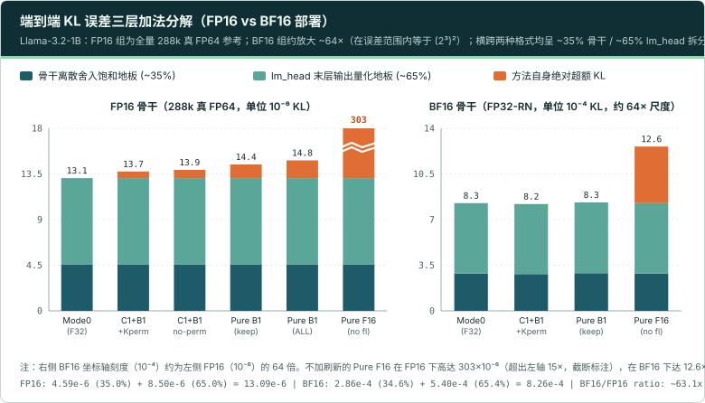
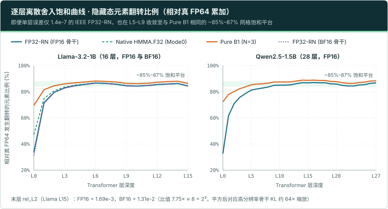

[English](route2-mma-bypass.md) | [中文](route2-mma-bypass.cn.md)

# 路线 2 深度报告 · SM 12.0 限速门模型、TMA-WS GEMM 与端到端 LLM 质量实证

本文全部硬件实测均采自同一张消费级 Blackwell 显卡（**RTX 5070 Ti Laptop GPU**，`GB205`，`10de:2f18`，46 SM，140 W 整板功耗墙，驱动 `621.01`，CUDA `13.5`，`sm_120a`），关键指令均经 `cuobjdump --dump-sass` / `nvdisasm -b SM120` 核验。桌面端 RTX 5080 与不限速 RTX PRO 6000 反面对照列于第 5 节待补项。

---

## 一、消费级 Blackwell MMA 限速门模型与编码封口

### 1.1 SM 12.0 全 4,096 Opcode 扫描与 `HMMA` 修饰位封口

对 SM 12.0 全部 4,096 个 12-bit 主操作码（`lo[11:0] = 0x000..0xFFF`）做离线 `nvdisasm -b SM120` 穷举：共 255 个有效 opcode，其中 **`*MMA*` 指令恰好只有 6 条**：`0x237 IMMA`、`0x23c HMMA`、`0x23f DMMA`、`0x27a QMMA`、`0x47a QMMA.SF` 与 `0x47f OMMA.SF`，不存在带缩放的 `HMMA.SF`。

对 `HMMA`（`0x23c`）的 `hi64` 控制位（`bit 76` 为 1-bit 累加器位 `0=F16, 1=F32`；`bits 83:82` 为输入类型 `0=F16, 1=BF16, 2=TF32, 3=INVALID3`）做真机执行探测证实：`HMMA.16816.F16.BF16`、`HMMA.1688.F16.TF32`、`HMMA.16816.F32.TF32`、`INVALID3` 与 `bit 81` 均触发 `CUDA_ERROR_ILLEGAL_INSTRUCTION (715)`；静默位（`74, 77, 79, 80, 84, 85, 86`）可执行但仍锁死在 `508.5 FLOP/SM/clk`。

### 1.2 每 SMSP 冷却门模型（无突发信用）

通过在同一 SMSP 上交错发射限速与不限速 MMA，测得限速器的精确微架构模型：

- **共享数据通路**：每条 MMA（无论是否限速）占用 **16 个 SMSP 周期**。
- **每 SMSP 硬间隔限速门**：同一 SMSP 上任意两条限速指令（`HMMA.F32.F16`、`HMMA.F32.BF16`、`HMMA.F32.TF32`、非缩放 `QMMA`、不含 FP8 的 `QMMA.SF`）之间至少间隔 **32 个 SMSP 周期**，且**没有突发信用**。
  - *决定性单 warp 实证*：单 warp/SMSP 下背靠背 `F16×4 → F32 → F32` 耗时 `124.51 clk`，拆开两个 `F32` 后降至 `113.63 clk`；扩展到 `4 warps/SMSP` 后跨 warp 错开将其掩盖至 `96.00 clk`（每条精确 `16.00 clk`）。
- **单 warp 发射上限**：单 warp/SMSP 在满速 `QMMA.SF` 上最快 `21.00 clk/MMA`；**`2 warps/SMSP`（`8 warps/SM`，单线程可用至 255 寄存器）** 即可把数据通路打满到 `16.00 clk/MMA`（纯 `QMMA.SF`、`1:2` 自由发射 `16.00 clk/MMA`、`1:2` 屏障锁步 `16.08 clk/MMA`）。
- **混发比例扫描（`4 warps/SMSP`，SASS 核验发射序）**：
  - **`1:2`（限速占 `33.3%`）**：**`16.00 clk/MMA`（零惩罚，工程默认值）**
  - `2:3`（`40.0%`）：`16.16–16.30 clk/MMA`（`+1.0–1.9%`）
  - `3:4`（`42.9%`）：`16.63–16.79 clk/MMA`（`+3.9–4.9%`）
  - `1:1`（`50.0%`）：`17.91 clk/MMA`（`+11.9%`）

### 1.3 窄格式推论：`FP6 → E4M3` 无损 2× 与未公开 `E3M4FN`

- **不含 FP8 的 `QMMA.SF` 走同一道冷却门**：`1 HMMA.F32 + 1 QMMA.SF(e3m2×e3m2)` 耗时 `64.00 clk`（`e2m1×e2m1` 同为 `64.00 clk`），而 `1 QMMA.SF(e3m2×e3m2) + 1 QMMA.SF(FP8)` 重叠至 `35.77 clk`，证实不含 FP8 的 `QMMA.SF` 是受同一冷却门限制而非 32 周期数据通路。
- **`FP6 → E4M3` 无损提升（`2.00×`、`0` 位差异）**：`E3M2` 与 `E2M3` 的全部 64 个码点均无损嵌入 `E4M3`（`UE8M0` 块缩放不变）。在加载/SMEM 阶段将 FP6 提升为 `E4M3` 后走 `QMMA.SF.16832`，五种组合（`E3M2×E3M2`、`E2M3×E2M3`、`E3M2×E2M3`、`E3M2×E2M1`、`E2M3×E2M1`，共 1.678 亿个 FP32 累加器）全部 **`0 / 33,554,432` 位差异**，吞吐从 `1023.5–1024.0` 翻倍至 **`2048.1 FLOP/SM/clk`**（`2.00×`，本机 `233.2–258.5 TFLOP/s`；16× CTA 均摊无访存 SWAR 达 `1466.5 FLOP/SM/clk`；切忌用 `__constant__` LUT，会因 bank 串行跌至 `40.6 FLOP/SM/clk`）。
- **未公开 `E3M4FN`（`QMMA.SF` 类型码 `2`）**：完整位布局、语义与 `2045.2 FLOP/SM/clk` 实测见 [software/README.cn.md](../software/README.cn.md#4-fp8fp32-满速软件路径qmmasf-与-cuda-132)。

### 1.4 硬件舍入模式与大 K `HMMA.F32` 漂移修正

逐点硬件探测证实：`HMMA.16816.F16` 为 **IEEE 就近舍入（RN）**（5/5 精确），而 `HMMA.16816.F32`（FP16 与 BF16 输入）为 **向零截断（RZ）**（4/4 精确）。在大 `K`、激活均值不为零的矩阵乘（如权重梯度 GEMM）中，长链 `HMMA.F32` 会产生系统性 RZ 漂移。每 16 步 `k16` 用 CUDA 核 IEEE RN `FADD` 将局部 `HMMA.F32` 刷新到主 FP32 累加器（`HMMA.F32 + RN16`），速度与原生持平，相对真实 `cublasGemmEx`（`BF16→FP32`）精度高 **19×–84×**，相对单链高 **562×**：

| 形状（偏置分布 `N(0.25, 1)`，相对真 FP64） | 单链 `HMMA.F32` | 真实 `cublasGemmEx`（`BF16→FP32`） | **`HMMA.F32 + RN16`** | 相对 `cuBLAS` 提升 |
|---|---:|---:|---:|---:|
| `1024×1024×65,536`（cuBLAS 未触发 split-K） | — | `2.31e-05` | **`2.74e-07`** | **`84×`** |
| `128×128×262,144`（cuBLAS 触发 split-K） | `3.24e-04` | `1.08e-05` | **`5.76e-07`** | **`19×`**（较单链 `562×`） |

---

## 二、SM 12.0 TMA + `mbarrier` + Warp 专门化端到端 GEMM

早期 `cp.async` 原型暴露出两处瓶颈：① 消费者 warp 同时承担地址计算、`cp.async`、`ldmatrix`、spill 与 FP16→FP32 刷新（SM 12.0 SASS 证实 `ptxas 13.5` 将 `__half22float2` 编译为快速 FMA 管线的 `HADD2.F32` + `FADD`，并非慢速 `F2F`），导致 `cp.async` 下 `Pure B1 (N=3)` 反比 `Pure F32` 更慢（`51.6` vs `54.7 TFLOP/s`）；② `ptxas 13.5` 在大循环内会把单 warp 里的全部 `HMMA.F32` 提前到 `HMMA.F16` 之前（即使包在单条 `asm volatile` 里）。

改用 **`128×256×48` 2-stage TMA (`SWIZZLE_32B`) + `mbarrier` + Warp 专门化（`setmaxnreg 40 / 232`）**（1 组 producer warpgroup + 2 组 consumer warpgroup = 8 消费者 warp，同 SMSP 的 2 个 warp 按 `wm` 相位错开）后，两处瓶颈同时解除。实测 SM 12.0 工程要点：编译必须使用 `-gencode arch=compute_120a,code=sm_120a`（仅 `-arch=sm_120a` 会报错不支持 `setmaxnreg`），且必须写满 `__launch_bounds__(384, 1)`（缺省 `, 1` 会触发 `ptxas C7508: 'setmaxnreg' ignored`，把 `C1+B1` 压到 40 寄存器并溢出 1,384 B 跌至 6.3 TFLOP/s；加 `, 1` 后 `Pure F32/F16` 为 `0 B` spill，`Pure B1`/`C1+B1 (N=2)` 仅 `8 B` 栈帧）。

### 稳态 NVML 基准（`1.0 s` 连续预热 + `1.0 s` 稳态 NVML 采样，GB205，140 W TDP）

由于 140 W 笔记本（`~3.0 W/SM`）上限速 `cuBLAS BF16→FP32` 主频高（`2.40–2.62 GHz`），满速内核撞 140 W 墙被压低 `18–21%`（`2.07–2.17 GHz`），下表同时报告墙钟 `TF/s`、同频 `TF/s/GHz`（`FLOP/SM/clk`）、主频/功耗以及相对**真 FP64**与相对 `cuBLAS FP16→FP32` 的 `rel_L2`：

#### 48 对齐尺寸 `K = 4080`（`85 × 48`）：`4096 × 4096 × 4080` 与 `4096 × 14336 × 4080`

以下两表将 `K` 对齐至内核分块大小 `BK = 48`（`4080 = 85 × 48`）；紧随其后给出 Llama-3-8B 真实未对齐隐藏维度 `K = 4096`（`85 × 48 + 16` 尾块）的稳态实测。

**48 对齐 Q/O (`4096 × 4096 × 4080`)**

| 内核 | 墙钟 `TF/s` | `TF/s/GHz` (`FLOP/SM/clk`) | 稳态主频 / 功耗 | 相对真 FP64 `rel_L2`（相对 `cuBLAS F16→F32`） | 相对 `cuBLAS BF16`（墙钟 / 同频） |
|---|---:|---:|---:|---:|---:|
| `cuBLAS BF16→FP32` (目标) | `53.52` | `22.34` (`485.7`) | `2.40 GHz` / `135.1 W` | — | `1.00× / 1.00×` |
| `cuBLAS FP16→FP32` (参考) | `52.51` | `21.99` (`478.1`) | `2.39 GHz` / `138.9 W` | `4.821e-06` (`0.000e+00`) | `0.98× / 0.98×` |
| `cuBLAS FP16→FP16` (上限) | `91.08` | `43.61` (`948.1`) | `2.09 GHz` / `139.1 W` | — | `1.70× / 1.95×` |
| `TMA-WS 128×256 Pure F32` | `55.52` | `21.79` (`473.8`) | `2.55 GHz` / `139.4 W` | `4.821e-06` (`0.000e+00`) | `1.04× / 0.98×` |
| `TMA-WS 128×256 Pure F16` | `86.71` | `40.52` (`880.8`) | `2.14 GHz` / `139.4 W` | `2.350e-03` (`2.350e-03`) | `1.62× / 1.81×` |
| **`TMA-WS 128×256 Pure B1 (N=3)`** | **`78.79`** | **`36.34` (`789.9`)** | `2.17 GHz` / `139.3 W` | `2.940e-04` (`2.940e-04`) | **`1.47× / 1.63×`** |
| **`TMA-WS 128×256 C1+B1 (N=2)`** | **`73.88`** | **`34.15` (`742.5`)** | `2.16 GHz` / `139.3 W` | **`2.069e-04`** (`2.069e-04`) | **`1.38× / 1.53×`** |
| `TMA-WS 128×256 C1+B1 (N=4)` | `72.54` | `32.77` (`712.3`) | `2.21 GHz` / `139.3 W` | `2.655e-04` (`2.655e-04`) | `1.36× / 1.47×` |

**48 对齐 Up (`4096 × 14336 × 4080`)**

| 内核 | 墙钟 `TF/s` | `TF/s/GHz` (`FLOP/SM/clk`) | 稳态主频 / 功耗 | 相对真 FP64 `rel_L2`（相对 `cuBLAS F16→F32`） | 相对 `cuBLAS BF16`（墙钟 / 同频） |
|---|---:|---:|---:|---:|---:|
| `cuBLAS BF16→FP32` (目标) | `60.66` | `23.14` (`503.1`) | `2.62 GHz` / `137.0 W` | — | `1.00× / 1.00×` |
| `cuBLAS FP16→FP32` (参考) | `58.45` | `22.80` (`495.6`) | `2.56 GHz` / `140.1 W` | `4.825e-06` (`0.000e+00`) | `0.96× / 0.99×` |
| `cuBLAS FP16→FP16` (上限) | `98.06` | `45.59` (`991.0`) | `2.15 GHz` / `139.8 W` | — | `1.62× / 1.97×` |
| `TMA-WS 128×256 Pure F32` | `58.15` | `22.93` (`498.5`) | `2.54 GHz` / `139.8 W` | `4.825e-06` (`0.000e+00`) | `0.96× / 0.99×` |
| `TMA-WS 128×256 Pure F16` | `85.84` | `41.31` (`898.0`) | `2.08 GHz` / `139.8 W` | `2.343e-03` (`2.343e-03`) | `1.42× / 1.79×` |
| **`TMA-WS 128×256 Pure B1 (N=3)`** | **`80.71`** | **`39.05` (`848.9`)** | `2.07 GHz` / `139.8 W` | `2.935e-04` (`2.935e-04`) | **`1.33× / 1.69×`** |
| **`TMA-WS 128×256 C1+B1 (N=2)`** | **`76.62`** | **`36.67` (`797.2`)** | `2.09 GHz` / `139.9 W` | **`2.073e-04`** (`2.073e-04`) | **`1.26× / 1.58×`** |
| `TMA-WS 128×256 C1+B1 (N=4)` | `74.21` | `34.84` (`757.5`) | `2.13 GHz` / `139.5 W` | `2.672e-04` (`2.673e-04`) | `1.22× / 1.51×` |

#### 真实未对齐 Llama-3-8B 尺寸 `K = 4096`（`85 × 48 + 16` 尾块，TMA 硬件零填充）

将迭代块数改为 `num_tiles = ceil(K / 48) = 86` 后，由 SM 12.0 TMA 硬件对末块越界的 32 列自动零填充（`CU_TENSOR_MAP_FLOAT_OOB_FILL_NONE`），主循环无需分支。`Pure F32` 与 `cuBLAS FP16→FP32` 保持 `0.000e+00` 误差（相对真 FP64 为 `4.849e-06` / `4.839e-06`），末块 32 列零填充仅带来约 `0.9%–1.0%` 的同频效率折损：

| 形状（`M × N × K`） | 内核 | 墙钟 `TF/s` | `TF/s/GHz` (`FLOP/SM/clk`) | 稳态主频 / 功耗 | 相对真 FP64 `rel_L2` | 相对 `cuBLAS BF16`（墙钟 / 同频） |
|---|---|---:|---:|---:|---:|---:|
| Llama-3-8B Q/O (`4096×4096×4096`) | `cuBLAS BF16→FP32` (目标) | `54.54` | `22.31` (`484.9`) | `2.44 GHz` / `138.6 W` | — | `1.00× / 1.00×` |
| Llama-3-8B Q/O (`4096×4096×4096`) | `cuBLAS FP16→FP16` (上限) | `92.30` | `43.80` (`952.2`) | `2.11 GHz` / `138.4 W` | — | `1.69× / 1.96×` |
| Llama-3-8B Q/O (`4096×4096×4096`) | `TMA-WS Pure F32` | `55.19` | `21.29` (`462.7`) | `2.59 GHz` / `140.0 W` | `4.849e-06`（相对 cuBLAS `0.000`） | `1.01× / 0.95×` |
| Llama-3-8B Q/O (`4096×4096×4096`) | **`TMA-WS Pure B1 (N=3)`** | **`75.41`** | **`35.96` (`781.7`)** | `2.10 GHz` / `139.5 W` | `2.951e-04` | **`1.38× / 1.61×`** |
| Llama-3-8B Q/O (`4096×4096×4096`) | **`TMA-WS C1+B1 (N=2)`** | **`71.78`** | **`33.84` (`735.7`)** | `2.12 GHz` / `139.2 W` | **`2.082e-04`** | **`1.32× / 1.52×`** |
| Llama-3-8B Up (`4096×14336×4096`) | `cuBLAS BF16→FP32` (目标) | `61.81` | `23.25` (`505.5`) | `2.66 GHz` / `134.7 W` | — | `1.00× / 1.00×` |
| Llama-3-8B Up (`4096×14336×4096`) | `cuBLAS FP16→FP16` (上限) | `99.57` | `45.40` (`987.1`) | `2.19 GHz` / `139.5 W` | — | `1.61× / 1.95×` |
| Llama-3-8B Up (`4096×14336×4096`) | `TMA-WS Pure F32` | `58.39` | `23.05` (`501.0`) | `2.53 GHz` / `139.5 W` | `4.839e-06`（相对 cuBLAS `0.000`） | `0.94× / 0.99×` |
| Llama-3-8B Up (`4096×14336×4096`) | **`TMA-WS Pure B1 (N=3)`** | **`81.13`** | **`38.68` (`840.8`)** | `2.10 GHz` / `139.7 W` | `2.941e-04` | **`1.31× / 1.66×`** |
| Llama-3-8B Up (`4096×14336×4096`) | **`TMA-WS C1+B1 (N=2)`** | **`77.08`** | **`36.36` (`790.5`)** | `2.12 GHz` / `139.5 W` | **`2.076e-04`** | **`1.25× / 1.56×`** |

关键结论：
1. 剥离访存后 `Pure B1 (N=3)` 从 `51–64 TF/s`（`cp.async`）跃升至真实未对齐 `K=4096` 上的 **`75.4–81.1 TF/s`**（48 对齐 `K=4080` 为 `78.8–80.7 TF/s`），在 `K=4096` 上同频超越 `cuBLAS BF16→FP32` **`1.61×–1.66×`**（墙钟 `1.31×–1.38×`；`K=4080` 同频 `1.63×–1.69×`）。
2. `C1+B1 (N=2)` 在真实 `K=4096` 上同频超越 `cuBLAS BF16→FP32` **`1.52×–1.56×`**（墙钟 `1.25×–1.32×`；`K=4080` 同频 `1.53×–1.58×`），相对 `Pure B1 (N=3)` 仅多花 **`+6.3%–6.5%`** 同频时间。
3. **单 GEMM 离群通道精度（5% 通道放大 20×，`K=4096`）**：把 top-1/3 `K` 通道重排进 `HMMA.F32` 槽位（`C1+B1 + K-perm`）可将单层 FP32 输出 `rel_L2` 压低 **约 6 倍**（`~2.9e-4 → 4.92e-5`）。
4. **测速内核与测质量内核逐位一致**：在含 50× 离群通道的 `1024×2048×2064` 上直接比对快速 `TMA-WS 128×256` 与支持任意 `(M, N, K)` 的 SM 12.0 `HMMA` 质量动态库，`Pure F32` / `Pure F16` / `Pure B1 (N=3)` / `C1+B1 (N=2)` / `C1+B1 (N=4)` 五种模式全部为 **`0 / 2,097,152` 位差异（`max_abs = 0.000e+00`, `rel_L2 = 0.000e+00`）**。

---

## 三、真实 LLM 端到端预填充质量：双口径 KL、固定参考因果消融与余量

将 **`Llama-3.2-1B`**（`unsloth/Llama-3.2-1B`，修订 `9535bd9b1d1d`，113 层线性层；`transformers 5.24.1`、`tokenizers 0.23.3`）与 **`Qwen2.5-1.5B`**（`Qwen/Qwen2.5-1.5B`，197 层线性层）的**全部 `nn.Linear`** 替换为真实 SM 12.0 硬件 `HMMA` 内核，在 **WikiText-2-raw**（`seq_len = 1024`）上实测 prefill，并以**无偏真 FP64 累加**（保持相同 FP16 权重与层间 FP16 舍入，仅线性层矩阵乘走 `F.linear(x.double(), w.double(), b.double())`，两次运行 `KL = 0.0`）作为参考。`C1+B1 + K-perm` 仅在独立验证集（2 段）上校准每层输入通道 `rms(X)`，评测框架中采用运行时 `index_select` gather 实现数值等价测试。

### 3.1 双口径 KL 差额、固定参考 2×2 因果消融与离散舍入饱和

对比**部署口径**（$\mathrm{KL}(\mathrm{softmax}(Q(z_{\text{ref}})) \,\|\, \mathrm{softmax}(Q(z_{\text{cur}})))$，参考与被测的末层 `lm_head` 输出均舍入为 `FP16`/`BF16`）与**高分辨率口径**（$\mathrm{KL}(\mathrm{softmax}(z_{\text{ref}}) \,\|\, \mathrm{softmax}(z_{\text{cur}}))$，双端均输出原始 `FP32` logits），可看到约 `~35%` 的高分辨率骨干地板与约 `~65%` 的双口径输出差额（`Deploy − High-Res`）。由于双口径相减同时改变了参考分布与被测分布的末层精度，不能直接把 `65%` 独立归因给单侧 `lm_head`；为此我们额外固定同一 `FP32` 参考分布 $P = \mathrm{softmax}(z_{\text{ref}}^{\text{FP32}})$ 完成了 **2×2 配对因果消融**（`Llama-3.2-1B`，32 段 = `32,768` tokens）：

| 固定 FP32 参考 2×2 因果消融（`Llama-3.2-1B`，32k tokens） | 仅骨干误差 $\mathrm{KL}(P_{\text{ref}}^{32} \| Q_{\text{cur}}^{32})$ | 仅单侧 `lm_head` 量化 $\mathrm{KL}(P_{\text{ref}}^{32} \| Q_{\text{ref}}^{\text{low}})$ | 联合误差（固定参考） $\mathrm{KL}(P_{\text{ref}}^{32} \| Q_{\text{cur}}^{\text{low}})$ | 交互项（`joint − bb − lm`）`[95% CI]` | 双端量化部署口径 $\mathrm{KL}(Q_{\text{ref}}^{\text{low}} \| Q_{\text{cur}}^{\text{low}})$ |
|---|---:|---:|---:|---:|---:|
| **FP16** `Mode0`（固定真 FP64 参考） | `4.64e-6` (`47.8%`) | **`5.11e-6` (`52.6%`)** | `9.70e-6` | `-4.25e-8 [-1.12e-7, +2.41e-8]`（`n.s.`） | `1.32e-5`（差额 `+8.52e-6`） |
| **FP16** `Pure B1 [保 head]` | `5.68e-6` | `5.11e-6` | `1.08e-5` | `-6.84e-9 [-5.69e-8, +4.40e-8]`（`n.s.`） | `1.46e-5` |
| **FP16** `C1+B1+K-perm [ALL]` | `5.09e-6` | `5.11e-6` | `1.02e-5` | `-3.26e-8 [-9.10e-8, +2.22e-8]`（`n.s.`） | `1.38e-5` |
| **BF16** `Mode0`（固定 `FP32-RN` 参考） | `2.94e-4` (`47.6%`) | **`3.27e-4` (`52.9%`)** | `6.17e-4` | `-3.17e-6 [-6.11e-6, -1.12e-7]`（`-0.5%`） | `8.42e-4`（差额 `+5.48e-4`） |
| **BF16** `Pure B1 [保 head]` | `3.02e-4` | `3.27e-4` | `6.29e-4` | `-2.23e-7 [-3.72e-6, +3.37e-6]`（`n.s.`） | `8.57e-4` |
| **BF16** `C1+B1+K-perm [ALL]` | `2.98e-4` | `3.27e-4` | `6.27e-4` | `+2.79e-6 [-8.48e-7, +6.43e-6]`（`n.s.`） | `8.51e-4` |

- **固定参考下的因果可加性**：固定 $P_{\text{ref}}^{\text{FP32}}$ 后，单侧 `lm_head` 末层输出量化独立贡献 **`5.11e-6`（`52.6%`）**（FP16）与 **`3.27e-4`（`52.9%`）**（BF16，精确 **`64.0×`** = $(2^3)^2$ 缩放），骨干离散舍入饱和独立贡献 **`4.64e-6`（`47.8%`）** / **`2.94e-4`（`47.6%`）**（`63.4×` 缩放），两者非线性交互项 **`< 0.5%`**（FP16 及 BF16 `Pure B1`/`C1+B1` 均与零统计不可区分）。而在双端量化部署口径（`1.32e-5` / `8.42e-4`）下，参考与被测 logits 同时舍入到部分去相关的网格，使双口径差额放大至单侧 `lm_head` 误差的约 `1.67×`（占部署口径总地板的 `~65%`）。
- **骨干离散舍入饱和**：即便无截断的 IEEE-754 RN `FP32`（单层 cast 前 `rel_L2 = 1.43e-7`），在 `L00` 块内即触发 `31%–34%` 隐藏态翻转，到 `L05–L09` 收敛到与 `Mode0`、`Pure B1` 相同的 **`~85%–87%` 离散舍入饱和平台**。末层隐藏态 `rel_L2` 在 `Llama-3.2-1B` 上为 `1.69e-3`（FP16）对 `1.31e-2`（BF16），比值 `7.75× ≈ 8 = 2³`。
- **Softmax 后 KL 缩放说明**：因 softmax 具平移不变性，小扰动 $\Delta z$ 的二阶展开为 $\mathrm{KL}(P \| Q) \approx \frac{1}{2}\mathrm{Var}_{i \sim P}(\Delta z_i)$（若全体 logits 平移同一常数或分布接近 one-hot，该项趋近于 0）。在多 token 竞争且舍入误差近似独立的条件下，方差正比于 $\text{ULP}^2$（`~ULP²/12` 仅为独立舍入下的量级启发式估算，而非普适精确公式），与实测的 `~64×` 缩放吻合。
- **主指标选择**：因百分比随分母（口径和地板高度）变化，下文以**相对 `Mode0` 的绝对超额 KL（带 95% 置信区间）**作为衡量内核质量的主指标，百分比作为辅助。

### 3.2 全量 WikiText-2-raw（`288,768` tokens，282 段）· 真 FP64 参考（`Llama-3.2-1B`, FP16）

全部 282 段逐段原始记录（`kl_deploy`、`kl_high_res`、`top1_high_res`、`nll_high_res`、`ref_nll_*`，含模型精确修订 `9535bd9b1d1d` 及 `transformers 5.24.1` / `tokenizers 0.23.3` 版本）已归档至 [reports/gb205-2f18/route2-wt2-288k-fp64.json](../reports/gb205-2f18/route2-wt2-288k-fp64.json)，无 GPU 环境下可直接运行 `python3 software/verify_wt2_bootstrap.py` 独立复算下表全部均值、ΔPPL 与 10,000 次按段配对 bootstrap 区间（`seed = 42`；`PPL_hi = 10.78688`，`PPL_dep = 10.78695`；全部 B1/C1 变体的 `|ΔPPL| ≤ 0.00014`，`< 0.0013%`，处于测量噪声内）：

| 配置（对比真 FP64 参考，288,768 tokens） | 部署口径 (`FP16 lm_head`) KL · **绝对超额 `[95% CI]`** | 高分辨率口径 (`FP32 lm_head`) KL · **绝对超额 `[95% CI]`** | 高分辨率 Top-1 |
|---|---:|---:|---:|
| `FP32-RN (allow_tf32=False)` | `1.30e-5` · `-9.92e-8 [-1.51e-7, -4.69e-8]` | `4.48e-6` · `-1.06e-7 [-1.36e-7, -7.66e-8]` | `99.88%` |
| `HW Mode5: HMMA.F32 + RN16` | `1.30e-5` · `-9.48e-8 [-1.46e-7, -4.28e-8]` | `4.53e-6` · `-5.93e-8 [-8.75e-8, -2.96e-8]` | `99.88%` |
| `HW Mode0: Native HMMA.F32` (基线) | `1.31e-5` · `0`（高分辨率 `4.59e-6` + 差额 `8.50e-6`） | `4.59e-6` · `0`（高分辨率地板 `35.0%`） | `99.87%` |
| `HW Mode1: Pure F16 (无刷新)` | `3.03e-4` · **`+2.90e-4 [+2.87e-4, +2.92e-4]`**（`23.1×`） | `2.98e-4` · **`+2.93e-4 [+2.91e-4, +2.95e-4]`**（`65.0×`） | `98.72%` |
| `HW Mode2: Pure B1 (N=3)` `[保 head]` | `1.44e-5` · **`+1.35e-6 [+1.29e-6, +1.41e-6]`**（`+10.3%`） | `5.61e-6` · **`+1.03e-6 [+9.88e-7, +1.07e-6]`**（`+22.4%`） | `99.86%` |
| `HW Mode2: Pure B1 (N=3)` `[ALL]` | `1.48e-5` · **`+1.75e-6 [+1.69e-6, +1.81e-6]`**（`+13.4%`） | `5.91e-6` · **`+1.32e-6 [+1.28e-6, +1.36e-6]`**（`+28.8%`） | `99.85%` |
| `HW Mode3: C1+B1 (N=2)` 无重排 `[保]` | `1.39e-5` · **`+8.10e-7 [+7.54e-7, +8.66e-7]`**（`+6.2%`） | `5.21e-6` · **`+6.24e-7 [+5.87e-7, +6.62e-7]`**（`+13.6%`） | `99.87%` |
| **`HW Mode3: C1+B1+K-perm(act)` `[ALL]`** | `1.37e-5` · **`+6.46e-7 [+5.92e-7, +7.02e-7]`**（`+4.9%`） | `5.04e-6` · **`+4.56e-7 [+4.24e-7, +4.89e-7]`**（`+9.9%`） | **`99.87%`** |

全量 288,768 tokens 配对 bootstrap 结论：
1. **无偏排序在 `10⁻⁸` 量级精确成立**：相对真 FP64，`FP32-RN`（`4.48e-6`）< `Mode5 (RN16)`（`4.53e-6`，较 `Mode0` 低 `5.93e-8`，`p < 0.05`）< `Mode0`（`4.59e-6`），直接证实 `Mode5` 消除了 `HMMA.F32` 的 RZ 偏差（统计显著，量级 `< 1.3%` 可忽略）。
2. **双口径压缩比高度一致**：`C1+B1+K-perm(act) [ALL]` 相对 `Pure B1 [ALL]` 将绝对超额 KL 压缩 **`2.90×` `[2.72×, 3.11×]`**（高分辨率）与 **`2.71×` `[2.51×, 2.93×]`**（部署口径）。小超额方法在部署口径下的超额约比高分辨率多 `1.2–1.4×`（大超额的 `Pure F16` 两边持平），反映双端网格舍入接近但尚未完全饱和的二阶效应。
3. **`lm_head` 消融与分场景耗时占比**：替换 `lm_head` 会给 `Pure B1` 额外带来 **`+2.93e-7` `[+2.89e-7, +2.98e-7]`**（高分辨率）/ **`+4.02e-7` `[+3.78e-7, +4.24e-7]`**（部署口径）超额 KL；在 `Qwen2.5-1.5B`（6k–12k 真 FP64）上，替换 `lm_head` 使高分辨率 `Pure B1` 超额从 `+1.56e-6`（`+29.1%`）升至 `+2.53e-6`（`+47.2%`），而 `C1+B1+K-perm` 仅 `+4.9e-7`（`+9.1%`）。保留原生 `lm_head` 的速度代价必须区分两种场景（GB205 原生 `cuBLAS`，`seq_len = 1024, batch = 1` 实测）：
   - **推理 prefill 仅取末位 token（`M = 1`）**：`lm_head` 仅占线性层 MAC 的 **`0.026%`**（`Llama-3.2-1B`）/ **`0.017%`**（`Qwen2.5-1.5B`），实测前向耗时仅占 **`0.90%–1.02%`**（`0.85–1.02 ms` vs `93.9–99.0 ms`）/ **`0.73%–0.82%`**（`0.84–0.95 ms` vs `114.5–114.6 ms`），保留原生几乎零代价。
   - **全序列逐位置计算完整 logits（训练 / PPL 评测，`M = 1024`）**：`1B–1.5B` 小模型配有 `128k–152k` 大词表，按架构配置 `lm_head` 占全部线性层 MAC 的 **`21.26%`**（`Llama-3.2-1B`）/ **`15.12%`**（`Qwen2.5-1.5B`；`Llama-3-8B` 为 `7.00%`），在 GB205 上实测占前向墙钟耗时的 **`8.9%–9.5%`**（`9.18–10.40 ms`）/ **`6.7%–7.5%`**（`8.27–9.24 ms`）。该场景下保留原生并非免费，而是在约 `7%–10%` 前向耗时与规避额外 KL 之间做明确权衡。
4. **纯 `act` vs `act×W` 校准**：全量 288k token（`FP32-RN` 参考）及两模型 12k–16k 真 FP64 实测均显示 `act×W − act = -7.56e-9 [-6.54e-8, +5.15e-8]`（`n.s.`），直接用更简单的纯激活 RMS 校准即可。
5. **K 维重排的运行时开销范围**：`down_proj`（最大离群层）可完全离线折进 `gate_proj`/`up_proj` 输出行与 `down_proj` 输入列，真正零运行时开销；`o_proj` 可在每个 attention head 内部离线折进 `v_proj` 输出行；`q/k/v_proj` 与 `gate/up_proj` 各层最优排列不同，需由前置 `RMSNorm` 内核按排列写出（接近零开销但需改 `RMSNorm` 内核）。

### 3.3 BF16 部署模式对照与 `BF16 → FP16 → BF16` 往返统计（`Llama-3.2-1B` 与 `Qwen2.5-1.5B`）

因 `BF16` 为 8 位指数而 `FP16` 仅 5 位指数，`max|x| < 65504` **只能排除上溢，不能证明转换无损**：绝对值 `< 2⁻¹⁴` 的元素会落入 `FP16` 次正规区（低于 `2⁻¹⁷` 开始丢失 BF16 尾数位），`≤ 2⁻²⁵` 的非零元素在就近偶数舍入转 `FP16` 后会直接下溢归零。在两模型全部 `nn.Linear` 权重及 16 段（`16,384` tokens）真实 WikiText-2-raw 激活上统计 `BF16 → FP16 → BF16` 往返表明，内部转 `FP16` **并非逐位无损**，但受影响的极小值比例很低，对张量总能量的扰动仅 `10⁻¹⁰–10⁻⁸` `rel_L2`：

| 模型与张量（全部 `nn.Linear`，16k tokens） | 元素总数 | `max\|x\|`（上溢 `>65504`） | `< 2⁻¹⁷`（次正规失精度） | 往返变化数（占比） | 非零下溢归零（占比） | 往返 `rel_L2` |
|---|---:|---:|---:|---:|---:|---:|
| `Llama-3.2-1B` 权重 | `1.236B` | `1.23` (`0`) | `425,200` | `283,704` (`0.0230%`) | `1,736` (`0.00014%`) | `1.80e-08` |
| `Llama-3.2-1B` 激活 | `5.402B` | `1,344.0` (`0`) | `2,819,459` | `1,948,418` (`0.0361%`) | `19,050` (`0.00035%`) | `1.19e-09` |
| `Qwen2.5-1.5B` 权重 | `1.544B` | `3.06` (`0`) | `361,775` | `62,666` (`0.0041%`) | `479` (`0.00003%`) | `6.06e-09` |
| `Qwen2.5-1.5B` 激活 | `8.363B` | `5,184.0` (`0`) | `1,093,172` | `748,051` (`0.0089%`) | `31,957` (`0.00038%`) | `2.71e-10` |

权重与层间激活保持 `BF16`、对比无偏 `BF16-input FP32-RN`（24k–32k tokens）：
- **部署口径（`BF16 lm_head`）**：两模型上 `cuBLAS BF16→FP32`（`8.57e-4` / `9.91e-4`）、`Pure B1 (N=3)`（`8.50e-4` / `9.86e-4`）、`C1+B1 (N=2)`（`8.46e-4` / `9.82e-4`）与 `C1+B1+K-perm`（`8.39e-4` / `9.87e-4`）在统计上**完全不可区分**；仅无刷新的 `Pure F16` 劣化 **`+33%–46%`**（`1.25e-3` / `1.32e-3`）。
- **高分辨率口径（`FP32 lm_head`，Llama BF16）**：去掉 `BF16 lm_head` 舍入后（24k 下 `8.26e-4 → 2.86e-4`，32k 下 `8.42e-4 → 2.94e-4`），`Pure B1`（`2.89e-4`）与 `C1+B1+K-perm`（`2.82e-4`）仍在 `2.86e-4` 骨干地板下与 `Mode0` 不可区分，而 `Pure F16` 升至 **`2.16×`**（`6.18e-4`）。

### 3.4 硬件实测 FP16 部分和溢出余量（`65504 / max|tmp_f16|`）

在内核每次 `HMMA.F16` 累加后通过 `atomicMax` 实测刷新前最大部分和绝对值：

| 模型（覆盖范围） | 最极端层 | `Pure F16` (`余量`) | `Pure B1 (N=3)` (`余量`) | `C1+B1` 无重排 (`余量`) | `C1+B1 + K-perm` (`余量`) |
|---|---|---:|---:|---:|---:|
| **`Llama-3.2-1B`**（全部 113 层） | `L1.mlp.down_proj` | `470.8` (`139×`) | `457.5` (`143×`) | `457.5` (`143×`) | 全模型最大 **`3.7`** (`17,736×`，**降 `124×`**) |
| **`Qwen2.5-1.5B`**（全部 197 层） | `L26.mlp.down_proj` | **`7,240.0` (`9.0×`)** | **`2,930.0` (`22.4×`)** | `2,930.0` (`22.4×`) | `L26`：**`21.4` (`3,062×`，降 `137×`)**；全模型最大 `150.5` @ `L27` (`435×`) |
| **`Qwen2.5-7B`**（仅 shard 1 **`L0–L5`**） | `L3` / `L4.mlp.down_proj` | **`9,048.0` (`7.2×` @ L3)** | `205.2` @ L3 / `317.8` @ L4 (`206×`) | `165.8` / `269.8` | **`12.9` @ L3 (`5,085×`)** / **`3.3` @ L4 (`19,636×`)** |

---

## 四、单侧双发 `QMMA.SF`（`W8A16` / `W4A16` / `FP8-KV`）与无损 INT8 块判别实证

当线性层权重已为 FP8（`MXFP8`）或 FP4（`MXFP4`）、或注意力 `K` 缓存已为 FP8 而仅激活 / `Q` 需保持 BF16 精度时，可将 BF16 激活沿 `K` 维每 32 元素分块拆分为 $X = s(H + L/16)$（$s$ 为块共享 `UE8M0` 二次幂缩放，将块峰值映射至 $[128, 256)$，$H$ 为最近 `E4M3FN`，$L$ 为放大 16 倍后的 `E4M3FN` 舍入残差），在**同一组 FP32 累加器**内用两条满速 `QMMA.SF.16832`（`scale_L = scale_H - 4`）复用同一份权重寄存器完成乘加。全部原始数据归档于 [reports/gb205-2f18/route2-dual-qmma-621.01.json](../reports/gb205-2f18/route2-dual-qmma-621.01.json)，参考 CUDA 内核见 [software/dual_qmma_tma_ws.cu](../software/dual_qmma_tma_ws.cu)，无 GPU 复算见 `python3 software/verify_dual_fp8.py`。

### 4.1 `QMMA.SF.16832` 硬件微探针：无 FTZ、23-bit RZ 累加与共享累加器吞吐

- **次正规数无 FTZ（无损范围扩至 16,384×）**：对全部 14 个非零 `E4M3` 次正规数 × 两种 `UE8M0` 缩放（`0x7F`/`0x83`）探测，`E4M3 × E4M3` 与 `E4M3 × E2M1` 均为 **`28 / 28` 逐位一致（`FTZ = NO`）**。因此 $X = s(H + L/16)$ 的严格无损区间从仅用正规数的 $[1/8, 256)$（`2,048×`）扩大 8 倍至 **`[2⁻⁶, 256)`（`16,384×`，覆盖连续 14 个二进制指数）**。
- **`E2M1` 打包与 `scale_vec::1X` 通道布局**：在 `kind::mxf8f6f4`（`m16n8k32.e4m3.e2m1`）中，4-bit `E2M1` 按每字节 1 元素存放在 **`[5:2]` 位**（`nib << 2`，全部 `16 码字 × 4 字节槽 = 64 / 64` 逐位一致），离线交错打包 `(k, k+16)` 后仅需两条位移掩码即可从 4-bit `MXFP4` 显存直接解包至寄存器（显存与 `ldmatrix` 减半）。`scale_vec::1X {0,0}` 下 `A` 缩放由 `t ∈ {0,1}` 提供 `byte 0`（行 `group + 8·t`），`B` 缩放由 `t = 0` 提供 `byte 0`（列 `group`）。
- **23-bit 尾数 + RZ 截断与 `RN16` 联动（矩阵级 `128×128` 统计）**：`QMMA.SF.16832` 保留完整 **23-bit IEEE FP32 尾数**（`1.0 + 2⁻²³ → 0x3f800001`，非 Hopper 的 FP22 截断），舍入模式与 `HMMA.F32` 一致为 **RZ（向零截断）**（`1.0 + 1.5·2⁻²⁴ → +0 ulp`，`1.0 + 1.75·2⁻²⁴ → +0 ulp`）。穷举 `[2⁻⁶, 256)` 内全部 `3,584` 个 BF16 值，`W8A16` 与 `W4A16` 共享累加器均为 **`3,584 / 3,584` 逐位精确**（`max_rel = 0.000e+00`）。为避免单个标量点积正负抵消导致分母过小的抽样伪影，下表在完整 **`128×128` 矩阵（`16,384` 个输出）**上统一以真 GPU FP64（`cublasDgemm`，同份解码权重）统计整体 `rel_L2`：

| 矩阵统计（`128×128` 输出，对照同权重真 FP64） | 权重格式 | `cuBLAS BF16`（split-K） | `Single-FP8` | `Dual-FP8`（无刷新） | `Dual-FP8 + RN16` | `RN16` 较 `Dual` 压降 |
|---|---|---:|---:|---:|---:|---:|
| `K = 4,096` 零均值 `N(0,1)` | `W8A16` | `8.713e-08` | `2.680e-02` | `1.401e-06` | **`1.503e-07`** | **`9×`** |
| `K = 4,096` 零均值 `N(0,1)` | `W4A16` | `5.383e-08` | `2.676e-02` | `1.671e-07` | **`5.546e-08`** | **`3×`** |
| `K = 65,536` 偏置 `N(0.25,1)` | `W8A16` | `1.452e-06` | `1.357e-03` | `5.597e-05` | **`2.080e-07`** | **`269×`** |
| `K = 65,536` 偏置 `N(0.25,1)` | `W4A16` | `1.914e-07` | `1.346e-03` | `2.902e-05` | **`1.530e-07`** | **`190×`** |

- **共享累加器指令吞吐**：`16 warps/SM` 下将 `H` 与 `L` 紧邻累加至同一组 `c[k]`（`4T`）实测 `1941.7` raw = `970.8` eff FLOP/SM/clk，与交错调度完全一致（**零 RAW 停顿**）；扩至 `8T` 达 **`1993.5` raw → `996.7` eff FLOP/SM/clk（`1.947×` 原生 512）**，`W8A16` 与 `W4A16` 一致。

### 4.2 Prefill 完整速度–精度前沿：对比 `W4A4`、`Single-FP8` 与 `Marlin-HMMA`（GB205, 140 W）

[software/dual_qmma_tma_ws.cu](../software/dual_qmma_tma_ws.cu) 提供三种部署形态：**Pre-split**（由前置融合算子直接产出 `(H, L, sH)`，或跨 `q/k/v`、`gate/up` 复用）、**2-kernel**（独立向量化拆分内核 + 预拆分 GEMM，含全部拆分耗时）与 **Online**（单核读原始 BF16 异步拆分）。为与实际部署中真正的竞争对手在同一组形状上同台比拼，除 `cuBLAS` 与单次 `QMMA.SF`（`W8A8`/`W4A8`）外，还实现了同样基于 `TMA-WS 128×256×64` 的 **Marlin 风格 `Dequant-HMMA`**（加载压缩 `W8`/`W4`，在寄存器内每 N-tile 仅反量化一次并跨 4 个 M-tile 复用，再走 `HMMA.16816.F32.BF16`，已核验相对同权重 `cuBLAS BF16` `rel_L2 = 0.000e+00`）以及满速 **`W4A4`（`OMMA.SF.16864 kind::mxf4`，已核验相对 `dequant(A4)×dequant(W4)` `rel_L2 = 0.000e+00`）**：

#### （1）`4096×14336×4096`（Llama-3-8B Up）完整速度–精度前沿（稳态 140 W NVML）

| 方案 | 理论上限 (`FL/SM/clk`) | 激活精度 | 墙钟 `TF/s` | `FLOP/SM/clk` | 稳态主频 / 功耗 | 相对同权重 `BF16` 激活 `rel_L2` | 相对 `Marlin-HMMA`（墙钟 / 同频） |
|---|---:|---|---:|---:|---:|---:|---:|
| `W4A4`（`OMMA.SF.16864`） | `4096` | `FP4` | **`309.04`** | **`3128.6`** | `2.15 GHz` / `139.2 W` | `1.155e-01`（`11.5%`） | `5.01× / 6.42×` |
| `Single-FP8 W4A8`（`QMMA.SF`） | `2048` | `FP8` | **`177.59`** | **`1808.6`** | `2.13 GHz` / `139.7 W` | `2.665e-02`（`2.66%`） | `2.88× / 3.71×` |
| `Single-FP8 W8A8`（`QMMA.SF`） | `2048` | `FP8` | **`158.45`** | **`1705.6`** | `2.02 GHz` / `140.1 W` | `2.665e-02`（`2.66%`） | `2.63× / 3.50×` |
| `cuBLAS FP16→FP16`（对照） | `1024` | `FP16`（FP16 累加） | `105.05` | `977.2` | `2.34 GHz` / `140.1 W` | — | `1.70× / 2.00×` |
| **`Dual-FP8 W4A16` (pre-split)** | `1024` | **BF16 精确** | **`99.36`** | **`969.2`** | `2.23 GHz` / `139.2 W` | **`3.992e-08`** | **`1.61× / 1.99×`** |
| **`Dual-FP8 W4A16` (2-kernel)** | `1024` | **BF16 精确** | **`96.57`** | **`942.4`** | `2.23 GHz` / `140.1 W` | **`3.992e-08`** | **`1.56× / 1.93×`** |
| **`Dual-FP8 W8A16` (pre-split)** | `1024` | **BF16 精确** | **`95.35`** | **`979.2`** | `2.12 GHz` / `139.8 W` | **`2.214e-07`** | **`1.58× / 2.01×`** |
| **`Dual-FP8 W8A16` (2-kernel)** | `1024` | **BF16 精确** | **`93.97`** | **`946.8`** | `2.16 GHz` / `139.9 W` | **`2.214e-07`** | **`1.56× / 1.94×`** |
| `cuBLAS BF16→FP32`（对照） | `512` | `BF16` | `62.22` | `500.3` | `2.70 GHz` / `139.7 W` | `0`（参考） | `1.01× / 1.03×` |
| `Marlin-HMMA W4A16`（反量化） | `512` | `BF16` | `61.71` | `487.5` | `2.75 GHz` / `137.1 W` | `0.000e+00` | `1.00× / 1.00×` |
| `Marlin-HMMA W8A16`（反量化） | `512` | `BF16` | `60.22` | `487.7` | `2.68 GHz` / `140.0 W` | `0.000e+00` | `1.00× / 1.00×` |

> 同批另外两组形状（完整归档于 `route2-dual-qmma-621.01.json`）：① `4096×4096×4096` 上，`Marlin-HMMA W8/W4` 分别跑 `56.81 / 57.26 TF/s`（`453.9 / 453.2 FL/SM/clk`，已超过 `cuBLAS BF16` 的 `55.85 TF/s`），而 `Dual-FP8 W8/W4 (pre-split)` 达 **`90.30 / 93.61 TF/s`**（相对 Marlin **`1.59× / 1.63×` 墙钟、`2.00× / 1.98×` 同频**），`Single-FP8` 为 `156.27 / 171.51 TF/s`，`W4A4` 为 `304.35 TF/s`；② `512×14336×4096` 上，`Marlin-HMMA W8/W4` 跑 `58.25 / 59.54 TF/s`（`471.5 / 471.6 FL/SM/clk`，高于 `cuBLAS` 的 `53.01 TF/s`），`Dual-FP8 (pre-split)` 达 **`90.60 / 94.89 TF/s`**（相对 Marlin **`1.56× / 1.59×` 墙钟、`1.99× / 1.97×` 同频**），`Single-FP8` 为 `151.08 / 167.08 TF/s`，`W4A4` 为 `282.27 TF/s`。

#### （2）三种拆分部署形态与真 FP64 累加误差归因（[software/dual_qmma_tma_ws.cu](../software/dual_qmma_tma_ws.cu) 独立归档）

下表列出 Pre-split / 2-kernel / Online 单核三种实现方式在三组形状上的稳态对比（对照对象为**同份已解码权重**下的 CPU 真 FP64 点积，衡量的是**累加与拆分误差**而非模型层面的权重量化误差）：

| 形状（`M×N×K`） | 内核 | 墙钟 `TF/s` | `FLOP/SM/clk` | 稳态主频 / 功耗 | 相对同权重真 FP64 `rel_L2` | 相对 `cuBLAS BF16`（墙钟 / 同频） |
|---|---|---:|---:|---:|---:|---:|
| `4096×14336×4096`（Up） | `cuBLAS BF16→FP32`（同份 W8 解码） | `62.60` | `503.7` | `2.70 GHz` / `132.4 W` | `1.47e-06` | `1.00× / 1.00×` |
| `4096×14336×4096`（Up） | **`Dual-FP8 W8A16` (pre / 2k / online)** | **`96.06` / `92.74` / `85.76`** | **`980.8` / `951.1` / `893.4`** | `2.09–2.13 GHz` | `1.38e-06` | **`1.53×–1.37×` / `1.95×–1.77×`** |
| `4096×14336×4096`（Up） | **`Dual-FP8 W4A16` (pre / 2k / online)** | **`98.86` / `96.86` / `88.67`** | **`968.6` / `941.3` / `892.1`** | `2.16–2.24 GHz` | `1.67e-07` | **`1.58×–1.42×` / `1.92×–1.77×`** |
| `4096×4096×4096`（Q/O） | `cuBLAS BF16→FP32` | `55.35` | `484.7` | `2.48 GHz` / `139.9 W` | `1.53e-06` | `1.00× / 1.00×` |
| `4096×4096×4096`（Q/O） | **`Dual-FP8 W8A16` (pre / 2k / online)** | **`90.68` / `85.13` / `82.20`** | **`907.5` / `843.9` / `836.8`** | `2.14–2.19 GHz` | `1.39e-06` | **`1.64×–1.48×` / `1.87×–1.73×`** |
| `4096×4096×4096`（Q/O） | **`Dual-FP8 W4A16` (pre / 2k / online)** | **`94.97` / `87.82` / `84.70`** | **`904.3` / `828.3` / `829.9`** | `2.22–2.31 GHz` | `1.55e-07` | **`1.72×–1.53×` / `1.87×–1.71×`** |
| `512×14336×4096`（B512） | `cuBLAS BF16→FP32` | `52.66` | `509.0` | `2.25 GHz` / `139.4 W` | `1.63e-06` | `1.00× / 1.00×` |
| `512×14336×4096`（B512） | **`Dual-FP8 W8A16` (pre / 2k / online)** | **`91.45` / `88.93` / `82.26`** | **`957.1` / `914.6` / `860.8`** | `2.08–2.11 GHz` | `1.53e-06` | **`1.74×–1.56×` / `1.88×–1.69×`** |
| `512×14336×4096`（B512） | **`Dual-FP8 W4A16` (pre / 2k / online)** | **`94.53` / `91.71` / `85.87`** | **`923.4` / `885.8` / `844.1`** | `2.21–2.25 GHz` | `1.78e-07` | **`1.79×–1.63×` / `1.81×–1.66×`** |

口径与机理说明：① **与 `Marlin-HMMA` 的本质差异**：我们的 `Marlin-HMMA` 基准已跑出 `487.5–487.7 FLOP/SM/clk`（硬件 512 上限的 `95.3%`），且在 `4096×4096` 与 `512×14336` 上已快于 `cuBLAS BF16`，绝非弱基线；但其仍走受限的 `HMMA.16816.F32.BF16` 管线，故在全部 Prefill 形状上都被 Dual-FP8 拉开 **`1.56×–1.63×` 墙钟（`1.97×–2.01×` 同频）**差距。② **累加误差的准确归因**：表中的真 FP64 误差是在**相同已解码权重**上比较累加精度，并非宣称量化模型比原生 BF16 权重更准；`W8A16`（`1.38e-6–1.53e-6`）与 `cuBLAS BF16`（`1.47e-6–1.63e-6`）处于同一量级（两者均为 23-bit RZ 截断），而 `W4A16` 误差更小（`1.55e-7–1.78e-7`）是因为 4-bit `E2M1` 权重乘积有效位数少、触发 RZ 截断的概率更低。③ **`2-kernel` vs `online`**：`2-kernel` 只需沿 `M×K` 拆分一次（`0.016–0.172 ms`），比每个 CTA 沿 `N` 重复拆分的 `online` 单核版快 `6%–9%`；`online` 则在零额外工作区下保留 `1.66×–1.77×` 同频加速。

### 4.3 冷 L2 Decode 带宽扫描（`M = 1, 8, 16, 32, 64`）：零额外开销与 `M = 32–64` 算力墙拐点

在 Decode 阶段（`Llama-3-8B Up: N = 14336, K = 4096`），单一 `W4` 权重仅 `31.2 MB`，若原地循环会完全驻留于 GB205 的 **`36.0 MB` L2 缓存**中制造虚假带宽。为模拟真实多层 LLM 逐层流式读显存，本基准为每种格式分配 **`281–352 MB` 轮转冷缓冲池**（`BF16` ×3 槽 = `352 MB`、`W8` ×5 槽 = `303 MB`、`W4` ×9 槽 = `281 MB`，均 `> 7.8× L2`），并采用统一的双缓冲 SMEM `A` + `ldmatrix.x4` Split-K 内核同台对比 `cuBLAS BF16`、`Marlin-HMMA`、`Single-FP8` 与 `Dual-FP8`：

| `M`（`split_k`） | `cuBLAS BF16` (`µs`) | `Marlin-HMMA` `W8 / W4` (`µs`) | `Single-FP8` `W8 / W4` (`µs`) | **`Dual-FP8` pre** `W8 / W4` (`µs`) | **`Dual-FP8` 含拆分** `W8 / W4` (`µs`) | `Dual` vs `cuBLAS` (`W8 / W4`) | `Dual` vs `Marlin` (`W8 / W4`) | `Dual / Single` (`W8 / W4`) |
|---:|---:|---:|---:|---:|---:|---:|---:|---:|
| **`1`** (`4`) | `184.5` | `107.1` / `86.5` | `113.7` / `80.7` | **`106.1` / `69.5`** | `117.7` / `70.9` | **`1.74× / 2.66×`** | **`1.01× / 1.25×`** | **`0.93× / 0.86×`** |
| **`8`** (`4`) | `195.1` | `110.2` / `68.5` | `116.8` / `66.7` | **`110.5` / `65.2`** | `113.4` / `70.2` | **`1.77× / 2.99×`** | **`1.00× / 1.05×`** | **`0.95× / 0.98×`** |
| **`16`** (`4`) | `196.6` | `122.0` / `71.4` | `125.7` / `70.2` | **`115.1` / `68.7`** | `115.0` / `74.3` | **`1.71× / 2.86×`** | **`1.06× / 1.04×`** | **`0.92× / 0.98×`** |
| **`32`** (`2`) | `233.0` | `119.4` / **`104.5`** | `123.4` / `76.2` | **`125.2` / `75.1`** | `125.9` / `86.0` | **`1.86× / 3.10×`** | `0.95×` / **`1.39×`** | **`1.02× / 0.99×`** |
| **`64`** (`2`) | `224.6` | **`231.3` / `196.9`** | `136.3` / `87.4` | **`154.2` / `120.1`** | `155.3` / `130.2` | **`1.46× / 1.87×`** | **`1.50× / 1.64×`** | `1.13× / 1.37×` |

两条核心实证结论：① **低批量纯带宽受限区（`M = 1–16`）**：Dual-FP8 的第二次 `QMMA.SF` 几乎**完全被 GDDR7 权重访存掩盖**（`Dual / Single = 0.86×–0.98×`），在保持精确 BF16 激活（`L2 = 9.4e-8–1.3e-6` vs Single-FP8 `2.65e-2`）的同时，凭借 1/2（W8）或 1/4（W4）权重流量实现相对 `cuBLAS BF16` **`1.71×–1.77×`（W8）**与 **`2.66×–2.99×`（W4）**的真实冷显存加速，即使加上独立拆分内核也仅增加 `1–6 µs`。② **连续批处理 / 投机解码拐点（`M = 32–64`）**：`Marlin-HMMA` 一旦在 `M = 32`（W4：`104.5 µs`，仅 `36.0 TF/s`）与 `M = 64`（W8/W4：`231.3 / 196.9 µs`，`32.5 / 38.2 TF/s`）触及 `512 FLOP/SM/clk` 的 HMMA 算力墙，性能便立刻平台化甚至慢于原生 `cuBLAS`；而 `Dual-FP8` 凭借 `1024 FLOP/SM/clk` 上限持续爬坡至 `50.1 / 62.6 TF/s`，在 `M = 32`（W4）反超 Marlin **`1.39×`**，在 `M = 64` 全面领先 Marlin **`1.50×`（W8A16）**与 **`1.64×`（W4A16）**。

### 4.4 预拆分能否落地：融合 `RMSNorm` + `SwiGLU` 的完整 Llama-3-8B MLP 端到端实测

预拆分版（`95–99 TF/s`）落地的关键在于两点：① 前置算子须按 **`sH[K/32, M]`（K-block 外置）**布局写出 1-byte `UE8M0` 缩放因子与行主序 `(H, L)`（写 `sH` 的字节量仅为主张量的 `1/32`）；② 在标准 Transformer 中，`RMSNorm` 产出的单份 `(H, L, sH)` 天然供 **`gate_proj + up_proj`（MLP）或 `q/k/v_proj`（Attention）多次复用**，`SwiGLU` 产出的 `(H, L, sH)` 直接喂给 `down_proj`。

我们在 [software/dual_qmma_tma_ws.cu](../software/dual_qmma_tma_ws.cu) 中实现了寄存器常驻单遍 `rmsnorm_fused_dual_split_kernel` 与向量化 `swiglu_fused_dual_split_kernel`（直接输出 `sH[K/32, M]`），并在完整 Llama-3-8B MLP（`RMSNorm → gate_proj + up_proj → SwiGLU → down_proj`，`H = 4096, I = 14336`，稳态 140 W NVML）上端到端实测：

| 序列长度 `M` | 逐元素核实测（`µs`） | 完整 MLP 管线（含全部逐元素核） | 端到端耗时 (`ms`) | 有效吞吐 (`TF/s`) | 稳态主频 / 功耗 | 相对 BF16 MLP（墙钟 / 同频） | 终态输出 `rel_L2` |
|---:|---|---|---:|---:|---:|---:|---:|
| **`4096`** | `RMSNorm`: BF16 `170.1` vs 融合 **`171.2`**（`+1.1 µs`，省 `170.7 µs`） `SwiGLU`: BF16 `1209.1` vs 融合 **`1178.2`**（`-30.9 µs`，省 `531.8 µs`） | `BF16 Baseline`（`cuBLAS + elem`） | `25.68` | `56.20` | `2.58 GHz` / `139.6 W` | `1.00× / 1.00×` | `0` |
| `4096` | | `Dual-FP8 W8A16`（未融合 2-kernel） | `17.05` | `84.64` | `2.18 GHz` / `139.6 W` | `1.51× / 1.78×` | `3.33e-05` |
| `4096` | | **`Dual-FP8 W8A16`（融合 Epilogue）** | **`16.45`** | **`87.71`** | `2.19 GHz` / `139.9 W` | **`1.56× / 1.84×`** | `3.33e-05` |
| `4096` | | **`Dual-FP8 W4A16`（融合 Epilogue）** | **`15.95`** | **`90.50`** | `2.26 GHz` / `139.3 W` | **`1.61× / 1.84×`** | `1.41e-05` |
| **`512`** | `RMSNorm`: BF16 `11.6` vs 融合 **`13.5`**（`+1.9 µs`） `SwiGLU`: BF16 `130.2` vs 融合 **`132.3`**（`+2.1 µs`） | `BF16 Baseline`（`cuBLAS + elem`） | `3.60` | `50.12` | `2.31 GHz` / `139.1 W` | `1.00× / 1.00×` | `0` |
| `512` | | `Dual-FP8 W8A16`（未融合 2-kernel） | `2.26` | `79.89` | `2.27 GHz` / `138.8 W` | `1.59× / 1.63×` | `2.93e-05` |
| `512` | | **`Dual-FP8 W8A16`（融合 Epilogue）** | **`2.23`** | **`81.06`** | `2.26 GHz` / `138.9 W` | **`1.62× / 1.65×`** | `2.93e-05` |
| `512` | | **`Dual-FP8 W4A16`（融合 Epilogue）** | **`2.15`** | **`83.71`** | `2.37 GHz` / `139.0 W` | **`1.67× / 1.63×`** | `1.36e-05` |

结论：把双拆分与 `sH[K/32, M]` 写出直接融合进 `RMSNorm` 与 `SwiGLU` 几乎零额外耗时（`M = 4096` 时分别仅 `+1.1 µs` 与 `-30.9 µs`；`M = 512` 时仅 `+1.9 / +2.1 µs`），整层 MLP 端到端实测即达 **`1.56×–1.67×` 墙钟加速（`M = 4096` 同频 `1.84×`）**；唯一需留意的特殊场景是残差直连或跨框架无融合算子时，可直接回退至未融合 2-kernel（`1.51×–1.59×` 墙钟，仅慢 `~1.5%–3.5%`）。

### 4.5 真实模型 5.17 亿块分布扫描与无损 INT8 仿射判别负结果

对 `Llama-3.2-1B` 与 `Qwen2.5-1.5B` 的全部线性层权重及 16,384 tokens WikiText-2-raw 真实激活共计 **`517,031,936` 个 32 元素 BF16 块（`165.45 亿` 元素）**做离线普查（精确 `Fraction` 有理数 GCD 核验 256 级均匀网格，零假阴/假阳）：

| 模型与张量 | 32 元素块数 | `nz ∈ [1/8,256)` | `nz ∈ [2⁻⁶,256)` | **Dual-FP8 全元素逐位无损** | `rel_L2`（Single → Dual FP8） | `B2`（`≤16×` 动态范围） | **严格无损 INT8 仿射通过率** |
|---|---:|---:|---:|---:|---|---:|---:|
| `Llama-3.2-1B` 权重 | `38,617,088` | `99.861%` | **`99.983%`** | **`99.9885%`** | `2.659e-2` → **`8.185e-9`**（`325 万×`） | `2.0658%` | **`0` (`0.000000%`)** |
| `Llama-3.2-1B` 激活 | `168,820,736` | `99.497%` | **`99.917%`** | **`99.9409%`** | `2.677e-2` → **`2.274e-7`**（`11.8 万×`） | `0.6669%` | **`0` (`0.000000%`)** |
| `Qwen2.5-1.5B` 权重 | `48,236,544` | `99.857%` | **`99.983%`** | **`99.9974%`** | `2.664e-2` → **`4.984e-9`**（`534 万×`） | `1.9818%` | **`0` (`0.000000%`)** |
| `Qwen2.5-1.5B` 激活 | `261,357,568` | `99.432%` | **`99.916%`** | **`99.9427%`** | `2.668e-2` → **`6.017e-7`**（`4.43 万×`） | `0.4824%` | **`0` (`0.000000%`)** |

结论明确：① 借助 E4M3 次正规数，真实 LLM 激活的 Dual-FP8 逐位无损覆盖达 **`99.94%`**、重建误差仅 **`2.3e-7 ~ 6.0e-7`**；② **严格无损 INT8 仿射判别在 `5.17 亿` 个连续分布 BF16 块上通过率为严格 `0`**（`100.00%` 块跨正负号；`391 万` 块虽过 `span ≤ 255·min_diff` 粗筛，经精确有理数 GCD 校验无一幸存）。因此无损 BF16→INT8 判别作为通用 LLM 路线已可关闭（仅当输入本身已预量化到 `≤8-bit` 均匀网格时才成立，而该场景无需在线判别）。

### 4.6 真实 LLM 32k WikiText-2-raw 端到端 KL 评测（含 K 平滑 `FP8-KV`、AWQ+MSE 校准 `W4` 与双口径 `lm_head`）

在两模型 32 段（`32,768` tokens）上固定同一份块 32 量化权重（`W8_MXFP8`、未校准直接舍入 `W4_MXFP4`、以及在 8 段独立验证集上按 AWQ 通道显著性 `α=0.5` + 块 32 加权 MSE 校准的 `W4_MXFP4_AWQ_MSE`），并单独测试采用 SageAttention 式**逐通道 K 均值平滑（`K_smooth = K − mean_T(K)`，在 softmax 平移不变性下严格数学等价）**的 `FP8-KV QKᵀ`。每组均同步计算**部署口径（`BF16 lm_head`）**与**高分辨率口径（`FP32 lm_head`）**的精确 FP64 `log_softmax` KL（4,000 次配对 bootstrap，`seed=2026`，可用 `python3 software/verify_dual_fp8.py` 离线复算）：

| 模型与场景（32,768 tokens） | 激活 / `Q` 精度 | `PPL` | 相对同权重 `BF16` 参考 KL（部署 / 高分辨率） | 相对原未量化 BF16 模型 KL | Single 相对原模型额外 KL | Single / Dual 本地 KL 压缩比（部署 `[95% CI]` / 高分辨率） |
|---|---|---:|---:|---:|---:|---:|
| `Llama-3.2-1B` **`W8_MXFP8`**（原 `11.1352`） | `BF16` / `Single` / **`Dual`** | `11.2261` / `11.3068` / **`11.2246`** | `0` / `7.403e-3` / **`8.298e-4`** (`2.784e-4` HR) | `7.280e-3` / `1.390e-2` / **`7.281e-3`** | **`+90.9%`**（Dual `+0.02%`） | **`8.9×`** `[8.6×, 9.3×]` / **`24.2×`** |
| `Llama-3.2-1B` **`FP8-KV-Smooth`**（`K−μ`） | `BF16` / `Single` / **`Dual`** | `11.2108` / `11.2955` / **`11.2129`** | `0` / `1.136e-2` / **`2.613e-3`** (`1.959e-3` HR) | `7.505e-3` / `1.399e-2` / **`7.440e-3`** | **`+86.4%`**（Dual `-0.87%`） | **`4.3×`** `[4.1×, 4.6×]` / **`5.5×`** |
| `Llama-3.2-1B` **`W4_MXFP4`**（未校准 RTN） | `BF16` / `Single` / **`Dual`** | `13.5875` / `13.7167` / **`13.5892`** | `0` / `9.932e-3` / **`9.504e-4`** (`3.780e-4` HR) | `2.027e-1` / `2.113e-1` / **`2.028e-1`** | `+4.2%`（Dual `+0.04%`） | **`10.5×`** `[10.0×, 10.9×]` / **`24.5×`** |
| `Llama-3.2-1B` **`W4_MXFP4_AWQ_MSE`**（校准） | `BF16` / `Single` / **`Dual`** | **`12.7064`** / `12.7942` / **`12.7118`** | `0` / `8.845e-3` / **`9.339e-4`** (`3.565e-4` HR) | `1.330e-1` / `1.401e-1` / **`1.330e-1`** | **`+5.3%`**（Dual `+0.01%`） | **`9.5×`** `[9.1×, 9.9×]` / **`23.0×`** |
| `Qwen2.5-1.5B` **`W8_MXFP8`**（原 `9.9583`） | `BF16` / `Single` / **`Dual`** | `9.9902` / `10.0435` / **`9.9889`** | `0` / `8.996e-3` / **`9.598e-4`** (`3.409e-4` HR) | `7.444e-3` / `1.538e-2` / **`7.481e-3`** | **`+106.6%`**（Dual `+0.50%`） | **`9.4×`** `[8.9×, 9.9×]` / **`24.5×`** |
| `Qwen2.5-1.5B` **`FP8-KV-Smooth`**（`K−μ`） | `BF16` / `Single` / **`Dual`** | **`9.9896`** / `10.0235` / **`9.9843`** | `0` / `6.128e-3` / **`1.895e-3`** (`1.237e-3` HR) | `4.707e-3` / `8.035e-3` / **`4.724e-3`** | **`+70.7%`**（Dual `+0.36%`） | **`3.2×`** `[3.1×, 3.4×]` / **`4.4×`** |
| `Qwen2.5-1.5B` **`W4_MXFP4`**（未校准 RTN） | `BF16` / `Single` / **`Dual`** | `11.1879` / `11.2609` / **`11.1893`** | `0` / `9.112e-3` / **`1.011e-3`** (`3.847e-4` HR) | `1.446e-1` / `1.514e-1` / **`1.447e-1`** | `+4.7%`（Dual `+0.02%`） | **`9.0×`** `[8.7×, 9.3×]` / **`22.0×`** |
| `Qwen2.5-1.5B` **`W4_MXFP4_AWQ_MSE`**（校准） | `BF16` / `Single` / **`Dual`** | **`10.9981`** / `11.0671` / **`11.0003`** | `0` / `8.964e-3` / **`1.035e-3`** (`3.990e-4` HR) | `1.154e-1` / `1.234e-1` / **`1.155e-1`** | **`+6.9%`**（Dual `+0.08%`） | **`8.7×`** `[8.3×, 9.0×]` / **`20.8×`** |

关键实证结论：
1. **质量收益精准定位（按场景区分，不夸大）**：在 **`W8_MXFP8`**（Single-FP8 额外增加 **`+90.9%` / `+106.6%`** 相对原模型 KL）与 **K 平滑 `FP8-KV QKᵀ`**（Single-FP8 额外增加 **`+86.4%` / `+70.7%`**）上，激活误差与权重/KV 误差处于同一量级，此时 Dual-FP8 价值最大——将端到端质量完全拉回精确 `BF16` 激活水平（`+0.02%–0.50%`）。而在未校准直接舍入的 `W4_MXFP4` 上，4-bit 权重误差占绝对主导（KL `0.145–0.203`），Single-FP8 仅带来 `+4.2% / +4.7%` 相对增量；经 AWQ 显著性通道缩放 + 块 32 加权 MSE 校准后，4-bit 权重 KL 下降 `20%–34%`（Llama PPL `13.59 → 12.71`，Qwen `11.19 → 11.00`），Single-FP8 的相对激活误差占比相应升至 **`+5.3% / +6.9%`**（在更大规模 8B–70B 模型上权重误差更小，该占比预计进一步上升）；同时即使在 W4A16 上，Dual-FP8 相对 `Marlin-HMMA` 仍具备 `1.56×–1.63×`（Prefill）与 `1.39×–1.64×`（`M = 32–64` Decode）的决定性速度优势。
2. **`Qwen2.5-1.5B` K 平滑的决定性作用**：因 `k_proj` 含强静态偏置离群通道（首层 `k_max = 322`），未经平滑直接做块 32 FP8 KV 量化会把基线 PPL 推崩至 `29.71`（KL `1.144`）；加入标准 SageAttention 式逐通道均值平滑 `K − mean_T(K)` 后，基线立刻恢复健康的 **`9.9896`**（`KL_orig = 4.707e-3`，较未平滑降 `243×`），在此健康基线上 `Dual-FP8 Q` 干净消除 Single-FP8 的 `+70.7%` 额外 KL。
3. **高分辨率 `FP32 lm_head` 证实剩余 KL 全部来自 BF16 离散地板**：去掉 `BF16 lm_head` 舍入后，线性层上 `Dual-FP8` 对同权重 `BF16` 参考的本地 KL 从 `8.30e-4` / `9.60e-4` 骤降至 **`2.78e-4` / `3.41e-4`**（与第 3.3 节测得的 BF16 高分辨率骨干地板 `2.86e-4` 吻合），`Single / Dual` 本地 KL 压缩比高达 **`20.8×–24.5×`**！

---

## 五、路线 2 两条旗舰路径收束、工程选型表与外部方案对照

在消费级 Blackwell（SM 12.0）上，针对 `BF16 / FP16` 激活且需突破 `512 FLOP/SM/clk` 钳制的稠密计算，本仓库最终收束为**按权重格式分工的两条 `1024 FLOP/SM/clk`（`2×` 上限）主力路径**：

- **权重保持 BF16 / FP16 → `Pure B1` / `C1+B1 (+ K-perm)`**：绕开 `HMMA.F32` 32 周期冷却门，同频加速 **`1.53×–1.69×`**（FP16 累加 + 周期性 FP32 刷新；BF16 部署不可区分，FP16 部署超额 KL `+6.5e-7` 至 `+1.35e-6`）。
- **权重为 FP8 / MXFP4（或 K 缓存为 FP8）→ 单侧 `Dual-FP8 QMMA.SF`**：保留完整精确 BF16 激活与 23-bit FP32 累加器，同频加速 **`1.87×–1.95×`**（Prefill 领先 `Marlin-HMMA` **`1.56×–1.63×` 墙钟 / `1.97×–2.01×` 同频**；融合 `RMSNorm`+`SwiGLU` 整层 MLP 端到端 **`1.56×–1.67×` 墙钟**；冷 L2 Decode 低批量 `M=1–16` 零额外开销、`M=32–64` 反超 `Marlin-HMMA` **`1.39×–1.64×`**）。**只要权重或 K 缓存已量化，Dual-FP8 是严格占优的首选。**

| 场景 | 推荐方案 | 实证依据 |
|---|---|---|
| **FP8 / MXFP4 权重 + BF16 激活（`W8A16` / `W4A16`）或 K 平滑 FP8-KV `QKᵀ`** | **单侧双发 `QMMA.SF`（`X = s(H+L/16)`，共享 FP32 累加器）** | Prefill **`95.4–99.4 TF/s`**（相对 `Marlin-HMMA` **`1.56×–1.63×` 墙钟 / `1.97×–2.01×` 同频**）；融合 `RMSNorm`+`SwiGLU` 完整 Llama-3-8B MLP 端到端 **`1.56×–1.67×`** 墙钟；冷 L2 Decode `M=1–16` 较 `cuBLAS` **`1.71×–2.99×`**（`Dual/Single ≈ 1.0×`）、`M=32–64` 超越 Marlin **`1.39×–1.64×`**；消除 `W8` / K 平滑 `FP8-KV` 上 Single-FP8 的 **`+71%–107%`** 额外 KL（高分辨率本地 KL 降 `20.8×–24.5×`） |
| 极致吞吐且可接受 2.7%–11.5% 激活量化误差 | **`Single-FP8`（`W8A8`/`W4A8`）或 `W4A4`（`OMMA.SF.16864`）** | `4096×14336×4096` 实测 `158.5 / 177.6 TF/s`（`2.66%` `rel_L2`）与 **`309.0 TF/s`**（`11.5%` `rel_L2`） |
| 纯 FP16 / BF16 权重与激活、近似高斯分布推理常规层 | **纯 `B1`（`N=3`，TMA-WS）** | `K=4096` 实测 `782–841 FLOP/SM/clk`（同频较 `cuBLAS BF16` 快 `1.61–1.66×`；`K=4080` 为 `790–849` / `1.63–1.69×`）；单 GEMM `rel_L2 ≈ 2.94e-4`；BF16 部署与 `cuBLAS` 不可区分，FP16 部署仅 `+1.35e-6` 超额 KL |
| 纯 FP16 / BF16 强离群通道重尾层（如 `max\|X\| > 10³` 的 `down_proj`） | **`C1 + B1 (N=2)` + `K` 维重排（按激活 `rms(X)` 校准）** | 同频比纯 `B1` 多花约 `6.4%–6.5%` 时间；单层 FP32 输出 `rel_L2` 降约 **6 倍**（`4.9e-5`），部分和峰值再降 **20×–137×**；端到端 FP16 模型上把绝对超额 KL 再压 **2.7×–2.9×**（`+6.5e-7` 部署 / `+4.6e-7` 高分辨率） |
| `K` 很大且激活均值不为零（如权重梯度 GEMM） | **`HMMA.F32` / Dual `QMMA.SF` + `RN16` 刷新** | 速度与原生一致；较 `cublasGemmEx` 准 **19×–84×**；在 `128×128×65,536` 偏置矩阵上把 Dual `QMMA.SF` 的 RZ 漂移从 `5.60e-5 / 2.90e-5` 压至 **`2.08e-7 / 1.53e-7`**（**`269× / 190×`**） |
| `logits`、`router` 等需要 FP32 级精度的层 | **保留原生 `HMMA.F32`（或 `RN16`）** | 推理末位 prefill 仅占 `0.73%–1.02%` 墙钟耗时；全序列训练/评测占 `6.7%–9.5%` 耗时（MAC 占 `15%–21%`），需结合 `+2.9e-7` 至 `+9.7e-7` 额外 KL 权衡 |
| FP8 / 混合 FP8×FP6 / FP8×FP4 / 纯 FP6 | **单位缩放 `QMMA.SF`（`0x7F`）**（纯 FP6 无损提升至 `E4M3`） | 跑满 **`2048 FLOP/SM/clk`**（`2.00×`），**`0` 位差异** |

### 与外部 Blackwell 软件绕行路线的互补定位（第三方 RTX 5090 报道，非本机实测）

- **FP4 微缩放注意力（[SageAttention3](https://arxiv.org/abs/2505.11594)）**：直接利用消费级 Blackwell 未限速的 `OMMA.SF` NVFP4 通路，第三方在 RTX 5090 上报告最高 `~1038 TOPS`（较 FlashAttention 约 `5×`），面向长序列视频/图像扩散注意力；本仓库的 K 平滑 Dual-FP8 `QKᵀ` 则面向已部署 FP8 KV 缓存且需无损保留 `Q` 精度的 LLM 注意力。
- **NVFP4 + 低秩离群分支（[SVDQuant / Nunchaku](https://arxiv.org/abs/2411.05007)）**：通过 SVD 把激活/权重离群值抽离到高精度低秩分支并融合进 4-bit 主干，第三方在 RTX 5090 上报告较 W4A16 基线约 `3.1×` 加速；与本仓库面向标准 MXFP4 权重的 `Dual-FP8 W4A16`（无需低秩旁路，Prefill 领先 `Marlin-HMMA` `1.56×–1.63×` 墙钟 / `1.97×–2.01×` 同频）形成互补。
- **INT8 张量核高精仿真（[GEMMul8 / Ozaki-II](https://github.com/RIKEN-RCCS/GEMMul8)）**：利用未限速的 `IMMA.16832.S8.S8`（本机实测满速 `2031.8 OP/SM/clk`）经模运算/中国剩余定理切片仿真科学计算 FP64/FP32 GEMM；而对于一般 BF16 激活的直接无损 INT8 映射，本节 4.5 已实证通过率为 `0 / 5.17 亿`。

### 待补验证项
- **跨卡验证**：桌面端高功耗墙 **RTX 5080**（`~4.3 W/SM`）上的 TMA-WS（含 `Pure B1`/`C1+B1` 与 Dual `QMMA.SF`）墙钟加速比，以及不限速 **RTX PRO 6000** 作为无 32 周期冷却门的反面对照。
- **更大规模（8B–70B）校准 W4 与 7B 深层余量**：更大模型上 4-bit 权重量化误差更小，预期 `Dual-FP8` 在校准 W4 上的相对激活质量收益会进一步放大；此外上述 `Qwen2.5-7B` 部分和余量仅实测了分片 1 的早期层 `L0–L5`，深层 `L6–L27` 尚待测量。
