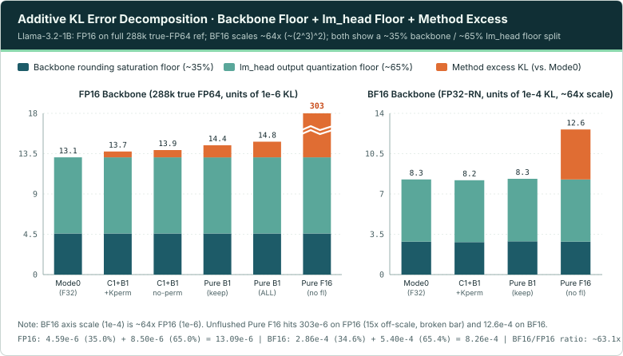

[English](route2-mma-bypass.md) | [中文](route2-mma-bypass.cn.md)

# Route 2 Deep Dive · SM 12.0 MMA Throttle-Gate Model, TMA-WS GEMM & End-to-End LLM Verification

All hardware measurements in this note were collected on a single consumer Blackwell GPU (**RTX 5070 Ti Laptop GPU**, `GB205`, `10de:2f18`, 46 SMs, 140 W board TDP, driver `621.01`, CUDA `13.5`, `sm_120a`), with SASS verified via `cuobjdump --dump-sass` / `nvdisasm -b SM120`. Cross-card confirmation on desktop RTX 5080 and an unthrottled RTX PRO 6000 control remains open (§4).

---

## 1. Consumer Blackwell MMA Throttle-Gate Model & Opcode Closure

### 1.1 Exhaustive SM 12.0 MMA opcode & `HMMA` bit-field closure

Offline disassembly scanning of all 4,096 12-bit SM 12.0 opcodes (`lo[11:0] = 0x000..0xFFF`) finds 255 valid opcodes and **exactly six `*MMA*` instructions**: `0x237 IMMA`, `0x23c HMMA`, `0x23f DMMA`, `0x27a QMMA`, `0x47a QMMA.SF`, and `0x47f OMMA.SF`. There is no block-scaled `HMMA.SF` opcode.

Probing `HMMA` (`0x23c`) control bits in `hi64` (`bit 76` = 1-bit accumulator `0=F16, 1=F32`; `bits 83:82` = input `0=F16, 1=BF16, 2=TF32, 3=INVALID3`) confirms on live GB205 silicon that `HMMA.16816.F16.BF16`, `HMMA.1688.F16.TF32`, `HMMA.16816.F32.TF32`, `INVALID3`, and `bit 81` all trap `CUDA_ERROR_ILLEGAL_INSTRUCTION (715)`, while silent modifier bits (`74, 77, 79, 80, 84, 85, 86`) execute cleanly but remain clamped at `508.5 FLOP/SM/clk`.

### 1.2 Per-SMSP cooldown gate (no burst credit)

Interleaving throttled and unthrottled MMA instructions on the same SMSP isolates the consumer throttle mechanism:

- **Shared datapath:** Every MMA occupies **16 SMSP cycles** regardless of whether it is throttled or full-rate.
- **Per-SMSP throttle gate:** Any two throttled MMAs (`HMMA.F32.F16`, `HMMA.F32.BF16`, `HMMA.F32.TF32`, unscaled `QMMA`, and non-FP8 `QMMA.SF`) issued on the same SMSP must be separated by at least **32 SMSP cycles**, with **no burst credit**.
  - *Decisive 1-warp/SMSP test:* `F16×4 → F32 → F32` (back-to-back throttled) takes `124.51 clk` vs. `113.63 clk` when the two `F32` MMAs are separated; at `4 warps/SMSP`, cross-warp staggering hides the back-to-back gap down to `96.00 clk` (`16.00 clk/MMA`).
- **Per-warp issue ceiling:** A single warp per SMSP caps at `21.00 clk/MMA` on `QMMA.SF`; **`2 warps/SMSP` (`8 warps/SM`, up to 255 regs/thread)** already saturates the `16.00 clk/MMA` datapath on pure `QMMA.SF`, `1:2` free-running (`16.00 clk/MMA`), and `1:2` barrier-lockstep (`16.08 clk/MMA`).
- **Mix-ratio sweep (`4 warps/SMSP`, SASS-verified):**
  - **`1:2` (`33.3%` throttled):** **`16.00 clk/MMA` (`0.0%` penalty — engineering default)**
  - `2:3` (`40.0%`): `16.16–16.30 clk/MMA` (`+1.0–1.9%`)
  - `3:4` (`42.9%`): `16.63–16.79 clk/MMA` (`+3.9–4.9%`)
  - `1:1` (`50.0%`): `17.91 clk/MMA` (`+11.9%`)

### 1.3 Narrow-format consequences: lossless `FP6 → E4M3` 2× & undocumented `E3M4FN`

- **Non-FP8 `QMMA.SF` shares the exact same cooldown gate:** Interleaving `1 HMMA.F32 + 1 QMMA.SF(e3m2×e3m2)` takes `64.00 clk` (same for `e2m1×e2m1`), whereas `1 QMMA.SF(e3m2×e3m2) + 1 QMMA.SF(FP8)` overlaps to `35.77 clk`—proving non-FP8 `QMMA.SF` is slowed by the consumer cooldown gate, not a 32-cycle datapath.
- **Lossless `FP6 → E4M3` upcast (`2.00×`, `0` bit diffs):** Both `E3M2` and `E2M3` embed losslessly into `E4M3` (`64/64` exact values each, unchanged `UE8M0` block scales). Upcasting `FP6` operands to `E4M3` at the SMEM/load stage and running `QMMA.SF.16832` produces **`0 / 33,554,432` bit differences** across all five combinations (`E3M2×E3M2`, `E2M3×E2M3`, `E3M2×E2M3`, `E3M2×E2M1`, `E2M3×E2M1`; 167.8M FP32 accumulators) while jumping from `1023.5–1024.0` to **`2048.1 FLOP/SM/clk`** (`2.00×`, `233.2–258.5 TFLOP/s` on GB205; `1466.5 FLOP/SM/clk` with 16× CTA-amortized register SWAR; avoid `__constant__` LUTs, which serialize to `40.6 FLOP/SM/clk`).
- **Undocumented `E3M4FN` (`QMMA.SF` code `2`):** Full hardware decoding and `2045.2 FLOP/SM/clk` verification are documented in [software/README.md](../software/README.md#4-full-rate-fp8fp32-via-qmmasf-and-cuda-132).

### 1.4 Hardware rounding modes & large-`K` `HMMA.F32` drift fix

Direct single-tile probes establish that `HMMA.16816.F16` uses **IEEE round-to-nearest-even (RN)** (`5/5` exact), whereas `HMMA.16816.F32` (both FP16 and BF16 inputs) uses **round-toward-zero (RZ) truncation** (`4/4` exact). On long inner dimensions with non-zero mean activations (e.g. weight-gradient GEMMs), sequential `HMMA.F32` accumulates systematic RZ drift. Flushing a local `HMMA.F32` accumulator into a master FP32 register via CUDA-core IEEE RN `FADD` every 16 `k16` steps (`HMMA.F32 + RN16`) runs at identical speed to native `HMMA.F32` while cutting error by **19×–84×** vs. real `cublasGemmEx` (`BF16→FP32`) and **562×** vs. a single unsplit chain:

| Workload (biased `N(0.25, 1)` inputs, vs. true FP64) | Single-chain `HMMA.F32` | Real `cublasGemmEx` (`BF16→FP32`) | **`HMMA.F32 + RN16`** | Improvement vs. `cuBLAS` |
|---|---:|---:|---:|---:|
| `1024×1024×65,536` (no cuBLAS split-K) | — | `2.31e-05` | **`2.74e-07`** | **`84×`** |
| `128×128×262,144` (cuBLAS uses split-K) | `3.24e-04` | `1.08e-05` | **`5.76e-07`** | **`19×`** (`562×` vs. single chain) |

---

## 2. End-to-End SM 12.0 TMA + `mbarrier` + Warp-Specialized GEMM

Early `cp.async` prototypes exposed two bottlenecks: (1) consumer warps running address math, `cp.async`, `ldmatrix`, spills, and FP16→FP32 flush (`HADD2.F32` + `FADD` in SM 12.0 SASS—`ptxas 13.5` lowers `__half22float2` to fast FMA-pipe `HADD2.F32`, not slow `F2F`) contended for issue slots, making `cp.async` `Pure B1 (N=3)` slower than `Pure F32` (`51.6` vs. `54.7 TFLOP/s`); (2) `ptxas 13.5` hoists all `HMMA.F32` instructions ahead of all `HMMA.F16` instructions within a single warp even inside one `asm volatile` block.

Moving to a **`128×256×48` 2-stage TMA (`SWIZZLE_32B`) + `mbarrier` + Warp-Specialized (`setmaxnreg 40 / 232`)** kernel (1 producer warpgroup + 2 consumer warpgroups = 8 consumer warps, `wm`-phase staggered across the 2 warps per SMSP) eliminated both bottlenecks. Two SM 12.0 compiler requirements are essential: compile with `-gencode arch=compute_120a,code=sm_120a` (plain `-arch=sm_120a` rejects `setmaxnreg`), and declare `__launch_bounds__(384, 1)` (omitting `, 1` causes `ptxas` `C7508: 'setmaxnreg' ignored`, collapsing `C1+B1` to 40 registers / 1,384 B spill / 6.3 TFLOP/s; with `, 1`, `Pure F32`/`F16` have `0 B` spill and `Pure B1`/`C1+B1 (N=2)` have `8 B` stack).

### Steady-state NVML benchmark (`1.0 s` continuous pre-burn + `1.0 s` NVML sampling, GB205, 140 W TDP)

Because this 140 W laptop GPU (`~3.0 W/SM`) boosts clamped `cuBLAS BF16→FP32` to `2.40–2.62 GHz` while full-rate kernels hit the 140 W wall at `2.07–2.17 GHz` (`18–21%` lower clock), both wall-clock `TFLOP/s` and clock-normalized `TF/s/GHz` (`FLOP/SM/clk`) are reported alongside true FP64 `rel_L2` (and `rel_L2` vs. `cuBLAS FP16→FP32`):

#### Aligned `K = 4080` (`85 × 48`): `4096 × 4096 × 4080` and `4096 × 14336 × 4080`

The first two tables align `K` to the `BK = 48` tile (`4080 = 85 × 48`). The exact unaligned Llama-3-8B `K = 4096` (`85 × 48 + 16` tail) benchmark follows immediately below.

**48-aligned Q/O (`4096 × 4096 × 4080`)**

| Kernel | Wall `TF/s` | `TF/s/GHz` (`FLOP/SM/clk`) | SM Clock / Power | `rel_L2` vs. True FP64 (vs. `cuBLAS F16→F32`) | vs. `cuBLAS BF16` (wall / per-GHz) |
|---|---:|---:|---:|---:|---:|
| `cuBLAS BF16→FP32` (target) | `53.52` | `22.34` (`485.7`) | `2.40 GHz` / `135.1 W` | — | `1.00× / 1.00×` |
| `cuBLAS FP16→FP32` (ref) | `52.51` | `21.99` (`478.1`) | `2.39 GHz` / `138.9 W` | `4.821e-06` (`0.000e+00`) | `0.98× / 0.98×` |
| `cuBLAS FP16→FP16` (ceiling) | `91.08` | `43.61` (`948.1`) | `2.09 GHz` / `139.1 W` | — | `1.70× / 1.95×` |
| `TMA-WS 128×256 Pure F32` | `55.52` | `21.79` (`473.8`) | `2.55 GHz` / `139.4 W` | `4.821e-06` (`0.000e+00`) | `1.04× / 0.98×` |
| `TMA-WS 128×256 Pure F16` | `86.71` | `40.52` (`880.8`) | `2.14 GHz` / `139.4 W` | `2.350e-03` (`2.350e-03`) | `1.62× / 1.81×` |
| **`TMA-WS 128×256 Pure B1 (N=3)`** | **`78.79`** | **`36.34` (`789.9`)** | `2.17 GHz` / `139.3 W` | `2.940e-04` (`2.940e-04`) | **`1.47× / 1.63×`** |
| **`TMA-WS 128×256 C1+B1 (N=2)`** | **`73.88`** | **`34.15` (`742.5`)** | `2.16 GHz` / `139.3 W` | **`2.069e-04`** (`2.069e-04`) | **`1.38× / 1.53×`** |
| `TMA-WS 128×256 C1+B1 (N=4)` | `72.54` | `32.77` (`712.3`) | `2.21 GHz` / `139.3 W` | `2.655e-04` (`2.655e-04`) | `1.36× / 1.47×` |

**48-aligned Up (`4096 × 14336 × 4080`)**

| Kernel | Wall `TF/s` | `TF/s/GHz` (`FLOP/SM/clk`) | SM Clock / Power | `rel_L2` vs. True FP64 (vs. `cuBLAS F16→F32`) | vs. `cuBLAS BF16` (wall / per-GHz) |
|---|---:|---:|---:|---:|---:|
| `cuBLAS BF16→FP32` (target) | `60.66` | `23.14` (`503.1`) | `2.62 GHz` / `137.0 W` | — | `1.00× / 1.00×` |
| `cuBLAS FP16→FP32` (ref) | `58.45` | `22.80` (`495.6`) | `2.56 GHz` / `140.1 W` | `4.825e-06` (`0.000e+00`) | `0.96× / 0.99×` |
| `cuBLAS FP16→FP16` (ceiling) | `98.06` | `45.59` (`991.0`) | `2.15 GHz` / `139.8 W` | — | `1.62× / 1.97×` |
| `TMA-WS 128×256 Pure F32` | `58.15` | `22.93` (`498.5`) | `2.54 GHz` / `139.8 W` | `4.825e-06` (`0.000e+00`) | `0.96× / 0.99×` |
| `TMA-WS 128×256 Pure F16` | `85.84` | `41.31` (`898.0`) | `2.08 GHz` / `139.8 W` | `2.343e-03` (`2.343e-03`) | `1.42× / 1.79×` |
| **`TMA-WS 128×256 Pure B1 (N=3)`** | **`80.71`** | **`39.05` (`848.9`)** | `2.07 GHz` / `139.8 W` | `2.935e-04` (`2.935e-04`) | **`1.33× / 1.69×`** |
| **`TMA-WS 128×256 C1+B1 (N=2)`** | **`76.62`** | **`36.67` (`797.2`)** | `2.09 GHz` / `139.9 W` | **`2.073e-04`** (`2.073e-04`) | **`1.26× / 1.58×`** |
| `TMA-WS 128×256 C1+B1 (N=4)` | `74.21` | `34.84` (`757.5`) | `2.13 GHz` / `139.5 W` | `2.672e-04` (`2.673e-04`) | `1.22× / 1.51×` |

#### Exact unaligned Llama-3-8B `K = 4096` (`85 × 48 + 16` tail via TMA OOB zero-fill)

Setting `num_tiles = ceil(K / 48) = 86` lets SM 12.0 TMA hardware zero-fill the 32 out-of-bounds columns of the final tile (`CU_TENSOR_MAP_FLOAT_OOB_FILL_NONE`) with no inner-loop branch. `Pure F32` matches `cuBLAS FP16→FP32` to `0.000e+00` (`4.849e-06` / `4.839e-06` vs. true FP64), and per-clock efficiency drops by only `~0.9%–1.0%` from the 32 padded columns:

| Shape (`M × N × K`) | Kernel | Wall `TF/s` | `TF/s/GHz` (`FLOP/SM/clk`) | SM Clock / Power | `rel_L2` vs. True FP64 | vs. `cuBLAS BF16` (wall / per-GHz) |
|---|---|---:|---:|---:|---:|---:|
| Llama-3-8B Q/O (`4096×4096×4096`) | `cuBLAS BF16→FP32` (target) | `54.54` | `22.31` (`484.9`) | `2.44 GHz` / `138.6 W` | — | `1.00× / 1.00×` |
| Llama-3-8B Q/O (`4096×4096×4096`) | `cuBLAS FP16→FP16` (ceiling) | `92.30` | `43.80` (`952.2`) | `2.11 GHz` / `138.4 W` | — | `1.69× / 1.96×` |
| Llama-3-8B Q/O (`4096×4096×4096`) | `TMA-WS Pure F32` | `55.19` | `21.29` (`462.7`) | `2.59 GHz` / `140.0 W` | `4.849e-06` (`0.000` vs. cuBLAS) | `1.01× / 0.95×` |
| Llama-3-8B Q/O (`4096×4096×4096`) | **`TMA-WS Pure B1 (N=3)`** | **`75.41`** | **`35.96` (`781.7`)** | `2.10 GHz` / `139.5 W` | `2.951e-04` | **`1.38× / 1.61×`** |
| Llama-3-8B Q/O (`4096×4096×4096`) | **`TMA-WS C1+B1 (N=2)`** | **`71.78`** | **`33.84` (`735.7`)** | `2.12 GHz` / `139.2 W` | **`2.082e-04`** | **`1.32× / 1.52×`** |
| Llama-3-8B Up (`4096×14336×4096`) | `cuBLAS BF16→FP32` (target) | `61.81` | `23.25` (`505.5`) | `2.66 GHz` / `134.7 W` | — | `1.00× / 1.00×` |
| Llama-3-8B Up (`4096×14336×4096`) | `cuBLAS FP16→FP16` (ceiling) | `99.57` | `45.40` (`987.1`) | `2.19 GHz` / `139.5 W` | — | `1.61× / 1.95×` |
| Llama-3-8B Up (`4096×14336×4096`) | `TMA-WS Pure F32` | `58.39` | `23.05` (`501.0`) | `2.53 GHz` / `139.5 W` | `4.839e-06` (`0.000` vs. cuBLAS) | `0.94× / 0.99×` |
| Llama-3-8B Up (`4096×14336×4096`) | **`TMA-WS Pure B1 (N=3)`** | **`81.13`** | **`38.68` (`840.8`)** | `2.10 GHz` / `139.7 W` | `2.941e-04` | **`1.31× / 1.66×`** |
| Llama-3-8B Up (`4096×14336×4096`) | **`TMA-WS C1+B1 (N=2)`** | **`77.08`** | **`36.36` (`790.5`)** | `2.12 GHz` / `139.5 W` | **`2.076e-04`** | **`1.25× / 1.56×`** |

Key observations:
1. Offloading memory transfers to the TMA producer warpgroup lifted `Pure B1 (N=3)` from `51–64 TF/s` (`cp.async`) to **`75.4–81.1 TF/s`** on exact `K=4096` (`78.8–80.7 TF/s` on 48-aligned `K=4080`), sustaining **`1.61×–1.66×`** per GHz (`1.31×–1.38×` wall) over `cuBLAS BF16→FP32` on exact `K=4096` (`1.63×–1.69×` per GHz on `K=4080`).
2. `C1+B1 (N=2)` sustains **`1.52×–1.56×`** per GHz (`1.25×–1.32×` wall) on exact `K=4096` (`1.53×–1.58×` per GHz on `K=4080`), costing **`+6.3%–6.5%`** more time per clock than `Pure B1 (N=3)`.
3. **Single-GEMM outlier accuracy (`5%` channels at `20×`, `K=4096`):** Routing the top-`1/3` `K` channels into the `HMMA.F32` slot (`C1+B1 + K-perm`) cuts single-GEMM FP32-output `rel_L2` by **~6×** (`~2.9e-4 → 4.92e-5`).
4. **Bit-exact speed/quality equivalence:** Comparing the fast `TMA-WS 128×256` kernel against the arbitrary-`(M, N, K)` SM 12.0 `HMMA` library used for LLM evaluation on `1024×2048×2064` (with `50×` outlier channels) yields **`0 / 2,097,152` bit differences (`max_abs = 0.000e+00`, `rel_L2 = 0.000e+00`)** across all five modes (`Pure F32`, `Pure F16`, `Pure B1 (N=3)`, `C1+B1 (N=2)`, `C1+B1 (N=4)`).

---

## 3. End-to-End LLM Quality: Dual-Regime KL, Fixed-Ref Causal Ablation & Headroom

Every `nn.Linear` layer in **`Llama-3.2-1B`** (`unsloth/Llama-3.2-1B`, revision `9535bd9b1d1d`, 113 layers; `transformers 5.24.1`, `tokenizers 0.23.3`) and **`Qwen2.5-1.5B`** (`Qwen/Qwen2.5-1.5B`, 197 layers) was replaced with real SM 12.0 hardware `HMMA` kernels and evaluated on **WikiText-2-raw** prefill (`seq_len = 1024`), using an **unbiased true FP64-accumulation reference** (`F.linear(x.double(), w.double(), b.double())` with identical FP16 weights and inter-layer FP16 rounding; `KL = 0.0` across repeated runs). Channel permutations for `C1+B1 + K-perm` were calibrated on a disjoint 2-chunk validation split (`rms(X)` per channel) and applied via runtime `index_select` gather in the evaluation harness.

### 3.1 Dual-regime KL gap, fixed-reference 2×2 causal ablation & rounding saturation

Comparing the **Deploy regime** ($\mathrm{KL}(\mathrm{softmax}(Q(z_{\text{ref}})) \,\|\, \mathrm{softmax}(Q(z_{\text{cur}})))$, where both reference and candidate `lm_head` outputs are rounded to `FP16`/`BF16`) against the **High-Res regime** ($\mathrm{KL}(\mathrm{softmax}(z_{\text{ref}}) \,\|\, \mathrm{softmax}(z_{\text{cur}}))$, raw `FP32` `lm_head` logits on both sides) separates the backbone saturation floor (`~35%`) from the dual-regime output gap (`Deploy − High-Res`, `~65%`). Because the two-regime difference quantizes *both* reference and candidate logits simultaneously, we also run a **fixed-FP32-reference 2×2 paired causal ablation** (`Llama-3.2-1B`, 32 chunks = `32,768` tokens, holding $P = \mathrm{softmax}(z_{\text{ref}}^{\text{FP32}})$ strictly fixed across all cells):

| Fixed-FP32-Ref 2×2 Causal Ablation (`Llama-3.2-1B`, 32k tokens) | Backbone only $\mathrm{KL}(P_{\text{ref}}^{32} \| Q_{\text{cur}}^{32})$ | Single-side `lm_head` only $\mathrm{KL}(P_{\text{ref}}^{32} \| Q_{\text{ref}}^{\text{low}})$ | Joint (fixed ref) $\mathrm{KL}(P_{\text{ref}}^{32} \| Q_{\text{cur}}^{\text{low}})$ | Interaction (`joint − bb − lm`) `[95% CI]` | Dual-quantized Deploy $\mathrm{KL}(Q_{\text{ref}}^{\text{low}} \| Q_{\text{cur}}^{\text{low}})$ |
|---|---:|---:|---:|---:|---:|
| **FP16** `Mode0` (vs. fixed true FP64) | `4.64e-6` (`47.8%`) | **`5.11e-6` (`52.6%`)** | `9.70e-6` | `-4.25e-8 [-1.12e-7, +2.41e-8]` (`n.s.`) | `1.32e-5` (gap `+8.52e-6`) |
| **FP16** `Pure B1 [keep head]` | `5.68e-6` | `5.11e-6` | `1.08e-5` | `-6.84e-9 [-5.69e-8, +4.40e-8]` (`n.s.`) | `1.46e-5` |
| **FP16** `C1+B1+K-perm [ALL]` | `5.09e-6` | `5.11e-6` | `1.02e-5` | `-3.26e-8 [-9.10e-8, +2.22e-8]` (`n.s.`) | `1.38e-5` |
| **BF16** `Mode0` (vs. fixed `FP32-RN`) | `2.94e-4` (`47.6%`) | **`3.27e-4` (`52.9%`)** | `6.17e-4` | `-3.17e-6 [-6.11e-6, -1.12e-7]` (`-0.5%`) | `8.42e-4` (gap `+5.48e-4`) |
| **BF16** `Pure B1 [keep head]` | `3.02e-4` | `3.27e-4` | `6.29e-4` | `-2.23e-7 [-3.72e-6, +3.37e-6]` (`n.s.`) | `8.57e-4` |
| **BF16** `C1+B1+K-perm [ALL]` | `2.98e-4` | `3.27e-4` | `6.27e-4` | `+2.79e-6 [-8.48e-7, +6.43e-6]` (`n.s.`) | `8.51e-4` |

- **Fixed-reference causal additivity:** Holding $P_{\text{ref}}^{\text{FP32}}$ fixed confirms that single-side `lm_head` output quantization independently contributes **`5.11e-6` (`52.6%`)** on FP16 and **`3.27e-4` (`52.9%`)** on BF16 (an exact **`64.0×`** = $(2^3)^2$ ratio), backbone saturation independently contributes **`4.64e-6` (`47.8%`)** / **`2.94e-4` (`47.6%`)** (`63.4×` ratio), and their non-linear interaction is **`< 0.5%`** (statistically indistinguishable from zero across FP16 and BF16 `Pure B1` / `C1+B1`). In the dual-quantized Deploy regime (`1.32e-5` / `8.42e-4`), quantizing *both* reference and candidate logits onto partially decorrelated grids widens the regime gap to `~1.67×` the single-side `lm_head` term (`~65%` of Deploy KL).
- **Backbone discrete-rounding saturation:** Even IEEE-754 RN `FP32` (`allow_tf32=False`, single-GEMM `rel_L2 = 1.43e-7`) flips `31%–34%` of residual-block elements at `L00` and converges by `L05–L09` to the exact same **`~85%–87%` discrete grid-saturation plateau** as `Mode0` and `Pure B1`. Final-layer hidden-state `rel_L2` on `Llama-3.2-1B` is `1.69e-3` (FP16) vs. `1.31e-2` (BF16) (`7.75× ≈ 8 = 2³`).
- **Softmax KL scaling note:** Because softmax is shift-invariant, small logit perturbations $\Delta z$ expand to $\mathrm{KL}(P \| Q) \approx \frac{1}{2}\mathrm{Var}_{i \sim P}(\Delta z_i)$ (vanishing if a constant offset shifts all logits or if $P$ is near one-hot). Under approximately independent per-token rounding noise on multi-token competitive distributions, this produces the observed `~64×` $(\text{ULP}_{\text{BF16}}/\text{ULP}_{\text{FP16}})^2$ scaling (`~ULP²/12` order-of-magnitude heuristic, not a general exact formula).
- **Primary metric:** Because relative percentages depend on which regime floor is included, **absolute excess KL vs. `Mode0` (with 95% CI)** is the primary kernel-quality metric; percentages are auxiliary.

### 3.2 Full WikiText-2-raw (`288,768` tokens, 282 chunks) · True FP64 Reference (`Llama-3.2-1B`, FP16)

All 282 per-chunk records (`kl_deploy`, `kl_high_res`, `top1_high_res`, `nll_high_res`, `ref_nll_*`, exact model revision `9535bd9b1d1d`, `transformers 5.24.1`, `tokenizers 0.23.3`) are archived in [reports/gb205-2f18/route2-wt2-288k-fp64.json](../reports/gb205-2f18/route2-wt2-288k-fp64.json) and can be independently recomputed without a GPU via `python3 software/verify_wt2_bootstrap.py` (10,000-resample chunk-paired bootstrap, `seed = 42`; `PPL_hi = 10.78688`, `PPL_dep = 10.78695`; across all B1/C1 variants, `|ΔPPL| ≤ 0.00014`, `< 0.0013%`, within measurement noise):

| Configuration (vs. True FP64, 288,768 tokens) | Deploy (`FP16 lm_head`) KL · **Excess vs. `Mode0` `[95% CI]`** | High-Res (`FP32 lm_head`) KL · **Excess vs. `Mode0` `[95% CI]`** | High-Res Top-1 |
|---|---:|---:|---:|
| `FP32-RN (allow_tf32=False)` | `1.30e-5` · `-9.92e-8 [-1.51e-7, -4.69e-8]` | `4.48e-6` · `-1.06e-7 [-1.36e-7, -7.66e-8]` | `99.88%` |
| `HW Mode5: HMMA.F32 + RN16` | `1.30e-5` · `-9.48e-8 [-1.46e-7, -4.28e-8]` | `4.53e-6` · `-5.93e-8 [-8.75e-8, -2.96e-8]` | `99.88%` |
| `HW Mode0: Native HMMA.F32` (ref) | `1.31e-5` · `0` (`High-Res 4.59e-6 + gap 8.50e-6`) | `4.59e-6` · `0` (`High-Res floor = 35.0%`) | `99.87%` |
| `HW Mode1: Pure F16 (no flush)` | `3.03e-4` · **`+2.90e-4 [+2.87e-4, +2.92e-4]`** (`23.1×`) | `2.98e-4` · **`+2.93e-4 [+2.91e-4, +2.95e-4]`** (`65.0×`) | `98.72%` |
| `HW Mode2: Pure B1 (N=3)` `[keep head]` | `1.44e-5` · **`+1.35e-6 [+1.29e-6, +1.41e-6]`** (`+10.3%`) | `5.61e-6` · **`+1.03e-6 [+9.88e-7, +1.07e-6]`** (`+22.4%`) | `99.86%` |
| `HW Mode2: Pure B1 (N=3)` `[ALL]` | `1.48e-5` · **`+1.75e-6 [+1.69e-6, +1.81e-6]`** (`+13.4%`) | `5.91e-6` · **`+1.32e-6 [+1.28e-6, +1.36e-6]`** (`+28.8%`) | `99.85%` |
| `HW Mode3: C1+B1 (N=2)` no-perm `[keep]` | `1.39e-5` · **`+8.10e-7 [+7.54e-7, +8.66e-7]`** (`+6.2%`) | `5.21e-6` · **`+6.24e-7 [+5.87e-7, +6.62e-7]`** (`+13.6%`) | `99.87%` |
| **`HW Mode3: C1+B1+K-perm(act)` `[ALL]`** | `1.37e-5` · **`+6.46e-7 [+5.92e-7, +7.02e-7]`** (`+4.9%`) | `5.04e-6` · **`+4.56e-7 [+4.24e-7, +4.89e-7]`** (`+9.9%`) | **`99.87%`** |

Key paired bootstrap findings across all 288,768 tokens:
1. **Unbiased ordering confirmed at `10⁻⁸` KL:** Against true FP64, `FP32-RN` (`4.48e-6`) < `Mode5 (RN16)` (`4.53e-6`, `-5.93e-8` vs. `Mode0`, `p < 0.05`) < `Mode0` (`4.59e-6`), directly confirming `Mode5` removes `HMMA.F32` RZ bias (statistically significant, though `< 1.3%` in magnitude).
2. **Consistent compression across both regimes:** `C1+B1+K-perm(act) [ALL]` cuts excess KL vs. `Pure B1 [ALL]` by **`2.90×` `[2.72×, 3.11×]`** in High-Res (`+4.56e-7` vs. `+1.32e-6`) and **`2.71×` `[2.51×, 2.93×]`** in Deploy (`+6.46e-7` vs. `+1.75e-6`). A small second-order effect (Deploy excess `~1.2–1.4×` High-Res excess for small-excess methods, equal for `Pure F16`) reflects near-saturated dual-grid rounding.
3. **`lm_head` ablation and scenario-dependent cost:** Replacing `lm_head` with `Pure B1` adds **`+2.93e-7` `[+2.89e-7, +2.98e-7]`** (High-Res) / **`+4.02e-7` `[+3.78e-7, +4.24e-7]`** (Deploy) on `Llama-3.2-1B`; on `Qwen2.5-1.5B` (6k–12k true FP64), replacing `lm_head` raises High-Res `Pure B1` excess from `+1.56e-6` (`+29.1%`) to `+2.53e-6` (`+47.2%`), while `C1+B1+K-perm` stays at `+4.9e-7` (`+9.1%`). The runtime cost of keeping `lm_head` native depends strongly on whether logits are computed for every token or only the last token (`seq_len = 1024, batch = 1`, native `cuBLAS` on GB205):
   - **Inference prefill (last-token logits only, `M = 1`):** `lm_head` is only **`0.026%`** (`Llama-3.2-1B`) / **`0.017%`** (`Qwen2.5-1.5B`) of linear MACs and **`0.90%–1.02%`** (`0.85–1.02 ms` vs. `93.9–99.0 ms`) / **`0.73%–0.82%`** (`0.84–0.95 ms` vs. `114.5–114.6 ms`) of measured forward wall time — keeping `lm_head` native is practically free.
   - **Full-sequence logits (training / PPL evaluation, `M = 1024`):** Because `1B–1.5B` models carry `128k–152k` vocabularies, `lm_head` accounts for **`21.26%`** (`Llama-3.2-1B`) / **`15.12%`** (`Qwen2.5-1.5B`) of total linear MACs (`7.00%` on `Llama-3-8B`), and **`8.9%–9.5%`** (`9.18–10.40 ms`) / **`6.7%–7.5%`** (`8.27–9.24 ms`) of real forward wall time on GB205. In full-sequence workloads, keeping `lm_head` native is therefore an explicit ~`7%–10%` time-vs-accuracy trade-off rather than free.
4. **Activation-only vs. `act×W` calibration:** Across all 288,768 tokens (verified on the `FP32-RN` full sweep and 12k–16k true-FP64 runs on both models), `C1+B1+K-perm(act×W) − C1+B1+K-perm(act) = -7.56e-9 [-6.54e-8, +5.15e-8]` (`n.s.`). Simpler activation-RMS calibration (`rms(X)`) is sufficient.
5. **K-perm runtime-cost scoping:** Offline folding is strictly zero-overhead for `down_proj` (folds into `gate_proj`/`up_proj` output rows) and per-head for `o_proj` (folds into `v_proj` output rows). For `q/k/v_proj` and `gate/up_proj`, per-layer permutations differ and require a fused permuted store in the preceding `RMSNorm` kernel (~0 overhead, requires kernel support).

### 3.3 BF16 deployment control & `BF16 → FP16 → BF16` round-trip census (`Llama-3.2-1B` & `Qwen2.5-1.5B`)

Because `BF16` has an 8-bit exponent vs. `FP16`'s 5-bit exponent, checking `max|x| < 65504` only rules out **overflow**; values with `|x| < 2⁻¹⁴` enter `FP16`'s subnormal range (losing BF16 mantissa bits below `2⁻¹⁷`), and values `≤ 2⁻²⁵` underflow to `0` under round-to-nearest-even `FP16`. Measuring exact `BF16 → FP16 → BF16` round-trips across all linear weights and 16 chunks (`16,384` tokens) of real WikiText-2-raw activations shows that internal `BF16 → FP16` casting is **not bit-lossless**, but the affected subnormal fraction is tiny and perturbs tensor energy by only `10⁻¹⁰–10⁻⁸` `rel_L2`:

| Model & Tensor (all `nn.Linear`, 16k tokens) | Elements | `max\|x\|` (ovf `>65504`) | `< 2⁻¹⁷` (subnormal loss) | Changed on `BF16→FP16→BF16` | Non-zero underflow `→ 0` | Round-trip `rel_L2` |
|---|---:|---:|---:|---:|---:|---:|
| `Llama-3.2-1B` weights | `1.236B` | `1.23` (`0`) | `425,200` | `283,704` (`0.0230%`) | `1,736` (`0.00014%`) | `1.80e-08` |
| `Llama-3.2-1B` activations | `5.402B` | `1,344.0` (`0`) | `2,819,459` | `1,948,418` (`0.0361%`) | `19,050` (`0.00035%`) | `1.19e-09` |
| `Qwen2.5-1.5B` weights | `1.544B` | `3.06` (`0`) | `361,775` | `62,666` (`0.0041%`) | `479` (`0.00003%`) | `6.06e-09` |
| `Qwen2.5-1.5B` activations | `8.363B` | `5,184.0` (`0`) | `1,093,172` | `748,051` (`0.0089%`) | `31,957` (`0.00038%`) | `2.71e-10` |

Keeping weights and inter-layer activations in `BF16` and comparing against unbiased `BF16-input FP32-RN` (24k–32k tokens):
- **Deploy (`BF16 lm_head`):** `cuBLAS BF16→FP32` (`8.57e-4` / `9.91e-4`), `Pure B1 (N=3)` (`8.50e-4` / `9.86e-4`), `C1+B1 (N=2)` (`8.46e-4` / `9.82e-4`), and `C1+B1+K-perm` (`8.39e-4` / `9.87e-4`) are **statistically indistinguishable** on both models; unflushed `Pure F16` degrades by **`+33%–46%`** (`1.25e-3` / `1.32e-3`).
- **High-Res (`FP32 lm_head`, Llama BF16):** Even after removing the `BF16 lm_head` cast (`8.26e-4 → 2.86e-4` on 24k; `8.42e-4 → 2.94e-4` on 32k), `Pure B1` (`2.89e-4`) and `C1+B1+K-perm` (`2.82e-4`) remain indistinguishable from `Mode0` (`2.86e-4`), while `Pure F16` rises **`2.16×`** (`6.18e-4`).

### 3.4 Hardware-measured FP16 partial-sum overflow headroom (`65504 / max|tmp_f16|`)

Measured via in-kernel `atomicMax` on every `HMMA.F16` partial sum before flush:

| Model (scope) | Worst Layer | `Pure F16` (`headroom`) | `Pure B1 (N=3)` (`headroom`) | `C1+B1` no-perm (`headroom`) | `C1+B1 + K-perm` (`headroom`) |
|---|---|---:|---:|---:|---:|
| **`Llama-3.2-1B`** (all 113 layers) | `L1.mlp.down_proj` | `470.8` (`139×`) | `457.5` (`143×`) | `457.5` (`143×`) | Global max **`3.7`** (`17,736×`, **`124×` lower**) |
| **`Qwen2.5-1.5B`** (all 197 layers) | `L26.mlp.down_proj` | **`7,240.0` (`9.0×`)** | **`2,930.0` (`22.4×`)** | `2,930.0` (`22.4×`) | `L26`: **`21.4` (`3,062×`, `137×` lower)**; global max `150.5` @ `L27` (`435×`) |
| **`Qwen2.5-7B`** (**`L0–L5` only**, shard 1) | `L3` / `L4.mlp.down_proj` | **`9,048.0` (`7.2×` @ L3)** | `205.2` @ L3 / `317.8` @ L4 (`206×`) | `165.8` / `269.8` | **`12.9` @ L3 (`5,085×`)** / **`3.3` @ L4 (`19,636×`)** |

---

## 4. Engineering Selection Table & Open Verification Items

| Workload / Scenario | Recommended Path | Empirical Basis |
|---|---|---|
| Near-Gaussian inputs, `BF16` output (or standard `BF16`/`FP16` inference layers) | **Pure `B1` (`N=3`, TMA-WS)** | Fastest (`782–841 FLOP/SM/clk` on exact `K=4096`, `1.61–1.66×` per-GHz vs. `cuBLAS BF16`; `790–849` / `1.63–1.69×` on 48-aligned `K=4080`); single-GEMM `rel_L2 ≈ 2.94e-4`; indistinguishable from `cuBLAS BF16→FP32` in BF16 deploy and `+1.35e-6` excess KL (`+10%`) in FP16 deploy |
| Heavy-tailed / outlier-channel layers (e.g., `down_proj` with `max\|X\| > 10³`) | **`C1 + B1 (N=2)` + `K`-dim perm (`rms(X)` calib)** | `+6.4%–6.5%` time per clock vs. Pure `B1`; cuts single-GEMM FP32-output `rel_L2` by **~6×** (`4.9e-5`) and peak FP16 partial sums by **20×–137×**; on end-to-end FP16 LLMs cuts excess KL **2.7×–2.9×** (`+6.5e-7` Deploy / `+4.6e-7` High-Res) while largely masked under BF16 inter-layer floors |
| Large `K` with non-zero activation mean (e.g., weight-gradient GEMMs) | **`HMMA.F32` + RN flush every 16 `k16` steps (`RN16`)** | Same throughput as native `HMMA.F32`; **19×–84×** lower error than `cublasGemmEx` (`19×` at `128×128×262k` with split-K; `84×` at `1024×1024×65k` without split-K) |
| `lm_head`, MoE routers, and other FP32-sensitive projections | **Keep native `HMMA.F32` (or `RN16`)** | `< 1.0%` wall time in last-token inference prefill (`0.73%–1.02%` on 1B–1.5B); in full-sequence training/eval (`6.7%–9.5%` wall / `15%–21%` MACs), weigh against the `+2.9e-7` to `+9.7e-7` KL penalty of replacing `lm_head` |
| FP8 / mixed FP8×FP6 / FP8×FP4 / pure FP6 | **`QMMA.SF` unit scale (`0x7F`)** (upcast pure `FP6 → E4M3`) | Full **`2048 FLOP/SM/clk`** (`2.00×`), **`0` bit differences** |

### Pending / Out-of-Scope Verification Items
- **Cross-GPU confirmation:** Re-running the TMA-WS NVML clock/power split on a higher-TDP desktop **RTX 5080** (`~4.3 W/SM`) and on an unthrottled **RTX PRO 6000** (negative control where `HMMA.F32` has no 32-cycle gate).
- **Deep 7B layers:** `Qwen2.5-7B` partial-sum headroom above covers early layers `L0–L5` (shard 1) only; layers `L6–L27` remain unmeasured.
