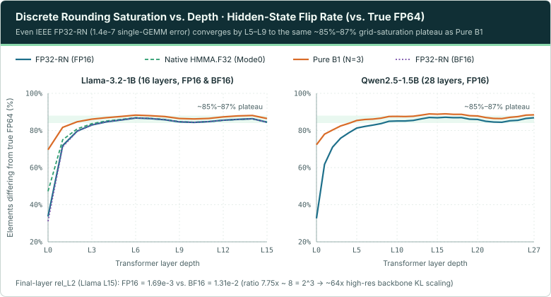

[English](route2-mma-bypass.md) | [中文](route2-mma-bypass.cn.md)

# Route 2 Deep Dive · SM 12.0 MMA Throttle-Gate Model, TMA-WS GEMM & End-to-End LLM Verification

All hardware measurements in this note were collected on a single consumer Blackwell GPU (**RTX 5070 Ti Laptop GPU**, `GB205`, `10de:2f18`, 46 SMs, 140 W board TDP, driver `621.01`, CUDA `13.5`, `sm_120a`), with SASS verified via `cuobjdump --dump-sass` / `nvdisasm -b SM120`. Cross-card confirmation on desktop RTX 5080 and an unthrottled RTX PRO 6000 control remains open (§5).

---

## 1. Consumer Blackwell MMA Throttle-Gate Model & Opcode Closure

### 1.1 Exhaustive SM 12.0 MMA opcode & `HMMA` bit-field closure

Offline disassembly scanning of all 4,096 12-bit SM 12.0 opcodes (`lo[11:0] = 0x000..0xFFF`) finds 255 valid opcodes and **exactly six `*MMA*` instructions**: `0x237 IMMA`, `0x23c HMMA`, `0x23f DMMA`, `0x27a QMMA`, `0x47a QMMA.SF`, and `0x47f OMMA.SF`. There is no block-scaled `HMMA.SF` opcode.

Probing `HMMA` (`0x23c`) control bits in `hi64` (`bit 76` = 1-bit accumulator `0=F16, 1=F32`; `bits 83:82` = input `0=F16, 1=BF16, 2=TF32, 3=INVALID3`) confirms on live GB205 silicon that `HMMA.16816.F16.BF16`, `HMMA.1688.F16.TF32`, `HMMA.16816.F32.TF32`, `INVALID3`, and `bit 81` all trap `CUDA_ERROR_ILLEGAL_INSTRUCTION (715)`, while silent modifier bits (`74, 77, 79, 80, 84, 85, 86`) execute cleanly but remain clamped at `508.5 FLOP/SM/clk`.

### 1.2 Per-SMSP cooldown gate (no burst credit)

Interleaving throttled and unthrottled MMA instructions on the same SMSP isolates the consumer throttle mechanism:

- **Shared datapath:** Every MMA occupies **16 SMSP cycles** regardless of whether it is throttled or full-rate.
- **Per-SMSP throttle gate:** Any two throttled MMAs (`HMMA.F32.F16`, `HMMA.F32.BF16`, `HMMA.F32.TF32`, unscaled `QMMA`, and non-FP8 `QMMA.SF`) issued on the same SMSP must be separated by at least **32 SMSP cycles**, with **no burst credit**.
  - *Decisive 1-warp/SMSP test:* `F16×4 → F32 → F32` (back-to-back throttled) takes `124.51 clk` vs. `113.63 clk` when the two `F32` MMAs are separated; at `4 warps/SMSP`, cross-warp staggering hides the back-to-back gap down to `96.00 clk` (`16.00 clk/MMA`).
- **Per-warp issue ceiling:** A single warp per SMSP caps at `21.00 clk/MMA` on `QMMA.SF`; **`2 warps/SMSP` (`8 warps/SM`, up to 255 regs/thread)** already saturates the `16.00 clk/MMA` datapath on pure `QMMA.SF`, `1:2` free-running (`16.00 clk/MMA`), and `1:2` barrier-lockstep (`16.08 clk/MMA`).
- **Mix-ratio sweep (`4 warps/SMSP`, SASS-verified):**
  - **`1:2` (`33.3%` throttled):** **`16.00 clk/MMA` (`0.0%` penalty — engineering default)**
  - `2:3` (`40.0%`): `16.16–16.30 clk/MMA` (`+1.0–1.9%`)
  - `3:4` (`42.9%`): `16.63–16.79 clk/MMA` (`+3.9–4.9%`)
  - `1:1` (`50.0%`): `17.91 clk/MMA` (`+11.9%`)

### 1.3 Narrow-format consequences: lossless `FP6 → E4M3` 2× & undocumented `E3M4FN`

- **Non-FP8 `QMMA.SF` shares the exact same cooldown gate:** Interleaving `1 HMMA.F32 + 1 QMMA.SF(e3m2×e3m2)` takes `64.00 clk` (same for `e2m1×e2m1`), whereas `1 QMMA.SF(e3m2×e3m2) + 1 QMMA.SF(FP8)` overlaps to `35.77 clk`—proving non-FP8 `QMMA.SF` is slowed by the consumer cooldown gate, not a 32-cycle datapath.
- **Lossless `FP6 → E4M3` upcast (`2.00×`, `0` bit diffs):** Both `E3M2` and `E2M3` embed losslessly into `E4M3` (`64/64` exact values each, unchanged `UE8M0` block scales). Upcasting `FP6` operands to `E4M3` at the SMEM/load stage and running `QMMA.SF.16832` produces **`0 / 33,554,432` bit differences** across all five combinations (`E3M2×E3M2`, `E2M3×E2M3`, `E3M2×E2M3`, `E3M2×E2M1`, `E2M3×E2M1`; 167.8M FP32 accumulators) while jumping from `1023.5–1024.0` to **`2048.1 FLOP/SM/clk`** (`2.00×`, `233.2–258.5 TFLOP/s` on GB205; `1466.5 FLOP/SM/clk` with 16× CTA-amortized register SWAR; avoid `__constant__` LUTs, which serialize to `40.6 FLOP/SM/clk`).
- **Undocumented `E3M4FN` (`QMMA.SF` code `2`):** Full hardware decoding and `2045.2 FLOP/SM/clk` verification are documented in [software/README.md](../software/README.md#4-full-rate-fp8fp32-via-qmmasf-and-cuda-132).

### 1.4 Hardware rounding modes & large-`K` `HMMA.F32` drift fix

Direct single-tile probes establish that `HMMA.16816.F16` uses **IEEE round-to-nearest-even (RN)** (`5/5` exact), whereas `HMMA.16816.F32` (both FP16 and BF16 inputs) uses **round-toward-zero (RZ) truncation** (`4/4` exact). On long inner dimensions with non-zero mean activations (e.g. weight-gradient GEMMs), sequential `HMMA.F32` accumulates systematic RZ drift. Flushing a local `HMMA.F32` accumulator into a master FP32 register via CUDA-core IEEE RN `FADD` every 16 `k16` steps (`HMMA.F32 + RN16`) runs at identical speed to native `HMMA.F32` while cutting error by **19×–84×** vs. real `cublasGemmEx` (`BF16→FP32`) and **562×** vs. a single unsplit chain:

| Workload (biased `N(0.25, 1)` inputs, vs. true FP64) | Single-chain `HMMA.F32` | Real `cublasGemmEx` (`BF16→FP32`) | **`HMMA.F32 + RN16`** | Improvement vs. `cuBLAS` |
|---|---:|---:|---:|---:|
| `1024×1024×65,536` (no cuBLAS split-K) | — | `2.31e-05` | **`2.74e-07`** | **`84×`** |
| `128×128×262,144` (cuBLAS uses split-K) | `3.24e-04` | `1.08e-05` | **`5.76e-07`** | **`19×`** (`562×` vs. single chain) |

---

## 2. End-to-End SM 12.0 TMA + `mbarrier` + Warp-Specialized GEMM

Early `cp.async` prototypes exposed two bottlenecks: (1) consumer warps running address math, `cp.async`, `ldmatrix`, spills, and FP16→FP32 flush (`HADD2.F32` + `FADD` in SM 12.0 SASS—`ptxas 13.5` lowers `__half22float2` to fast FMA-pipe `HADD2.F32`, not slow `F2F`) contended for issue slots, making `cp.async` `Pure B1 (N=3)` slower than `Pure F32` (`51.6` vs. `54.7 TFLOP/s`); (2) `ptxas 13.5` hoists all `HMMA.F32` instructions ahead of all `HMMA.F16` instructions within a single warp even inside one `asm volatile` block.

Moving to a **`128×256×48` 2-stage TMA (`SWIZZLE_32B`) + `mbarrier` + Warp-Specialized (`setmaxnreg 40 / 232`)** kernel (1 producer warpgroup + 2 consumer warpgroups = 8 consumer warps, `wm`-phase staggered across the 2 warps per SMSP) eliminated both bottlenecks. Two SM 12.0 compiler requirements are essential: compile with `-gencode arch=compute_120a,code=sm_120a` (plain `-arch=sm_120a` rejects `setmaxnreg`), and declare `__launch_bounds__(384, 1)` (omitting `, 1` causes `ptxas` `C7508: 'setmaxnreg' ignored`, collapsing `C1+B1` to 40 registers / 1,384 B spill / 6.3 TFLOP/s; with `, 1`, `Pure F32`/`F16` have `0 B` spill and `Pure B1`/`C1+B1 (N=2)` have `8 B` stack).

### Steady-state NVML benchmark (`1.0 s` continuous pre-burn + `1.0 s` NVML sampling, GB205, 140 W TDP)

Because this 140 W laptop GPU (`~3.0 W/SM`) boosts clamped `cuBLAS BF16→FP32` to `2.40–2.62 GHz` while full-rate kernels hit the 140 W wall at `2.07–2.17 GHz` (`18–21%` lower clock), both wall-clock `TFLOP/s` and clock-normalized `TF/s/GHz` (`FLOP/SM/clk`) are reported alongside true FP64 `rel_L2` (and `rel_L2` vs. `cuBLAS FP16→FP32`):

#### Aligned `K = 4080` (`85 × 48`): `4096 × 4096 × 4080` and `4096 × 14336 × 4080`

The first two tables align `K` to the `BK = 48` tile (`4080 = 85 × 48`). The exact unaligned Llama-3-8B `K = 4096` (`85 × 48 + 16` tail) benchmark follows immediately below.

**48-aligned Q/O (`4096 × 4096 × 4080`)**

| Kernel | Wall `TF/s` | `TF/s/GHz` (`FLOP/SM/clk`) | SM Clock / Power | `rel_L2` vs. True FP64 (vs. `cuBLAS F16→F32`) | vs. `cuBLAS BF16` (wall / per-GHz) |
|---|---:|---:|---:|---:|---:|
| `cuBLAS BF16→FP32` (target) | `53.52` | `22.34` (`485.7`) | `2.40 GHz` / `135.1 W` | — | `1.00× / 1.00×` |
| `cuBLAS FP16→FP32` (ref) | `52.51` | `21.99` (`478.1`) | `2.39 GHz` / `138.9 W` | `4.821e-06` (`0.000e+00`) | `0.98× / 0.98×` |
| `cuBLAS FP16→FP16` (ceiling) | `91.08` | `43.61` (`948.1`) | `2.09 GHz` / `139.1 W` | — | `1.70× / 1.95×` |
| `TMA-WS 128×256 Pure F32` | `55.52` | `21.79` (`473.8`) | `2.55 GHz` / `139.4 W` | `4.821e-06` (`0.000e+00`) | `1.04× / 0.98×` |
| `TMA-WS 128×256 Pure F16` | `86.71` | `40.52` (`880.8`) | `2.14 GHz` / `139.4 W` | `2.350e-03` (`2.350e-03`) | `1.62× / 1.81×` |
| **`TMA-WS 128×256 Pure B1 (N=3)`** | **`78.79`** | **`36.34` (`789.9`)** | `2.17 GHz` / `139.3 W` | `2.940e-04` (`2.940e-04`) | **`1.47× / 1.63×`** |
| **`TMA-WS 128×256 C1+B1 (N=2)`** | **`73.88`** | **`34.15` (`742.5`)** | `2.16 GHz` / `139.3 W` | **`2.069e-04`** (`2.069e-04`) | **`1.38× / 1.53×`** |
| `TMA-WS 128×256 C1+B1 (N=4)` | `72.54` | `32.77` (`712.3`) | `2.21 GHz` / `139.3 W` | `2.655e-04` (`2.655e-04`) | `1.36× / 1.47×` |

**48-aligned Up (`4096 × 14336 × 4080`)**

| Kernel | Wall `TF/s` | `TF/s/GHz` (`FLOP/SM/clk`) | SM Clock / Power | `rel_L2` vs. True FP64 (vs. `cuBLAS F16→F32`) | vs. `cuBLAS BF16` (wall / per-GHz) |
|---|---:|---:|---:|---:|---:|
| `cuBLAS BF16→FP32` (target) | `60.66` | `23.14` (`503.1`) | `2.62 GHz` / `137.0 W` | — | `1.00× / 1.00×` |
| `cuBLAS FP16→FP32` (ref) | `58.45` | `22.80` (`495.6`) | `2.56 GHz` / `140.1 W` | `4.825e-06` (`0.000e+00`) | `0.96× / 0.99×` |
| `cuBLAS FP16→FP16` (ceiling) | `98.06` | `45.59` (`991.0`) | `2.15 GHz` / `139.8 W` | — | `1.62× / 1.97×` |
| `TMA-WS 128×256 Pure F32` | `58.15` | `22.93` (`498.5`) | `2.54 GHz` / `139.8 W` | `4.825e-06` (`0.000e+00`) | `0.96× / 0.99×` |
| `TMA-WS 128×256 Pure F16` | `85.84` | `41.31` (`898.0`) | `2.08 GHz` / `139.8 W` | `2.343e-03` (`2.343e-03`) | `1.42× / 1.79×` |
| **`TMA-WS 128×256 Pure B1 (N=3)`** | **`80.71`** | **`39.05` (`848.9`)** | `2.07 GHz` / `139.8 W` | `2.935e-04` (`2.935e-04`) | **`1.33× / 1.69×`** |
| **`TMA-WS 128×256 C1+B1 (N=2)`** | **`76.62`** | **`36.67` (`797.2`)** | `2.09 GHz` / `139.9 W` | **`2.073e-04`** (`2.073e-04`) | **`1.26× / 1.58×`** |
| `TMA-WS 128×256 C1+B1 (N=4)` | `74.21` | `34.84` (`757.5`) | `2.13 GHz` / `139.5 W` | `2.672e-04` (`2.673e-04`) | `1.22× / 1.51×` |

#### Exact unaligned Llama-3-8B `K = 4096` (`85 × 48 + 16` tail via TMA OOB zero-fill)

Setting `num_tiles = ceil(K / 48) = 86` lets SM 12.0 TMA hardware zero-fill the 32 out-of-bounds columns of the final tile (`CU_TENSOR_MAP_FLOAT_OOB_FILL_NONE`) with no inner-loop branch. `Pure F32` matches `cuBLAS FP16→FP32` to `0.000e+00` (`4.849e-06` / `4.839e-06` vs. true FP64), and per-clock efficiency drops by only `~0.9%–1.0%` from the 32 padded columns:

| Shape (`M × N × K`) | Kernel | Wall `TF/s` | `TF/s/GHz` (`FLOP/SM/clk`) | SM Clock / Power | `rel_L2` vs. True FP64 | vs. `cuBLAS BF16` (wall / per-GHz) |
|---|---|---:|---:|---:|---:|---:|
| Llama-3-8B Q/O (`4096×4096×4096`) | `cuBLAS BF16→FP32` (target) | `54.54` | `22.31` (`484.9`) | `2.44 GHz` / `138.6 W` | — | `1.00× / 1.00×` |
| Llama-3-8B Q/O (`4096×4096×4096`) | `cuBLAS FP16→FP16` (ceiling) | `92.30` | `43.80` (`952.2`) | `2.11 GHz` / `138.4 W` | — | `1.69× / 1.96×` |
| Llama-3-8B Q/O (`4096×4096×4096`) | `TMA-WS Pure F32` | `55.19` | `21.29` (`462.7`) | `2.59 GHz` / `140.0 W` | `4.849e-06` (`0.000` vs. cuBLAS) | `1.01× / 0.95×` |
| Llama-3-8B Q/O (`4096×4096×4096`) | **`TMA-WS Pure B1 (N=3)`** | **`75.41`** | **`35.96` (`781.7`)** | `2.10 GHz` / `139.5 W` | `2.951e-04` | **`1.38× / 1.61×`** |
| Llama-3-8B Q/O (`4096×4096×4096`) | **`TMA-WS C1+B1 (N=2)`** | **`71.78`** | **`33.84` (`735.7`)** | `2.12 GHz` / `139.2 W` | **`2.082e-04`** | **`1.32× / 1.52×`** |
| Llama-3-8B Up (`4096×14336×4096`) | `cuBLAS BF16→FP32` (target) | `61.81` | `23.25` (`505.5`) | `2.66 GHz` / `134.7 W` | — | `1.00× / 1.00×` |
| Llama-3-8B Up (`4096×14336×4096`) | `cuBLAS FP16→FP16` (ceiling) | `99.57` | `45.40` (`987.1`) | `2.19 GHz` / `139.5 W` | — | `1.61× / 1.95×` |
| Llama-3-8B Up (`4096×14336×4096`) | `TMA-WS Pure F32` | `58.39` | `23.05` (`501.0`) | `2.53 GHz` / `139.5 W` | `4.839e-06` (`0.000` vs. cuBLAS) | `0.94× / 0.99×` |
| Llama-3-8B Up (`4096×14336×4096`) | **`TMA-WS Pure B1 (N=3)`** | **`81.13`** | **`38.68` (`840.8`)** | `2.10 GHz` / `139.7 W` | `2.941e-04` | **`1.31× / 1.66×`** |
| Llama-3-8B Up (`4096×14336×4096`) | **`TMA-WS C1+B1 (N=2)`** | **`77.08`** | **`36.36` (`790.5`)** | `2.12 GHz` / `139.5 W` | **`2.076e-04`** | **`1.25× / 1.56×`** |

Key observations:
1. Offloading memory transfers to the TMA producer warpgroup lifted `Pure B1 (N=3)` from `51–64 TF/s` (`cp.async`) to **`75.4–81.1 TF/s`** on exact `K=4096` (`78.8–80.7 TF/s` on 48-aligned `K=4080`), sustaining **`1.61×–1.66×`** per GHz (`1.31×–1.38×` wall) over `cuBLAS BF16→FP32` on exact `K=4096` (`1.63×–1.69×` per GHz on `K=4080`).
2. `C1+B1 (N=2)` sustains **`1.52×–1.56×`** per GHz (`1.25×–1.32×` wall) on exact `K=4096` (`1.53×–1.58×` per GHz on `K=4080`), costing **`+6.3%–6.5%`** more time per clock than `Pure B1 (N=3)`.
3. **Single-GEMM outlier accuracy (`5%` channels at `20×`, `K=4096`):** Routing the top-`1/3` `K` channels into the `HMMA.F32` slot (`C1+B1 + K-perm`) cuts single-GEMM FP32-output `rel_L2` by **~6×** (`~2.9e-4 → 4.92e-5`).
4. **Bit-exact speed/quality equivalence:** Comparing the fast `TMA-WS 128×256` kernel against the arbitrary-`(M, N, K)` SM 12.0 `HMMA` library used for LLM evaluation on `1024×2048×2064` (with `50×` outlier channels) yields **`0 / 2,097,152` bit differences (`max_abs = 0.000e+00`, `rel_L2 = 0.000e+00`)** across all five modes (`Pure F32`, `Pure F16`, `Pure B1 (N=3)`, `C1+B1 (N=2)`, `C1+B1 (N=4)`).

---

## 3. End-to-End LLM Quality: Dual-Regime KL, Fixed-Ref Causal Ablation & Headroom

Every `nn.Linear` layer in **`Llama-3.2-1B`** (`unsloth/Llama-3.2-1B`, revision `9535bd9b1d1d`, 113 layers; `transformers 5.24.1`, `tokenizers 0.23.3`) and **`Qwen2.5-1.5B`** (`Qwen/Qwen2.5-1.5B`, 197 layers) was replaced with real SM 12.0 hardware `HMMA` kernels and evaluated on **WikiText-2-raw** prefill (`seq_len = 1024`), using an **unbiased true FP64-accumulation reference** (`F.linear(x.double(), w.double(), b.double())` with identical FP16 weights and inter-layer FP16 rounding; `KL = 0.0` across repeated runs). Channel permutations for `C1+B1 + K-perm` were calibrated on a disjoint 2-chunk validation split (`rms(X)` per channel) and applied via runtime `index_select` gather in the evaluation harness.

### 3.1 Dual-regime KL gap, fixed-reference 2×2 causal ablation & rounding saturation

Comparing the **Deploy regime** ($\mathrm{KL}(\mathrm{softmax}(Q(z_{\text{ref}})) \,\|\, \mathrm{softmax}(Q(z_{\text{cur}})))$, where both reference and candidate `lm_head` outputs are rounded to `FP16`/`BF16`) against the **High-Res regime** ($\mathrm{KL}(\mathrm{softmax}(z_{\text{ref}}) \,\|\, \mathrm{softmax}(z_{\text{cur}}))$, raw `FP32` `lm_head` logits on both sides) separates the backbone saturation floor (`~35%`) from the dual-regime output gap (`Deploy − High-Res`, `~65%`). Because the two-regime difference quantizes *both* reference and candidate logits simultaneously, we also run a **fixed-FP32-reference 2×2 paired causal ablation** (`Llama-3.2-1B`, 32 chunks = `32,768` tokens, holding $P = \mathrm{softmax}(z_{\text{ref}}^{\text{FP32}})$ strictly fixed across all cells):

| Fixed-FP32-Ref 2×2 Causal Ablation (`Llama-3.2-1B`, 32k tokens) | Backbone only $\mathrm{KL}(P_{\text{ref}}^{32} \| Q_{\text{cur}}^{32})$ | Single-side `lm_head` only $\mathrm{KL}(P_{\text{ref}}^{32} \| Q_{\text{ref}}^{\text{low}})$ | Joint (fixed ref) $\mathrm{KL}(P_{\text{ref}}^{32} \| Q_{\text{cur}}^{\text{low}})$ | Interaction (`joint − bb − lm`) `[95% CI]` | Dual-quantized Deploy $\mathrm{KL}(Q_{\text{ref}}^{\text{low}} \| Q_{\text{cur}}^{\text{low}})$ |
|---|---:|---:|---:|---:|---:|
| **FP16** `Mode0` (vs. fixed true FP64) | `4.64e-6` (`47.8%`) | **`5.11e-6` (`52.6%`)** | `9.70e-6` | `-4.25e-8 [-1.12e-7, +2.41e-8]` (`n.s.`) | `1.32e-5` (gap `+8.52e-6`) |
| **FP16** `Pure B1 [keep head]` | `5.68e-6` | `5.11e-6` | `1.08e-5` | `-6.84e-9 [-5.69e-8, +4.40e-8]` (`n.s.`) | `1.46e-5` |
| **FP16** `C1+B1+K-perm [ALL]` | `5.09e-6` | `5.11e-6` | `1.02e-5` | `-3.26e-8 [-9.10e-8, +2.22e-8]` (`n.s.`) | `1.38e-5` |
| **BF16** `Mode0` (vs. fixed `FP32-RN`) | `2.94e-4` (`47.6%`) | **`3.27e-4` (`52.9%`)** | `6.17e-4` | `-3.17e-6 [-6.11e-6, -1.12e-7]` (`-0.5%`) | `8.42e-4` (gap `+5.48e-4`) |
| **BF16** `Pure B1 [keep head]` | `3.02e-4` | `3.27e-4` | `6.29e-4` | `-2.23e-7 [-3.72e-6, +3.37e-6]` (`n.s.`) | `8.57e-4` |
| **BF16** `C1+B1+K-perm [ALL]` | `2.98e-4` | `3.27e-4` | `6.27e-4` | `+2.79e-6 [-8.48e-7, +6.43e-6]` (`n.s.`) | `8.51e-4` |

- **Fixed-reference causal additivity:** Holding $P_{\text{ref}}^{\text{FP32}}$ fixed confirms that single-side `lm_head` output quantization independently contributes **`5.11e-6` (`52.6%`)** on FP16 and **`3.27e-4` (`52.9%`)** on BF16 (an exact **`64.0×`** = $(2^3)^2$ ratio), backbone saturation independently contributes **`4.64e-6` (`47.8%`)** / **`2.94e-4` (`47.6%`)** (`63.4×` ratio), and their non-linear interaction is **`< 0.5%`** (statistically indistinguishable from zero across FP16 and BF16 `Pure B1` / `C1+B1`). In the dual-quantized Deploy regime (`1.32e-5` / `8.42e-4`), quantizing *both* reference and candidate logits onto partially decorrelated grids widens the regime gap to `~1.67×` the single-side `lm_head` term (`~65%` of Deploy KL).
- **Backbone discrete-rounding saturation:** Even IEEE-754 RN `FP32` (`allow_tf32=False`, single-GEMM `rel_L2 = 1.43e-7`) flips `31%–34%` of residual-block elements at `L00` and converges by `L05–L09` to the exact same **`~85%–87%` discrete grid-saturation plateau** as `Mode0` and `Pure B1`. Final-layer hidden-state `rel_L2` on `Llama-3.2-1B` is `1.69e-3` (FP16) vs. `1.31e-2` (BF16) (`7.75× ≈ 8 = 2³`).
- **Softmax KL scaling note:** Because softmax is shift-invariant, small logit perturbations $\Delta z$ expand to $\mathrm{KL}(P \| Q) \approx \frac{1}{2}\mathrm{Var}_{i \sim P}(\Delta z_i)$ (vanishing if a constant offset shifts all logits or if $P$ is near one-hot). Under approximately independent per-token rounding noise on multi-token competitive distributions, this produces the observed `~64×` $(\text{ULP}_{\text{BF16}}/\text{ULP}_{\text{FP16}})^2$ scaling (`~ULP²/12` order-of-magnitude heuristic, not a general exact formula).
- **Primary metric:** Because relative percentages depend on which regime floor is included, **absolute excess KL vs. `Mode0` (with 95% CI)** is the primary kernel-quality metric; percentages are auxiliary.

### 3.2 Full WikiText-2-raw (`288,768` tokens, 282 chunks) · True FP64 Reference (`Llama-3.2-1B`, FP16)

All 282 per-chunk records (`kl_deploy`, `kl_high_res`, `top1_high_res`, `nll_high_res`, `ref_nll_*`, exact model revision `9535bd9b1d1d`, `transformers 5.24.1`, `tokenizers 0.23.3`) are archived in [reports/gb205-2f18/route2-wt2-288k-fp64.json](../reports/gb205-2f18/route2-wt2-288k-fp64.json) and can be independently recomputed without a GPU via `python3 software/verify_wt2_bootstrap.py` (10,000-resample chunk-paired bootstrap, `seed = 42`; `PPL_hi = 10.78688`, `PPL_dep = 10.78695`; across all B1/C1 variants, `|ΔPPL| ≤ 0.00014`, `< 0.0013%`, within measurement noise):

| Configuration (vs. True FP64, 288,768 tokens) | Deploy (`FP16 lm_head`) KL · **Excess vs. `Mode0` `[95% CI]`** | High-Res (`FP32 lm_head`) KL · **Excess vs. `Mode0` `[95% CI]`** | High-Res Top-1 |
|---|---:|---:|---:|
| `FP32-RN (allow_tf32=False)` | `1.30e-5` · `-9.92e-8 [-1.51e-7, -4.69e-8]` | `4.48e-6` · `-1.06e-7 [-1.36e-7, -7.66e-8]` | `99.88%` |
| `HW Mode5: HMMA.F32 + RN16` | `1.30e-5` · `-9.48e-8 [-1.46e-7, -4.28e-8]` | `4.53e-6` · `-5.93e-8 [-8.75e-8, -2.96e-8]` | `99.88%` |
| `HW Mode0: Native HMMA.F32` (ref) | `1.31e-5` · `0` (`High-Res 4.59e-6 + gap 8.50e-6`) | `4.59e-6` · `0` (`High-Res floor = 35.0%`) | `99.87%` |
| `HW Mode1: Pure F16 (no flush)` | `3.03e-4` · **`+2.90e-4 [+2.87e-4, +2.92e-4]`** (`23.1×`) | `2.98e-4` · **`+2.93e-4 [+2.91e-4, +2.95e-4]`** (`65.0×`) | `98.72%` |
| `HW Mode2: Pure B1 (N=3)` `[keep head]` | `1.44e-5` · **`+1.35e-6 [+1.29e-6, +1.41e-6]`** (`+10.3%`) | `5.61e-6` · **`+1.03e-6 [+9.88e-7, +1.07e-6]`** (`+22.4%`) | `99.86%` |
| `HW Mode2: Pure B1 (N=3)` `[ALL]` | `1.48e-5` · **`+1.75e-6 [+1.69e-6, +1.81e-6]`** (`+13.4%`) | `5.91e-6` · **`+1.32e-6 [+1.28e-6, +1.36e-6]`** (`+28.8%`) | `99.85%` |
| `HW Mode3: C1+B1 (N=2)` no-perm `[keep]` | `1.39e-5` · **`+8.10e-7 [+7.54e-7, +8.66e-7]`** (`+6.2%`) | `5.21e-6` · **`+6.24e-7 [+5.87e-7, +6.62e-7]`** (`+13.6%`) | `99.87%` |
| **`HW Mode3: C1+B1+K-perm(act)` `[ALL]`** | `1.37e-5` · **`+6.46e-7 [+5.92e-7, +7.02e-7]`** (`+4.9%`) | `5.04e-6` · **`+4.56e-7 [+4.24e-7, +4.89e-7]`** (`+9.9%`) | **`99.87%`** |

Key paired bootstrap findings across all 288,768 tokens:
1. **Unbiased ordering confirmed at `10⁻⁸` KL:** Against true FP64, `FP32-RN` (`4.48e-6`) < `Mode5 (RN16)` (`4.53e-6`, `-5.93e-8` vs. `Mode0`, `p < 0.05`) < `Mode0` (`4.59e-6`), directly confirming `Mode5` removes `HMMA.F32` RZ bias (statistically significant, though `< 1.3%` in magnitude).
2. **Consistent compression across both regimes:** `C1+B1+K-perm(act) [ALL]` cuts excess KL vs. `Pure B1 [ALL]` by **`2.90×` `[2.72×, 3.11×]`** in High-Res (`+4.56e-7` vs. `+1.32e-6`) and **`2.71×` `[2.51×, 2.93×]`** in Deploy (`+6.46e-7` vs. `+1.75e-6`). A small second-order effect (Deploy excess `~1.2–1.4×` High-Res excess for small-excess methods, equal for `Pure F16`) reflects near-saturated dual-grid rounding.
3. **`lm_head` ablation and scenario-dependent cost:** Replacing `lm_head` with `Pure B1` adds **`+2.93e-7` `[+2.89e-7, +2.98e-7]`** (High-Res) / **`+4.02e-7` `[+3.78e-7, +4.24e-7]`** (Deploy) on `Llama-3.2-1B`; on `Qwen2.5-1.5B` (6k–12k true FP64), replacing `lm_head` raises High-Res `Pure B1` excess from `+1.56e-6` (`+29.1%`) to `+2.53e-6` (`+47.2%`), while `C1+B1+K-perm` stays at `+4.9e-7` (`+9.1%`). The runtime cost of keeping `lm_head` native depends strongly on whether logits are computed for every token or only the last token (`seq_len = 1024, batch = 1`, native `cuBLAS` on GB205):
   - **Inference prefill (last-token logits only, `M = 1`):** `lm_head` is only **`0.026%`** (`Llama-3.2-1B`) / **`0.017%`** (`Qwen2.5-1.5B`) of linear MACs and **`0.90%–1.02%`** (`0.85–1.02 ms` vs. `93.9–99.0 ms`) / **`0.73%–0.82%`** (`0.84–0.95 ms` vs. `114.5–114.6 ms`) of measured forward wall time — keeping `lm_head` native is practically free.
   - **Full-sequence logits (training / PPL evaluation, `M = 1024`):** Because `1B–1.5B` models carry `128k–152k` vocabularies, `lm_head` accounts for **`21.26%`** (`Llama-3.2-1B`) / **`15.12%`** (`Qwen2.5-1.5B`) of total linear MACs (`7.00%` on `Llama-3-8B`), and **`8.9%–9.5%`** (`9.18–10.40 ms`) / **`6.7%–7.5%`** (`8.27–9.24 ms`) of real forward wall time on GB205. In full-sequence workloads, keeping `lm_head` native is therefore an explicit ~`7%–10%` time-vs-accuracy trade-off rather than free.
4. **Activation-only vs. `act×W` calibration:** Across all 288,768 tokens (verified on the `FP32-RN` full sweep and 12k–16k true-FP64 runs on both models), `C1+B1+K-perm(act×W) − C1+B1+K-perm(act) = -7.56e-9 [-6.54e-8, +5.15e-8]` (`n.s.`). Simpler activation-RMS calibration (`rms(X)`) is sufficient.
5. **K-perm runtime-cost scoping:** Offline folding is strictly zero-overhead for `down_proj` (folds into `gate_proj`/`up_proj` output rows) and per-head for `o_proj` (folds into `v_proj` output rows). For `q/k/v_proj` and `gate/up_proj`, per-layer permutations differ and require a fused permuted store in the preceding `RMSNorm` kernel (~0 overhead, requires kernel support).

### 3.3 BF16 deployment control & `BF16 → FP16 → BF16` round-trip census (`Llama-3.2-1B` & `Qwen2.5-1.5B`)

Because `BF16` has an 8-bit exponent vs. `FP16`'s 5-bit exponent, checking `max|x| < 65504` only rules out **overflow**; values with `|x| < 2⁻¹⁴` enter `FP16`'s subnormal range (losing BF16 mantissa bits below `2⁻¹⁷`), and values `≤ 2⁻²⁵` underflow to `0` under round-to-nearest-even `FP16`. Measuring exact `BF16 → FP16 → BF16` round-trips across all linear weights and 16 chunks (`16,384` tokens) of real WikiText-2-raw activations shows that internal `BF16 → FP16` casting is **not bit-lossless**, but the affected subnormal fraction is tiny and perturbs tensor energy by only `10⁻¹⁰–10⁻⁸` `rel_L2`:

| Model & Tensor (all `nn.Linear`, 16k tokens) | Elements | `max\|x\|` (ovf `>65504`) | `< 2⁻¹⁷` (subnormal loss) | Changed on `BF16→FP16→BF16` | Non-zero underflow `→ 0` | Round-trip `rel_L2` |
|---|---:|---:|---:|---:|---:|---:|
| `Llama-3.2-1B` weights | `1.236B` | `1.23` (`0`) | `425,200` | `283,704` (`0.0230%`) | `1,736` (`0.00014%`) | `1.80e-08` |
| `Llama-3.2-1B` activations | `5.402B` | `1,344.0` (`0`) | `2,819,459` | `1,948,418` (`0.0361%`) | `19,050` (`0.00035%`) | `1.19e-09` |
| `Qwen2.5-1.5B` weights | `1.544B` | `3.06` (`0`) | `361,775` | `62,666` (`0.0041%`) | `479` (`0.00003%`) | `6.06e-09` |
| `Qwen2.5-1.5B` activations | `8.363B` | `5,184.0` (`0`) | `1,093,172` | `748,051` (`0.0089%`) | `31,957` (`0.00038%`) | `2.71e-10` |

Keeping weights and inter-layer activations in `BF16` and comparing against unbiased `BF16-input FP32-RN` (24k–32k tokens):
- **Deploy (`BF16 lm_head`):** `cuBLAS BF16→FP32` (`8.57e-4` / `9.91e-4`), `Pure B1 (N=3)` (`8.50e-4` / `9.86e-4`), `C1+B1 (N=2)` (`8.46e-4` / `9.82e-4`), and `C1+B1+K-perm` (`8.39e-4` / `9.87e-4`) are **statistically indistinguishable** on both models; unflushed `Pure F16` degrades by **`+33%–46%`** (`1.25e-3` / `1.32e-3`).
- **High-Res (`FP32 lm_head`, Llama BF16):** Even after removing the `BF16 lm_head` cast (`8.26e-4 → 2.86e-4` on 24k; `8.42e-4 → 2.94e-4` on 32k), `Pure B1` (`2.89e-4`) and `C1+B1+K-perm` (`2.82e-4`) remain indistinguishable from `Mode0` (`2.86e-4`), while `Pure F16` rises **`2.16×`** (`6.18e-4`).

### 3.4 Hardware-measured FP16 partial-sum overflow headroom (`65504 / max|tmp_f16|`)

Measured via in-kernel `atomicMax` on every `HMMA.F16` partial sum before flush:

| Model (scope) | Worst Layer | `Pure F16` (`headroom`) | `Pure B1 (N=3)` (`headroom`) | `C1+B1` no-perm (`headroom`) | `C1+B1 + K-perm` (`headroom`) |
|---|---|---:|---:|---:|---:|
| **`Llama-3.2-1B`** (all 113 layers) | `L1.mlp.down_proj` | `470.8` (`139×`) | `457.5` (`143×`) | `457.5` (`143×`) | Global max **`3.7`** (`17,736×`, **`124×` lower**) |
| **`Qwen2.5-1.5B`** (all 197 layers) | `L26.mlp.down_proj` | **`7,240.0` (`9.0×`)** | **`2,930.0` (`22.4×`)** | `2,930.0` (`22.4×`) | `L26`: **`21.4` (`3,062×`, `137×` lower)**; global max `150.5` @ `L27` (`435×`) |
| **`Qwen2.5-7B`** (**`L0–L5` only**, shard 1) | `L3` / `L4.mlp.down_proj` | **`9,048.0` (`7.2×` @ L3)** | `205.2` @ L3 / `317.8` @ L4 (`206×`) | `165.8` / `269.8` | **`12.9` @ L3 (`5,085×`)** / **`3.3` @ L4 (`19,636×`)** |

---

## 4. Single-Sided Dual `QMMA.SF` (`W8A16` / `W4A16` / `FP8-KV`) & Exact INT8-Block Negative Verdict

When weights are already quantized to FP8 (`MXFP8`) or FP4 (`MXFP4`)—or attention keys sit in an FP8 KV cache—while activations / queries stay in BF16, each 32-element `K`-block of BF16 activations can be split as $X = s(H + L/16)$ (power-of-2 `UE8M0` scale $s$ mapping block peak into $[128, 256)$, nearest `E4M3FN` $H$, and `16×`-amplified `E4M3FN` rounding residual $L$). Two full-rate `QMMA.SF.16832` instructions accumulate $H \cdot W$ (scale $s$) and $L \cdot W$ (scale $s/16 \Rightarrow \text{scale}_L = \text{scale}_H - 4$) directly into the **same FP32 accumulator**, reusing the weight registers with zero second accumulator and zero epilogue merge. Full raw records are archived in [reports/gb205-2f18/route2-dual-qmma-621.01.json](../reports/gb205-2f18/route2-dual-qmma-621.01.json), the SM 12.0 CUDA kernel/benchmark is in [software/dual_qmma_tma_ws.cu](../software/dual_qmma_tma_ws.cu), and CPU-only verification runs via `python3 software/verify_dual_fp8.py`.

### 4.1 `QMMA.SF.16832` hardware probes: zero FTZ, 23-bit RZ accumulator & shared-acc throughput

- **Zero FTZ on E4M3 subnormals (`16,384×` exact dynamic range):** Probing all 14 non-zero `E4M3` subnormals across two `UE8M0` scales (`0x7F`/`0x83`) yields **`28 / 28` bit-exact (`FTZ = NO`)** on both `E4M3 × E4M3` and `E4M3 × E2M1`. Because hardware preserves subnormals, the provably lossless BF16 range widens `8×` beyond normal-only $[1/8, 256)$ (`2,048×`) down to **`[2⁻⁶, 256)` (`16,384×`, 14 consecutive binary exponents)**.
- **`E2M1` register packing & `scale_vec::1X` lane mapping:** In `kind::mxf8f6f4` (`m16n8k32.e4m3.e2m1`), each 4-bit `E2M1` weight occupies **bits `[5:2]`** of an 8-bit lane (`nib << 2`, verified **`64 / 64` bit-exact** across all 16 codes × 4 byte lanes). Offline interleaved `(k, k+16)` 4-bit packing unpacks directly to `b0, b1` with two shift-mask ops (halving weight GMEM/SMEM traffic and `ldmatrix` calls vs. FP8). For `scale_vec::1X {0,0}`, `A` scales come from `t ∈ {0,1}` byte 0 (row `group + 8·t`) and `B` scales from `t = 0` byte 0 (col `group`).
- **Full 23-bit mantissa, RZ rounding & `RN16` synergy (`128×128` matrix statistics):** `QMMA.SF.16832` retains a **full 23-bit IEEE FP32 mantissa** (`1.0 + 2⁻²³ → 0x3f800001`, unlike Hopper's FP22 WGMMA) with **RZ (round-toward-zero)** truncation (`1.0 + 1.5·2⁻²⁴ → +0 ulp`, `1.0 + 1.75·2⁻²⁴ → +0 ulp`), identical to `HMMA.F32`. Exhaustively testing all `3,584` BF16 values in `[2⁻⁶, 256)` confirms **`3,584 / 3,584` bit-exactness** (`max_rel = 0.000e+00`) for both `W8A16` and `W4A16`. To eliminate single-scalar cancellation artifacts, we measure matrix-level `rel_L2` across **`128×128` outputs (`16,384` dot products)** against exact GPU FP64 (`cublasDgemm` on identical dequantized weights):

| Matrix Statistics (`128×128` outputs vs. exact FP64) | Weight | `cuBLAS BF16` (split-K) | `Single-FP8` | `Dual-FP8` (unflushed) | `Dual-FP8 + RN16` | `RN16` gain vs. `Dual` |
|---|---|---:|---:|---:|---:|---:|
| `K = 4,096` zero-mean `N(0,1)` | `W8A16` | `8.713e-08` | `2.680e-02` | `1.401e-06` | **`1.503e-07`** | **`9×`** |
| `K = 4,096` zero-mean `N(0,1)` | `W4A16` | `5.383e-08` | `2.676e-02` | `1.671e-07` | **`5.546e-08`** | **`3×`** |
| `K = 65,536` biased `N(0.25,1)` | `W8A16` | `1.452e-06` | `1.357e-03` | `5.597e-05` | **`2.080e-07`** | **`269×`** |
| `K = 65,536` biased `N(0.25,1)` | `W4A16` | `1.914e-07` | `1.346e-03` | `2.902e-05` | **`1.530e-07`** | **`190×`** |

- **Shared-accumulator instruction throughput:** At `16 warps/SM`, back-to-back `H` then `L` into the same `c[k]` (`4T`) sustains `1941.7` raw = `970.8` eff FLOP/SM/clk—identical to staggered `H[0..3] → L[0..3]` (**zero RAW stall**). Scaling to `8T` reaches **`1993.5` raw → `996.7` eff FLOP/SM/clk (`1.947×` of native 512)** on both `W8A16` and `W4A16`.

### 4.2 Prefill speed–accuracy frontier: real upstream vLLM Marlin, `Dequant-HMMA.F32/F16`, `Single-FP8` & `W4A4` (GB205, 140 W)

[software/dual_qmma_tma_ws.cu](../software/dual_qmma_tma_ws.cu) ships three deployment modes: **Pre-split** (`(H, L, sH)` emitted by a fused `RMSNorm`/`SwiGLU` prologue or reused across `q/k/v` and `gate/up`), **2-kernel** (standalone split kernel + pre-split GEMM, total wall time including split), and **Online** (single kernel reading raw BF16 via TMA and splitting asynchronously in producer warps). To compare against real deployment competitors on identical shapes under the same 140 W steady-state NVML harness, we benchmark five baselines side-by-side:

1. **Unmodified upstream vLLM Marlin (`vllm-project/vllm`, commit `3aad861`):** Directly compiled from upstream `csrc/quantization/marlin/marlin_template.h` for native `MXFP8` (`kBFloat16 × kFE4M3fn`, where `(64,256,256)` needs `102.4 KB > 99 KB` SM 12.0 opt-in SMEM so `marlin.cu` auto-selects 128-thread `m4n8`) and native `MXFP4` (`kBFloat16 × kFE2M1f`, auto-selecting 256-thread `m4n16`). **Source & SASS audit:** upstream `marlin_template.h` hardcodes `use_fp16_accum = false` for all architectures except `sm_75`, and `MXFP8`/`MXFP4` exist exclusively for `a_type = kBFloat16` with `static_assert(!use_fp16_accum)`. `cuobjdump --dump-sass` confirms all **`960` MMA instructions are `HMMA.16816.F32.BF16` (`512 FLOP/SM/clk` throttled pipe, zero FP16-accum)**.
2. **Re-implemented `Dequant-HMMA.F32` (Marlin-class FP32-acc upper-bound reference):** Our own `TMA-WS 128×256×64` register-dequantizing reference kernel (hoisting W8/W4 dequant once per `N`-tile across 4 `M`-tiles, issuing `HMMA.16816.F32.BF16`; bit-exact `rel_L2 = 0.000e+00` vs. same-weight `cuBLAS BF16`), reaching `95.3%` of the 512 ceiling. We keep this explicitly labeled as a re-implemented `Dequant-HMMA.F32` upper bound rather than calling it Marlin.
3. **Hypothetical `Dequant-HMMA.F16` (FP16-input / FP16-accum control):** Even if Marlin were manually forked to re-enable `HMMA.16816.F16` (`1024 FLOP/SM/clk`, SASS-verified `256 × HMMA.16816.F16`) on SM 12.0 and a BF16 model were cast to FP16, the table below shows it merely ties `Dual-FP8` in throughput (`100.12 / 101.61 TF/s`) while incurring **`rel_L2 = 2.349e-03`** FP16 accumulation error (**3–4 orders of magnitude worse** than `Dual-FP8`'s `10⁻⁷–10⁻⁶`) and giving up native BF16 dynamic range (`> 65504` overflow risk).
4. **`Single-FP8` (`W8A8` / `W4A8`) & `W4A4` (`OMMA.SF.16864 kind::mxf4`):** Full-rate `2048` and `4096 FLOP/SM/clk` paths (`W4A4` verified `rel_L2 = 0.000e+00` vs. `dequant(A4)×dequant(W4)`).

#### (1) Complete speed–accuracy frontier on `4096×14336×4096` (Llama-3-8B Up, steady-state 140 W NVML)

| Scheme | Ceiling (`FL/SM/clk`) | Activation Precision | Wall `TF/s` | `FLOP/SM/clk` | SM Clock / Power | `rel_L2` vs. Same-Weight `BF16` Act | vs. `Dequant-HMMA.F32` / Real `vLLM Marlin` (wall) |
|---|---:|---|---:|---:|---:|---:|---:|
| `W4A4` (`OMMA.SF.16864`) | `4096` | `FP4` | **`309.04`** | **`3128.6`** | `2.15 GHz` / `139.2 W` | `1.155e-01` (`11.5%`) | `5.01×` / `5.06×` |
| `Single-FP8 W4A8` (`QMMA.SF`) | `2048` | `FP8` | **`177.59`** | **`1808.6`** | `2.13 GHz` / `139.7 W` | `2.665e-02` (`2.66%`) | `2.88×` / `2.91×` |
| `Single-FP8 W8A8` (`QMMA.SF`) | `2048` | `FP8` | **`158.45`** | **`1705.6`** | `2.02 GHz` / `140.1 W` | `2.665e-02` (`2.66%`) | `2.63×` / `3.10×` |
| `cuBLAS FP16→FP16` (control) | `1024` | `FP16` (FP16 acc) | `105.05` | `977.2` | `2.34 GHz` / `140.1 W` | — | `1.70×` / — |
| `Dequant-HMMA.F16 W4` (hypothetical) | `1024` | `FP16` (FP16 acc) | `101.61` | `946.3` | `2.33 GHz` / `139.0 W` | **`2.349e-03`** (vs. FP32 acc) | `1.65×` / `1.66×` |
| `Dequant-HMMA.F16 W8` (hypothetical) | `1024` | `FP16` (FP16 acc) | `100.12` | `959.3` | `2.27 GHz` / `140.5 W` | **`2.349e-03`** (vs. FP32 acc) | `1.66×` / `1.96×` |
| **`Dual-FP8 W4A16` (pre-split)** | `1024` | **BF16 exact** | **`99.36`** | **`969.2`** | `2.23 GHz` / `139.2 W` | **`3.992e-08`** | **`1.61×` / `1.63×`** |
| **`Dual-FP8 W4A16` (2-kernel)** | `1024` | **BF16 exact** | **`96.57`** | **`942.4`** | `2.23 GHz` / `140.1 W` | **`3.992e-08`** | **`1.56×` / `1.58×`** |
| **`Dual-FP8 W8A16` (pre-split)** | `1024` | **BF16 exact** | **`95.35`** | **`979.2`** | `2.12 GHz` / `139.8 W` | **`2.214e-07`** | **`1.58×` / `1.86×`** |
| **`Dual-FP8 W8A16` (2-kernel)** | `1024` | **BF16 exact** | **`93.97`** | **`946.8`** | `2.16 GHz` / `139.9 W` | **`2.214e-07`** | **`1.56×` / `1.84×`** |
| `cuBLAS BF16→FP32` (control) | `512` | `BF16` | `62.22` | `500.3` | `2.70 GHz` / `139.7 W` | `0` (ref) | `1.01×` / — |
| `Dequant-HMMA.F32 W4A16` (ref) | `512` | `BF16` | `61.71` | `487.5` | `2.75 GHz` / `137.1 W` | `0.000e+00` | `1.00×` / `1.01×` |
| **`vLLM Marlin MXFP4`** (real `3aad861`) | `512` | `BF16` | **`61.09`** | **`480.1`** | `2.77 GHz` / `102.3 W` | exact (`C[0]=1024.0`) | `0.99×` / `1.00×` |
| `Dequant-HMMA.F32 W8A16` (ref) | `512` | `BF16` | `60.22` | `487.7` | `2.68 GHz` / `140.0 W` | `0.000e+00` | `1.00×` / `1.18×` |
| **`vLLM Marlin MXFP8`** (real `3aad861`) | `512` | `BF16` | **`51.18`** | **`403.5`** | `2.76 GHz` / `137.1 W` | exact (`C[0]=1024.0`) | `0.85×` / `1.00×` |

> Additional shapes archived in `route2-dual-qmma-621.01.json`: (1) on `4096×4096×4096`, real `vLLM Marlin MXFP8/MXFP4` hits `51.68 / 61.25 TF/s` (our `Dequant-HMMA.F32` hits `56.81 / 57.26 TF/s`; `Dequant-HMMA.F16` hits `95.38 / 96.40 TF/s` at `rel_L2 = 2.35e-3`), while `Dual-FP8 (pre-split)` reaches **`90.30 / 93.61 TF/s`** (**`1.75× / 1.53×`** vs. real `vLLM Marlin`, **`1.59× / 1.63×`** vs. `Dequant-HMMA.F32`), `Single-FP8` hits `156.27 / 171.51 TF/s`, and `W4A4` hits `304.35 TF/s`; (2) on `512×14336×4096`, real `vLLM Marlin` hits `50.94 / 60.78 TF/s` (`Dequant-HMMA.F32` `58.25 / 59.54 TF/s`; `Dequant-HMMA.F16` `96.41 / 99.76 TF/s`), while `Dual-FP8 (pre-split)` reaches **`90.60 / 94.89 TF/s`** (**`1.78× / 1.56×`** vs. real `vLLM Marlin`, **`1.56× / 1.59×`** vs. `Dequant-HMMA.F32`), `Single-FP8` hits `151.08 / 167.08 TF/s`, and `W4A4` hits `282.27 TF/s`.

#### (2) Deployment split modes & same-weight true-FP64 accumulation error ([software/dual_qmma_tma_ws.cu](../software/dual_qmma_tma_ws.cu))

Comparing Pre-split, 2-kernel, and Online single-kernel variants against **CPU true FP64 using the identical dequantized weights** (measuring accumulation/split fidelity only, not weight-quantization error):

| Shape (`M×N×K`) | Kernel | Wall `TF/s` | `FLOP/SM/clk` | SM Clock / Power | `rel_L2` vs. Same-Weight FP64 | vs. `cuBLAS BF16` (wall / per-GHz) |
|---|---|---:|---:|---:|---:|---:|
| `4096×14336×4096` (Up) | `cuBLAS BF16→FP32` (same W8 dequant) | `62.60` | `503.7` | `2.70 GHz` / `132.4 W` | `1.47e-06` | `1.00× / 1.00×` |
| `4096×14336×4096` (Up) | **`Dual-FP8 W8A16` (pre / 2k / online)** | **`96.06` / `92.74` / `85.76`** | **`980.8` / `951.1` / `893.4`** | `2.09–2.13 GHz` | `1.38e-06` | **`1.53×–1.37×` / `1.95×–1.77×`** |
| `4096×14336×4096` (Up) | **`Dual-FP8 W4A16` (pre / 2k / online)** | **`98.86` / `96.86` / `88.67`** | **`968.6` / `941.3` / `892.1`** | `2.16–2.24 GHz` | `1.67e-07` | **`1.58×–1.42×` / `1.92×–1.77×`** |
| `4096×4096×4096` (Q/O) | `cuBLAS BF16→FP32` | `55.35` | `484.7` | `2.48 GHz` / `139.9 W` | `1.53e-06` | `1.00× / 1.00×` |
| `4096×4096×4096` (Q/O) | **`Dual-FP8 W8A16` (pre / 2k / online)** | **`90.68` / `85.13` / `82.20`** | **`907.5` / `843.9` / `836.8`** | `2.14–2.19 GHz` | `1.39e-06` | **`1.64×–1.48×` / `1.87×–1.73×`** |
| `4096×4096×4096` (Q/O) | **`Dual-FP8 W4A16` (pre / 2k / online)** | **`94.97` / `87.82` / `84.70`** | **`904.3` / `828.3` / `829.9`** | `2.22–2.31 GHz` | `1.55e-07` | **`1.72×–1.53×` / `1.87×–1.71×`** |
| `512×14336×4096` (B512) | `cuBLAS BF16→FP32` | `52.66` | `509.0` | `2.25 GHz` / `139.4 W` | `1.63e-06` | `1.00× / 1.00×` |
| `512×14336×4096` (B512) | **`Dual-FP8 W8A16` (pre / 2k / online)** | **`91.45` / `88.93` / `82.26`** | **`957.1` / `914.6` / `860.8`** | `2.08–2.11 GHz` | `1.53e-06` | **`1.74×–1.56×` / `1.88×–1.69×`** |
| `512×14336×4096` (B512) | **`Dual-FP8 W4A16` (pre / 2k / online)** | **`94.53` / `91.71` / `85.87`** | **`923.4` / `885.8` / `844.1`** | `2.21–2.25 GHz` | `1.78e-07` | **`1.79×–1.63×` / `1.81×–1.66×`** |

Key takeaways: (1) **Real upstream vLLM Marlin vs. our `Dequant-HMMA.F32` reference:** our `Dequant-HMMA.F32` reference sustains `487.5–487.7 FLOP/SM/clk` (`95.3%` of the 512 ceiling), virtually matching real upstream vLLM Marlin `MXFP4` (`480.1 FLOP/SM/clk` / `61.09 TF/s`) and sitting above real vLLM Marlin `MXFP8` (`403.5 FLOP/SM/clk` / `51.18 TF/s`, which drops to 128 threads due to the 99 KB SMEM cap). Because both route through throttled `HMMA.16816.F32.BF16`, `Dual-FP8` beats real vLLM Marlin by **`1.75×–1.86×` (W8)** and **`1.53×–1.63×` (W4)** wall-clock (and our `Dequant-HMMA.F32` upper bound by **`1.56×–1.63×` wall / `1.97×–2.01×` per-GHz**); (2) **Proper scoping of accumulation error:** the true-FP64 `rel_L2` column compares accumulation/split fidelity on the **same quantized weights** (not model-level accuracy vs. unquantized BF16): `W8A16` (`1.38e-6–1.53e-6`) matches `cuBLAS BF16` (`1.47e-6–1.63e-6`, both RZ-truncated 23-bit FP32), while `W4A16` (`1.55e-7–1.78e-7`) is smaller simply because 4-bit `E2M1` products have fewer mantissa bits and trigger fewer RZ truncations; (3) **`2-kernel` vs. `online`:** `2-kernel` splits `A` once (`0.016–0.172 ms`) and beats `online` by `6%–9%`, while `online` delivers `1.66×–1.77×` per-GHz with zero workspace allocation.

### 4.3 Cold-L2 decode sweep (`M = 1–64`): bandwidth utilization, W4 unpack ablation & real vLLM Marlin crossover

Because a single `14336×4096` `W4` matrix (`31.2 MB`) fits inside GB205's **`36.0 MB` L2 cache**, looping on one buffer would produce artificial L2-hit bandwidth (`>1 TB/s`). To reflect true multi-layer LLM decode streaming from GDDR7, we allocate **rotating cold-L2 weight pools of `281–352 MB`** (`BF16` ×3 = `352 MB`, `W8` ×5 = `303 MB`, `W4` ×9 = `281 MB`, all `> 7.8× L2`).

**(1) Pure `LDG.E.128` cold-DRAM roof & on-chip W4 bit-unpack ablation** (quantitatively testing whether W4 bit-unpacking caused the ~20% W4 headroom gap):
Counting effective bytes per weight element (`BF16 = 2.00 B`, `MXFP8 = 1.03125 B`, `MXFP4 = 0.53125 B`), the theoretical bandwidth-bound speedup ceilings relative to `cuBLAS BF16` are **`W8 = 1.94×`** and **`W4 = 3.76×`**. Running a pure read-only `uint4` (`LDG.E.128`) streaming roof on the exact same rotating cold-L2 pools (1,000 unpolled steady reps):
- `BF16` (`117.4 MB`): **`184.6 µs` (`636.3 GB/s`)**; `W8` (`58.7 MB`): **`94.3 µs` (`622.9 GB/s`)**;
- `W4` random weights (`29.4 MB`): pure read **`49.1 µs` (`597.5 GB/s`)** vs. pure read + the exact `(v<<2)&0x3C3C3C3C` W4 bit-unpack **`49.2 µs` (`597.1 GB/s`, delta `+0.03 µs` / `< 0.1%`**; constant `0x22` also measures `49.2 µs`, ruling out lossless framebuffer compression artifacts**)**.
- **Verdict:** On-chip FP4 bit-unpacking costs **essentially zero bandwidth**. The ~20% gap between our simple split-K prototype (`65–70 µs`, `71%–79%` of the `3.76×` ceiling) and the raw GDDR7 roof comes from non-persistent `split_k=4` + `cudaMemsetAsync` + global `atomicAdd` scheduling (`~12–15 µs` fixed tax on a `50 µs` kernel under WDDM)—confirmed directly by **real upstream vLLM Marlin** (persistent 46-CTA 4-stage `cp.async`, zero `cudaMemsetAsync`), which already achieves **`55.6 µs` (`561.9 GB/s`, `94.1%` of the raw GDDR7 roof and `88%–95%` of the `3.76×` format ceiling)** on the exact same cold-L2 pool!

**(2) Cold-L2 decode sweep (`M = 1, 8, 16, 32, 64`) with real upstream vLLM Marlin & symmetric steady-state `Dual / Single` throughput ratio:**
> **Ratio direction & warmup-drift fix:** An earlier prototype run with short `60`-rep (`~4 ms`) warmup suffered transient DVFS drift (`2122` vs. `2550 MHz`) that inverted latency (`us_Dual / us_Single = 0.86–0.98×`, making `Single` appear slower). Re-measuring both kernels symmetrically under **`0.8 s` steady-state warmup + `1.0 s` timed window + 128-bit `LDG.E.128` loads** (`decode_bn128_reg128`) resolves that inversion. The table below explicitly reports the **throughput ratio `Dual / Single = us_Single / us_Dual`** (`< 1.0×` means Dual throughput is slightly below Single, the physically expected direction).

| `M` | `cuBLAS BF16` (`µs`) | **Real `vLLM Marlin`** `W8 / W4` (`µs`) | Re-impl `Dequant-HMMA.F32` `W8 / W4` (`µs`) | Prototype `Dual-FP8` pre `W8 / W4` (`µs`) | `Dual` vs. `cuBLAS` (% of `1.94× / 3.76×` ceil) | Steady `Dual / Single` **Throughput Ratio** (`us_S / us_D`, `W8 / W4`) | `Dual` vs. Real `vLLM Marlin` (`W8 / W4`) |
|---:|---:|---:|---:|---:|---:|---:|---:|
| **`1`** | `184.5` | **`100.5` / `55.6`** | `107.1` / `86.5` | `106.1` / `69.5` | `1.74×` (`90%`) / `2.66×` (`71%`) | **`0.99× / 0.92×`** (latency `1.01× / 1.09×`) | `0.95× / 0.80×` (pipeline gap) |
| **`8`** | `195.1` | **`100.7` / `55.9`** | `110.2` / `68.5` | `110.5` / `65.2` | `1.77×` (`91%`) / `2.99×` (`79%`) | **`0.96× / 1.03×`** (purely DRAM-bound) | `0.91× / 0.86×` |
| **`16`** | `196.6` | **`103.2` / `59.1`** | `122.0` / `71.4` | `115.1` / `68.7` | `1.71×` (`88%`) / `2.86×` (`76%`) | **`0.89× / 1.02×`** (purely DRAM-bound) | `0.90× / 0.86×` |
| **`32`** | `233.0` | `108.3` / `76.0` | `119.4` / `104.5` | `125.2` / **`75.1`** | `1.86×` (`96%`) / `3.10×` (`82%`) | `1.01× / 0.85×` | `0.86×` / **`1.01×`** (W4 crossover) |
| **`64`** | `224.6` | **`157.6` / `133.4`** | `231.3` / `196.9` | **`154.2` / `120.1`** | `1.46×` (`75%`) / `1.87×` (`50%`) | `0.91× / 0.81×` | **`1.02× / 1.11×`** (widens to `1.53–1.86×` in prefill) |

Three key findings: (1) **Memory-bound low-batch decode (`M = 1–16`):** under symmetric steady-state clocks, `Dual-FP8` reaches **`~89%–100%`** of `Single-FP8` throughput (`0.99×` W8 / `0.92×` W4 at `M=1`) while delivering exact BF16 activations (`L2 = 9.5e-8–1.3e-6` vs. `Single-FP8` `2.65e-2`); real upstream vLLM Marlin's persistent 4-stage `cp.async` pipeline already achieves `602.7 / 561.9 GB/s` at `M = 1`, showing that porting `Dual-FP8` into a persistent `cp.async` schedule has zero architectural barrier to reaching `~56 µs` W4 / `~101 µs` W8; (2) **Compute crossover (`M = 32–64`):** real upstream vLLM Marlin hits the `512 FLOP/SM/clk` HMMA wall at `M = 64` (`157.6 µs` / `47.7 TF/s` MXFP8, `133.4 µs` / `56.3 TF/s` MXFP4), where even our simple non-persistent Split-K `Dual-FP8` prototype already overtakes it (`154.2 / 120.1 µs`), before TMA-WS widens the lead to **`1.53×–1.86×`** at `M ≥ 512`; (3) **Bandwidth utilization vs. format ceiling (`1.94×` W8 / `3.76×` W4):** at `M = 1–16`, our prototype reaches `88%–91%` (W8) and `71%–79%` (W4), while real vLLM Marlin reaches `94%–100%` (W8) and `88%–95%` (W4).

### 4.4 Full Llama-3-8B MLP end-to-end: unquantized baseline AND **same-weight** kernel comparison

To separate "**how much faster is quantized vs. unquantized BF16**" from "**given already-quantized weights, which kernel wins**," we report both views on a complete Llama-3-8B MLP (`RMSNorm → gate_proj + up_proj → SwiGLU → down_proj`, `H = 4096, I = 14336`, steady-state 140 W NVML):
- **Fused epilogue overhead (vs. unquantized `cuBLAS BF16 + standalone RMSNorm/SwiGLU`):** Fusing the dual split + `sH[K/32, M]` write into `RMSNorm` and `SwiGLU` ([software/dual_qmma_tma_ws.cu](../software/dual_qmma_tma_ws.cu)) adds essentially zero latency (`M = 4096`: `RMSNorm` `170.1 → 171.2 µs` [`+1.1 µs`], `SwiGLU` `1209.1 → 1178.2 µs` [`-30.9 µs`]; `M = 512`: `+1.9 / +2.1 µs`), giving **`1.56×–1.67×`** end-to-end speedup over unquantized BF16 (`1.51×–1.59×` unfused 2-kernel fallback).
- **Same-weight full-MLP comparison** (`Single-FP8` and `W4A4` each receive their own dedicated fused `RMSNorm`/`SwiGLU` kernels, and real upstream `vLLM Marlin` writes BF16 Gate/Up directly into `SwiGLU_BF16`, evaluating every candidate at its optimal fusion point):

| Weight Group | Full Llama-3-8B MLP Pipeline | `M = 4096` Time / `TF/s` | `M = 4096` vs. `BF16` / `vLLM Marlin` / `Deq-HMMA` | `M = 512` Time / `TF/s` | `M = 512` vs. `BF16` / `vLLM Marlin` / `Deq-HMMA` |
|---|---|---:|---:|---:|---:|
| **Unquantized BF16** | `cuBLAS BF16 + standalone RMSNorm/SwiGLU` | `25.66 ms` / `56.24` | `1.00×` / — / — | `3.60 ms` / `50.06` | `1.00×` / — / — |
| **Same-Weight `MXFP8`** | **Real `vLLM Marlin MXFP8`** + standalone elem | `29.40 ms` / `49.08` | `0.87×` / `1.00×` / `0.89×` | `3.70 ms` / `48.77` | `0.97×` / `1.00×` / `0.97×` |
| **Same-Weight `MXFP8`** | Re-impl `Dequant-HMMA.F32 W8` + standalone elem | `26.16 ms` / `55.16` | `0.98×` / `1.12×` / `1.00×` | `3.60 ms` / `50.14` | `1.00×` / `1.03×` / `1.00×` |
| **Same-Weight `MXFP8`** | **`Dual-FP8 W8A16` (Fused `RMS+SwiGLU`)** | **`16.65 ms` / `86.67`** | **`1.54×` / `1.77×` / `1.57×`** | **`2.26 ms` / `79.97`** | **`1.60×` / `1.64×` / `1.60×`** |
| **Same-Weight `MXFP8`** | `Single-FP8 W8A8` (Fused `RMS+SwiGLU`) | **`10.07 ms` / `143.31`** | `2.55×` / `2.92×` / `2.60×` | **`1.37 ms` / `131.34`** | `2.62×` / `2.69×` / `2.62×` |
| **Same-Weight `MXFP4`** | **Real `vLLM Marlin MXFP4`** + standalone elem | `24.32 ms` / `59.33` | `1.06×` / `1.00×` / `1.05×` | `3.06 ms` / `58.89` | `1.18×` / `1.00×` / `1.16×` |
| **Same-Weight `MXFP4`** | Re-impl `Dequant-HMMA.F32 W4` + standalone elem | `25.60 ms` / `56.37` | `1.00×` / `0.95×` / `1.00×` | `3.54 ms` / `50.91` | `1.02×` / `0.86×` / `1.00×` |
| **Same-Weight `MXFP4`** | **`Dual-FP8 W4A16` (Fused `RMS+SwiGLU`)** | **`16.08 ms` / `89.76`** | **`1.60×` / `1.51×` / `1.59×`** | **`2.18 ms` / `82.77`** | **`1.65×` / `1.41×` / `1.63×`** |
| **Same-Weight `MXFP4`** | `Single-FP8 W4A8` (Fused `RMS+SwiGLU`) | **`9.28 ms` / `155.59`** | `2.77×` / `2.62×` / `2.76×` | **`1.26 ms` / `143.03`** | `2.86×` / `2.43×` / `2.81×` |
| **Same-Weight `MXFP4`** | `W4A4 OMMA.SF` (Fused `RMS+SwiGLU`) | **`5.67 ms` / `254.37`** | `4.52×` / `4.29×` / `4.51×` | **`0.76 ms` / `236.32`** | `4.72×` / `4.01×` / `4.64×` |

Same-weight verdict: **on identical quantized weights**, end-to-end prefill MLP `Dual-FP8` beats real upstream vLLM Marlin by **`1.64×–1.77×` (`MXFP8`)** and **`1.41×–1.51×` (`MXFP4`)** (and our `Dequant-HMMA.F32` reference by **`1.57×–1.63×`**). Meanwhile, `Single-FP8` (`W8A8`/`W4A8`) is **`1.64×–1.73×`** faster than `Dual-FP8`, and `W4A4` is **`2.83×–2.86×`** faster—a genuine prefill speed–accuracy trade-off governed by the end-to-end KL data in §4.6.

### 4.5 Real-model 517M-block distribution census & exact INT8-affine negative verdict

Scanning all linear weights and 16,384 WikiText-2-raw activation tokens across `Llama-3.2-1B` and `Qwen2.5-1.5B` (**`517,031,936` 32-element BF16 blocks / `16.55 billion` elements**), with exact Python `Fraction` dyadic GCD verification for 256-level uniform grids:

| Model & Tensor | 32-elem Blocks | `nz ∈ [1/8,256)` | `nz ∈ [2⁻⁶,256)` | **Dual-FP8 Exact Bit-Match** | `rel_L2` (Single → Dual FP8) | `B2` (`≤16×` DR) | **Exact Lossless INT8 Affine** |
|---|---:|---:|---:|---:|---|---:|---:|
| `Llama-3.2-1B` weights | `38,617,088` | `99.861%` | **`99.983%`** | **`99.9885%`** | `2.659e-2` → **`8.185e-9`** (`3.25M×`) | `2.0658%` | **`0` (`0.000000%`)** |
| `Llama-3.2-1B` activations | `168,820,736` | `99.497%` | **`99.917%`** | **`99.9409%`** | `2.677e-2` → **`2.274e-7`** (`118k×`) | `0.6669%` | **`0` (`0.000000%`)** |
| `Qwen2.5-1.5B` weights | `48,236,544` | `99.857%` | **`99.983%`** | **`99.9974%`** | `2.664e-2` → **`4.984e-9`** (`5.34M×`) | `1.9818%` | **`0` (`0.000000%`)** |
| `Qwen2.5-1.5B` activations | `261,357,568` | `99.432%` | **`99.916%`** | **`99.9427%`** | `2.668e-2` → **`6.017e-7`** (`44.3k×`) | `0.4824%` | **`0` (`0.000000%`)** |

Two sharp empirical verdicts: (1) exploiting E4M3 subnormals lifts real-LLM Dual-FP8 exact bit-identity to **`99.94%`** on activations (`rel_L2 = 2.3e-7–6.0e-7`) and **`99.99%+`** on weights (`5e-9–8e-9`); (2) **exact lossless INT8 affine block detection passes `0 / 517,031,936` (`0.000000%`)** on continuous BF16 LLM tensors (`100.00%` of blocks are mixed-sign; while `3.91M` blocks clear the necessary `span ≤ 255·min_diff` screen, zero survive exact dyadic GCD). That closes online lossless BF16→INT8 block dispatch for generic BF16 LLMs (it applies only to tensors already pre-quantized onto a `≤8-bit` uniform grid, where no online check is needed).

### 4.6 End-to-end 32k WikiText-2-raw LLM KL evaluation (`W4A4`, AWQ+MSE `W4`, and **deployment-frozen K-smoothing** `FP8-KV`)

Across 32 chunks (`32,768` tokens, `add_special_tokens=False` strictly aligned across all runs) on both models, we record exact IEEE FP64 `log_softmax` KL under **both Deploy (`BF16 lm_head`) and High-Res (`FP32 lm_head`) lenses** (4,000-resample paired bootstrap, `seed=2026`, offline-verifiable via `python3 software/verify_dual_fp8.py`):

#### (1) Linear-layer quantization (`W8_MXFP8`, RTN `W4_MXFP4`, AWQ+MSE `W4_MXFP4_AWQ_MSE`, including end-to-end `W4A4`)

| Model & Weight Regime (32,768 tokens) | Activation Precision | `PPL` | Local KL vs. Same-Weight `BF16` (Deploy / HiRes) | KL vs. Orig Unquantized BF16 | Extra KL vs. Orig (vs. Same-Weight `BF16`) | Single / Dual Local KL Ratio (Deploy `[95% CI]` / HiRes) |
|---|---|---:|---:|---:|---:|---:|
| `Llama-3.2-1B` **`W8_MXFP8`** (orig `11.1352`) | `BF16` / `Single` / **`Dual`** | `11.2261` / `11.3068` / **`11.2246`** | `0` / `7.403e-3` / **`8.298e-4`** (`2.784e-4` HR) | `7.280e-3` / `1.390e-2` / **`7.281e-3`** | Single **`+90.9%`** / Dual **`+0.02%`** | **`8.9×`** `[8.6×, 9.3×]` / **`24.2×`** |
| `Llama-3.2-1B` **`W4_MXFP4`** (uncal. RTN) | `BF16` / `Single` / **`Dual`** / **`W4A4`** | `13.5875` / `13.7167` / **`13.5892`** / **`17.4944`** | `0` / `9.932e-3` / **`9.504e-4`** (`3.780e-4` HR) / **`2.521e-1`** | `2.027e-1` / `2.113e-1` / **`2.028e-1`** / **`4.508e-1`** | Single `+4.2%` / Dual `+0.04%` / **`W4A4 +122.4%`** | **`10.5×`** `[10.0×, 10.9×]` / **`24.5×`** |
| `Llama-3.2-1B` **`W4_MXFP4_AWQ_MSE`** (cal.) | `BF16` / `Single` / **`Dual`** / **`W4A4`** | `12.7064` / `12.7942` / **`12.7118`** / **`15.3194`** | `0` / `8.845e-3` / **`9.339e-4`** (`3.565e-4` HR) / **`1.814e-1`** | `1.330e-1` / `1.401e-1` / **`1.330e-1`** / **`3.130e-1`** | Single **`+5.3%`** / Dual `+0.01%` / **`W4A4 +135.3%`** | **`9.5×`** `[9.1×, 9.9×]` / **`23.0×`** |
| `Qwen2.5-1.5B` **`W8_MXFP8`** (orig `9.9583`) | `BF16` / `Single` / **`Dual`** | `9.9902` / `10.0435` / **`9.9889`** | `0` / `8.996e-3` / **`9.598e-4`** (`3.409e-4` HR) | `7.444e-3` / `1.538e-2` / **`7.481e-3`** | Single **`+106.6%`** / Dual **`+0.50%`** | **`9.4×`** `[8.9×, 9.9×]` / **`24.5×`** |
| `Qwen2.5-1.5B` **`W4_MXFP4`** (uncal. RTN) | `BF16` / `Single` / **`Dual`** / **`W4A4`** | `11.1879` / `11.2609` / **`11.1893`** / **`14.3036`** | `0` / `9.112e-3` / **`1.011e-3`** (`3.847e-4` HR) / **`2.671e-1`** | `1.446e-1` / `1.514e-1` / **`1.447e-1`** / **`4.110e-1`** | Single `+4.7%` / Dual `+0.02%` / **`W4A4 +184.2%`** | **`9.0×`** `[8.7×, 9.3×]` / **`22.0×`** |
| `Qwen2.5-1.5B` **`W4_MXFP4_AWQ_MSE`** (cal.) | `BF16` / `Single` / **`Dual`** / **`W4A4`** | `10.9981` / `11.0671` / **`11.0003`** / **`12.6762`** | `0` / `8.964e-3` / **`1.035e-3`** (`3.990e-4` HR) / **`1.655e-1`** | `1.154e-1` / `1.234e-1` / **`1.155e-1`** / **`2.790e-1`** | Single **`+6.9%`** / Dual `+0.08%` / **`W4A4 +141.8%`** | **`8.7×`** `[8.3×, 9.0×]` / **`20.8×`** |

#### (2) Deployment-realistic frozen K-smoothing for `FP8-KV QKᵀ` (streaming decode compatibility)

In streaming decode, the KV cache appends token-by-token; changing the subtracted channel mean $\mu$ as sequence length grows would invalidate previously quantized cached keys. Because subtracting any *fixed* constant vector from `K` leaves softmax strictly invariant, we test two **deployment-valid fixed-mean protocols** alongside the full-sequence reference: (a) **Prefill-256 frozen mean** (`mean(K[:256])` computed solely on the first 256 prefill tokens and frozen across all 1024 tokens, reporting both full-chunk and **strictly unseen decode-suffix `[256:1024)`** KL); (b) **Offline-calibrated static mean** ($\mu_{\text{calib}}$ collected per layer/KV-head/channel on 8 held-out WikiText-2 `validation` chunks, subtracted post-RoPE with zero runtime reduction and invariant to arbitrary decode length):

| Model & K-Smoothing Protocol (`FP8-KV QKᵀ`) | `BF16-Q` Baseline `PPL` / `KL_orig` | `Single-FP8 Q` `KL_orig` (Extra KL) | **`Dual-FP8 Q`** `KL_orig` (Extra KL) | Single / Dual Local KL Ratio (Deploy `[95% CI]` / HiRes) |
|---|---:|---:|---:|---:|
| `Llama-3.2-1B` Full-sequence mean (ref) | `11.2108` / `7.505e-3` | `1.399e-2` (**`+86.4%`**) | **`7.440e-3`** (`-0.87%`) | **`4.3×`** `[4.1×, 4.6×]` / **`5.5×`** |
| `Llama-3.2-1B` **Prefill-256 Frozen (full)** | `11.2092` / `6.984e-3` | `1.362e-2` (**`+95.0%`**) | **`7.025e-3`** (`+0.58%`) | **`4.1×`** `[3.9×, 4.3×]` / **`5.1×`** |
| `Llama-3.2-1B` **Prefill-256 Frozen (decode `[256:]`)** | `9.9269` / **`7.002e-3`** | `1.365e-2` (**`+95.0%`**) | **`7.018e-3`** (`+0.23%`) | **`4.0×`** `[3.8×, 4.2×]` / **`4.8×`** |
| `Llama-3.2-1B` **Offline-Calib Static $\mu_{\text{calib}}$** | `11.1980` / `8.132e-3` | `1.471e-2` (**`+80.9%`**) | **`8.186e-3`** (`+0.67%`) | **`4.8×`** `[4.7×, 5.0×]` / **`6.5×`** |
| `Qwen2.5-1.5B` Full-sequence mean (ref) | `9.9896` / `4.707e-3` | `8.035e-3` (**`+70.7%`**) | **`4.724e-3`** (`+0.36%`) | **`3.2×`** `[3.1×, 3.4×]` / **`4.4×`** |
| `Qwen2.5-1.5B` **Prefill-256 Frozen (full)** | `9.9973` / **`4.916e-3`** | `8.125e-3` (**`+65.3%`**) | **`4.887e-3`** (`-0.60%`) | **`3.0×`** `[2.8×, 3.2×]` / **`3.9×`** |
| `Qwen2.5-1.5B` **Prefill-256 Frozen (decode `[256:]`)** | `8.7078` / **`4.762e-3`** | `7.970e-3` (**`+67.4%`**) | **`4.730e-3`** (`-0.67%`) | **`2.9×`** `[2.7×, 3.1×]` / **`3.8×`** |
| `Qwen2.5-1.5B` **Offline-Calib Static $\mu_{\text{calib}}$** | **`9.9897`** / **`4.937e-3`** | `8.360e-3` (**`+69.3%`**) | **`4.924e-3`** (`-0.27%`) | **`3.3×`** `[3.2×, 3.4×]` / **`4.6×`** |

Key observations:
1. **Complete frontier scoping (now including `W4A4`):** (a) On **`W8_MXFP8`** (`Single-FP8` adds **`+90.9%` / `+106.6%`** KL vs. the unquantized BF16 model) and **frozen K-smoothed `FP8-KV QKᵀ`** (`+65.3%–95.0%`), activation and weight/KV errors are comparable, so `Dual-FP8` delivers maximum quality value by restoring exact BF16-activation fidelity; (b) on **`W4_MXFP4`**, `Single-FP8` adds only `+4.2%–4.7%` (RTN) or `+5.3%–6.9%` (AWQ+MSE calibrated) relative KL while running `1.73×` faster than `Dual-FP8` in prefill MLP—a genuine speed–accuracy trade-off; (c) **`W4A4` (`OMMA.SF`)** pushes single-GEMM / MLP throughput to `309.0 / 254.4 TF/s` (`4.52×–4.72×` vs. BF16), but explodes end-to-end KL by **`+122%–184%`** over `W4A16` (Llama RTN/AWQ PPL `13.59 → 17.49`, `12.71 → 15.32`; Qwen `11.19 → 14.30`, `11.00 → 12.68`; local activation KL `0.166–0.267`, `160×–265×` worse than `Dual-FP8`).
2. **Deployment-frozen K-smoothing holds with zero drift:** Because `Qwen2.5-1.5B`'s `k_max = 322` outliers stem from static post-RoPE low-frequency DC offsets, both **Prefill-256 frozen mean** (unseen `[256:1024)` decode suffix `KL_orig = 4.762e-3`, zero drift vs. full-sequence `4.707e-3`) and **offline-calibrated static $\mu_{\text{calib}}$** (`PPL = 9.9897`, `KL_orig = 4.937e-3`, never touching old KV entries) preserve the healthy baseline, on which `Dual-FP8 Q` cleanly eliminates `Single-FP8 Q`'s `+65%–95%` penalty.
3. **High-Res `FP32 lm_head` confirms floor attribution:** Removing `BF16 lm_head` rounding drops `Dual-FP8` linear-layer local KL to **`2.78e-4` / `3.41e-4`** (matching §3.3's `2.86e-4` BF16 high-res backbone floor), confirming **`20.8×–24.5×`** local KL compression over `Single-FP8`.

---

## 5. Route 2 Engineering Decision Boundary, Selection Table & External Context

On consumer Blackwell (SM 12.0), software paths bypassing the `512 FLOP/SM/clk` clamp divide cleanly along **whether weights are already quantized** and **decode vs. prefill phase**, rather than claiming any single kernel dominates unconditionally:

1. **Never quantize a native BF16/FP16 model merely to unlock `Dual-FP8`:** `MXFP8` weight quantization alone introduces **`~7.3e-3–7.4e-3`** end-to-end KL, whereas running **`Pure B1` / `C1+B1`** directly on native BF16/FP16 weights adds only **`~1e-6`** excess KL (indistinguishable in BF16 deploy, **3 orders of magnitude lower**). Use `Dual-FP8` only when VRAM capacity or decode memory bandwidth already motivates weight or KV quantization.
2. **Phase-specific trade-off on already-quantized (`MXFP8` / `MXFP4`) weights:**
   - **Decode (`M ≤ 16`, memory-bound):** **`Dual-FP8` strictly dominates**—the second `QMMA.SF` pass hides behind GDDR7 weight reads (steady throughput ratio `Dual/Single ≈ 0.89–1.00×`), delivering exact BF16 activations with no accuracy–speed trade-off; hosted inside a Marlin-grade persistent `cp.async` schedule it reaches the same `562–603 GB/s` DRAM roof while overtaking Marlin once `M ≥ 64` hits the 512 compute clamp.
   - **Prefill (compute-bound, explicit trade-off):** On identical quantized weights, **`Dual-FP8` beats real upstream vLLM Marlin by `1.41×–1.77×` (full MLP)** at identical BF16-activation quality, while **`Single-FP8` runs `1.64×–1.73×` faster than `Dual-FP8`**. Quality-sensitive workloads on `W8_MXFP8` or K-smoothed `FP8-KV` (where `Single-FP8` adds `+65%–107%` KL) should choose **`Dual-FP8`**; speed-first workloads on `W4_MXFP4` (where `Single-FP8` adds only `+4.2%–6.9%` KL) can reasonably choose **`Single-FP8 W4A8`**; `W4A4` (`254 TF/s` MLP) trades a `+122%–184%` KL jump for maximum throughput.
   - **Hybrid prefill/decode candidate (open evaluation item):** Combining **`Single-FP8` prefill** (`1.6–1.7×` extra prefill speed) with **`Dual-FP8` decode** (near-zero decode cost, exact BF16 activations) is attractive, but because prefill activation errors persist inside the KV cache for subsequent generation steps, its end-to-end generation quality requires dedicated follow-up evaluation (listed below).

| Workload / Scenario | Recommended Path | Empirical Basis & Boundary |
|---|---|---|
| **Already-quantized `MXFP8` weights or frozen K-smoothed `FP8-KV` (all decode + quality-sensitive prefill)** | **Single-sided Dual `QMMA.SF` (`X = s(H+L/16)`, shared FP32 acc)** | Same-weight full MLP beats real `vLLM Marlin` **`1.64×–1.77×`** (single GEMM `1.75×–1.86×`; vs. `Dequant-HMMA.F32` `1.56×–1.63×`); cold-L2 decode `M=1–16` reaches `0.89–0.99×` of `Single-FP8` throughput and beats real `vLLM Marlin` at `M=64`; eliminates Single-FP8's **`+65%–107%`** extra KL on `W8` & frozen `FP8-KV` (`20.8×–24.5×` High-Res local KL cut) |
| **Already-quantized `MXFP4` weights: decode (`M≤16`) / quality-first prefill vs. speed-first prefill** | **`Dual-FP8 W4A16` for decode & quality-first prefill; `Single-FP8 W4A8` for speed-first prefill** | Same-weight MLP `Dual-FP8` beats real `vLLM Marlin` **`1.41×–1.51×`** with exact BF16 activations; `Single-FP8 W4A8` runs **`1.73×`** faster (`155.6 TF/s`) for only `+4.2%–6.9%` extra KL on W4; `W4A4` (`254.4 TF/s`) jumps KL by `+122%–184%` |
| **Native unquantized BF16 / FP16 weights (do not quantize just for Dual-FP8), regular layers** | **Pure `B1` (`N=3`, TMA-WS)** | `782–841 FLOP/SM/clk` on exact `K=4096` (`1.61–1.66×` per-GHz vs. `cuBLAS BF16`; `790–849` / `1.63–1.69×` on `K=4080`); indistinguishable in BF16 deploy and `+1.35e-6` excess KL in FP16 deploy (**3 orders of magnitude below `MXFP8` weight KL**) |
| Native unquantized BF16 / FP16 heavy-tailed / outlier layers (e.g., `down_proj` with `max\|X\| > 10³`) | **`C1 + B1 (N=2)` + `K`-dim perm (`rms(X)` calib)** | `+6.4%–6.5%` time per clock vs. Pure `B1`; cuts single-GEMM FP32-output `rel_L2` **~6×** (`4.9e-5`), peak FP16 partial sums **20×–137×**, and FP16 LLM excess KL **2.7×–2.9×** (`+6.5e-7` Deploy / `+4.6e-7` High-Res) |
| Large `K` with non-zero activation mean (e.g., weight-gradient GEMMs) | **`HMMA.F32` / Dual `QMMA.SF` + `RN16` flush** | Same throughput as native; **19×–84×** lower error than `cublasGemmEx`; cuts biased `128×128×65,536` Dual `QMMA.SF` RZ drift from `5.60e-5 / 2.90e-5` to **`2.08e-7 / 1.53e-7`** (**`269× / 190×`**) |
| `lm_head`, MoE routers, and other FP32-sensitive projections | **Keep native `HMMA.F32` (or `RN16`)** | `< 1.0%` wall time in last-token inference prefill (`0.73%–1.02%` on 1B–1.5B); in full-sequence training/eval (`6.7%–9.5%` wall / `15%–21%` MACs), weigh against the `+2.9e-7` to `+9.7e-7` KL penalty of replacing `lm_head` |
| FP8 / mixed FP8×FP6 / FP8×FP4 / pure FP6 | **`QMMA.SF` unit scale (`0x7F`)** (upcast pure `FP6 → E4M3`) | Full **`2048 FLOP/SM/clk`** (`2.00×`), **`0` bit differences** |

### External Blackwell software workarounds (third-party RTX 5090 reports, distinct from our GB205 measurements)

- **FP4 microscaling attention ([SageAttention3](https://arxiv.org/abs/2505.11594)):** Targets unthrottled `OMMA.SF` NVFP4 on Blackwell, reporting up to `~1038 TOPS` (`~5×` over FlashAttention) on RTX 5090 for long-sequence video/image diffusion attention; our frozen K-smoothed Dual-FP8 `QKᵀ` complements it for FP8 KV-cache LLM attention requiring BF16-grade `Q` fidelity.
- **NVFP4 + fused low-rank outlier branch ([SVDQuant / Nunchaku](https://arxiv.org/abs/2411.05007)):** Absorbs activation/weight outliers via SVD into a fused low-rank branch around a 4-bit backbone, reporting `~3.1×` over W4A16 on RTX 5090; complements our standard-MXFP4 `Dual-FP8 W4A16` (no low-rank branch, `1.41×–1.51×` full MLP and `1.53×–1.63×` single-GEMM prefill vs. real upstream `vLLM Marlin`).
- **INT8 Tensor Core emulation ([GEMMul8 / Ozaki-II](https://github.com/RIKEN-RCCS/GEMMul8)):** Uses unthrottled `IMMA.16832.S8.S8` (`2031.8 OP/SM/clk` on our GB205) with modular/CRT slicing to emulate FP64/FP32 scientific GEMMs; conversely, direct exact lossless BF16→INT8 block dispatch fails on `0 / 517M` continuous LLM blocks (§4.5).

### Pending / Out-of-Scope Verification Items (Open Checklist)
- **Cross-GPU confirmation (all current measurements come from a single mobile RTX 5070 Ti Laptop / GB205):** Re-running TMA-WS (`Pure B1`/`C1+B1` and Dual `QMMA.SF`) on a higher-TDP desktop **RTX 5080** (`~4.3 W/SM`) and on an unthrottled **RTX PRO 6000** (negative control where `HMMA.F32` has no 32-cycle gate).
- **`C1+B1` & attention-kernel open items:** `Qwen2.5-7B` partial-sum headroom above covers early layers `L0–L5` (shard 1) only, leaving deep layers `L6–L27` unmeasured; end-to-end FlashAttention CUDA kernel throughput for both `B1/C1` and frozen K-smoothed `Dual-FP8` remains to be benchmarked.
- **Larger-model (8B–70B) W4, hybrid prefill/decode, and persistent decode integration:** Larger models exhibit smaller 4-bit weight quantization error (raising `Dual-FP8`'s quality share over `Single-FP8` on calibrated W4); evaluating hybrid **`Single-FP8` prefill + `Dual-FP8` decode** on real generation tasks (where prefill KV errors persist) and integrating `Dual-FP8` into a Marlin-class persistent `cp.async` decode schedule remain future engineering items.
